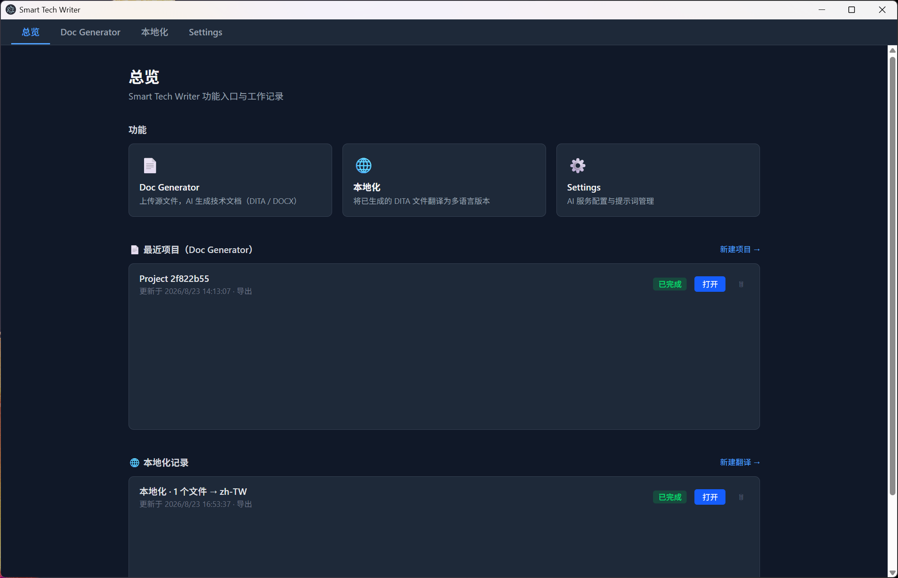
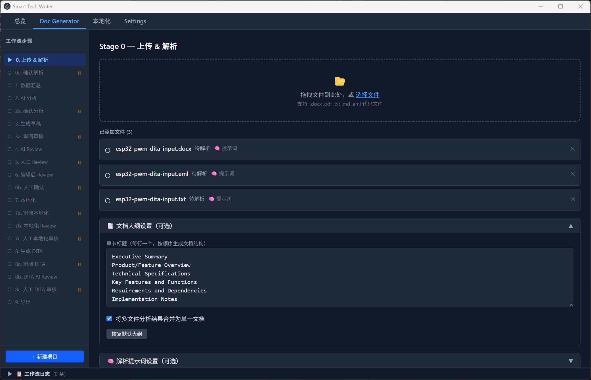
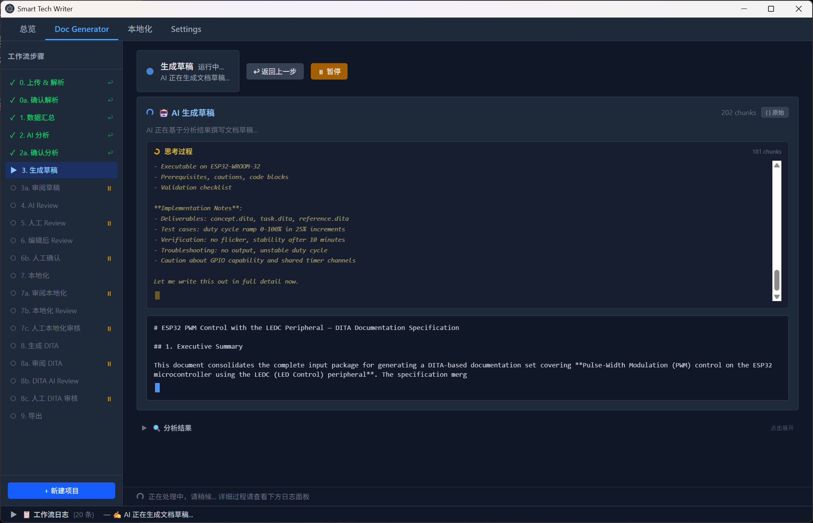
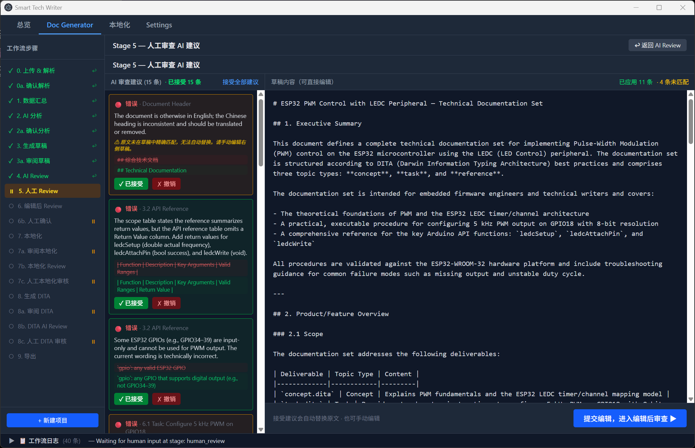
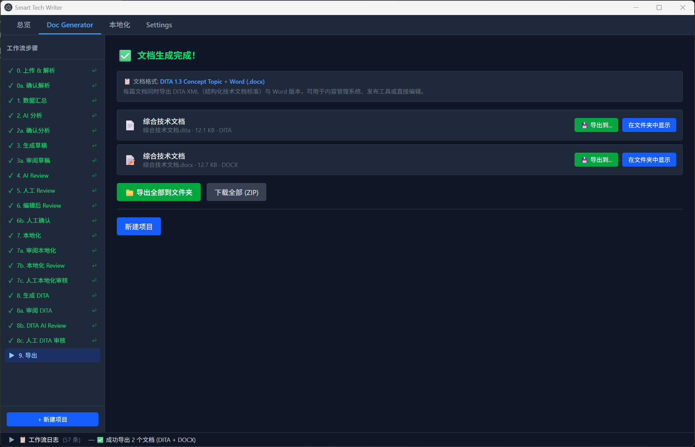
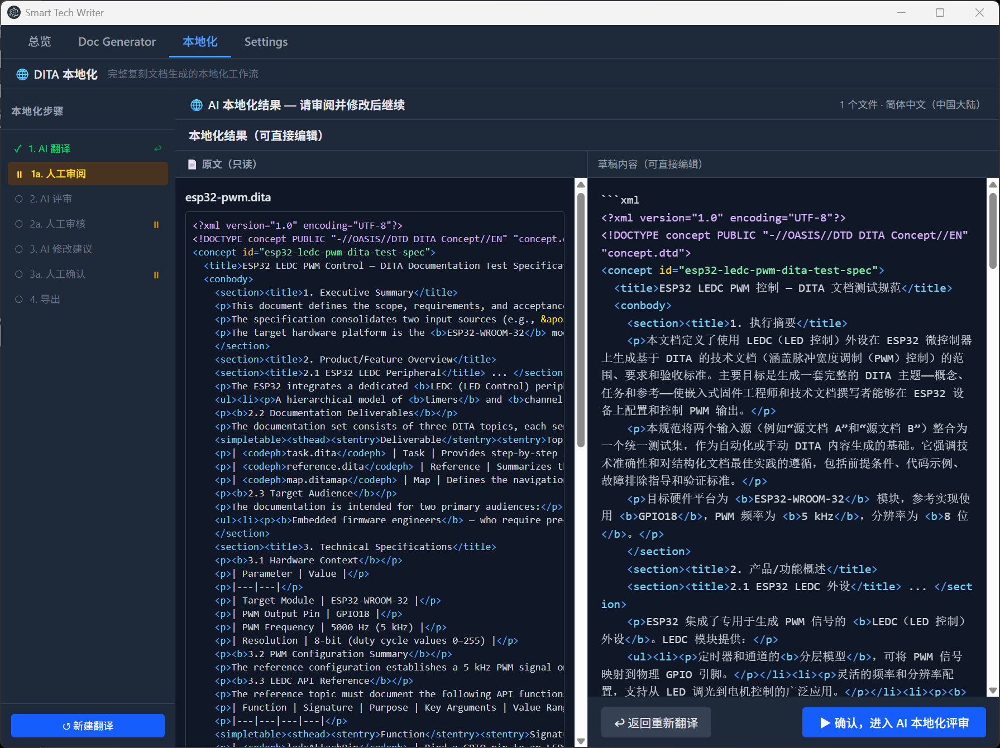
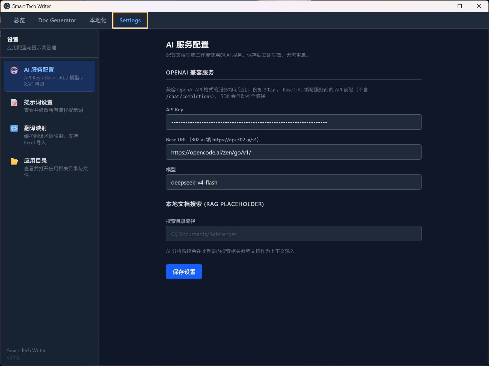
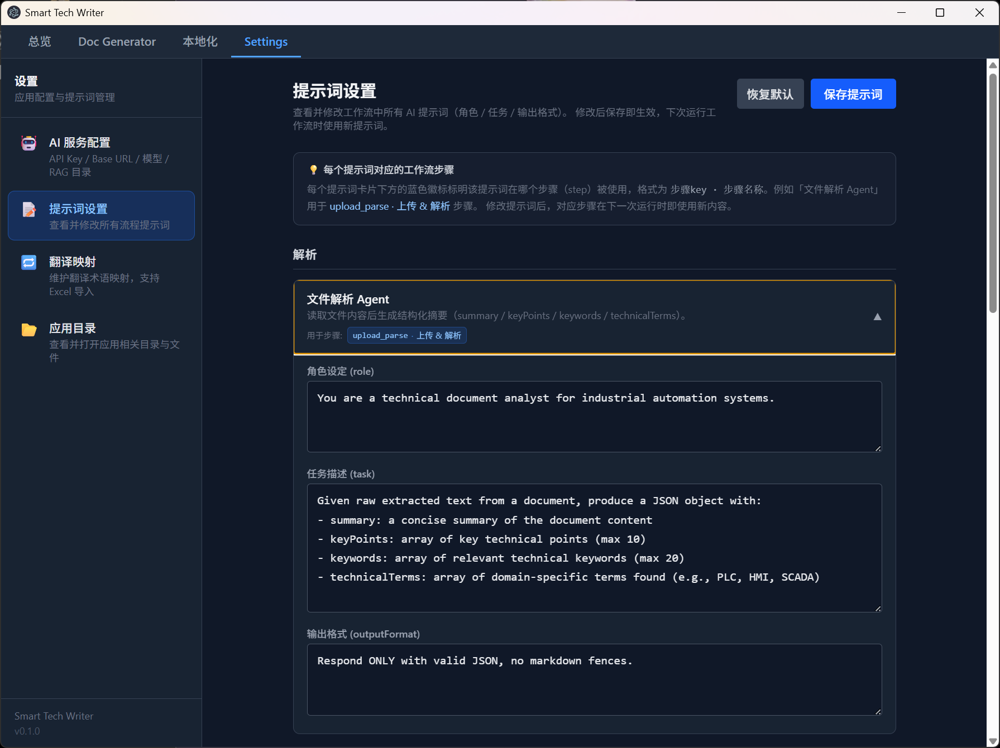
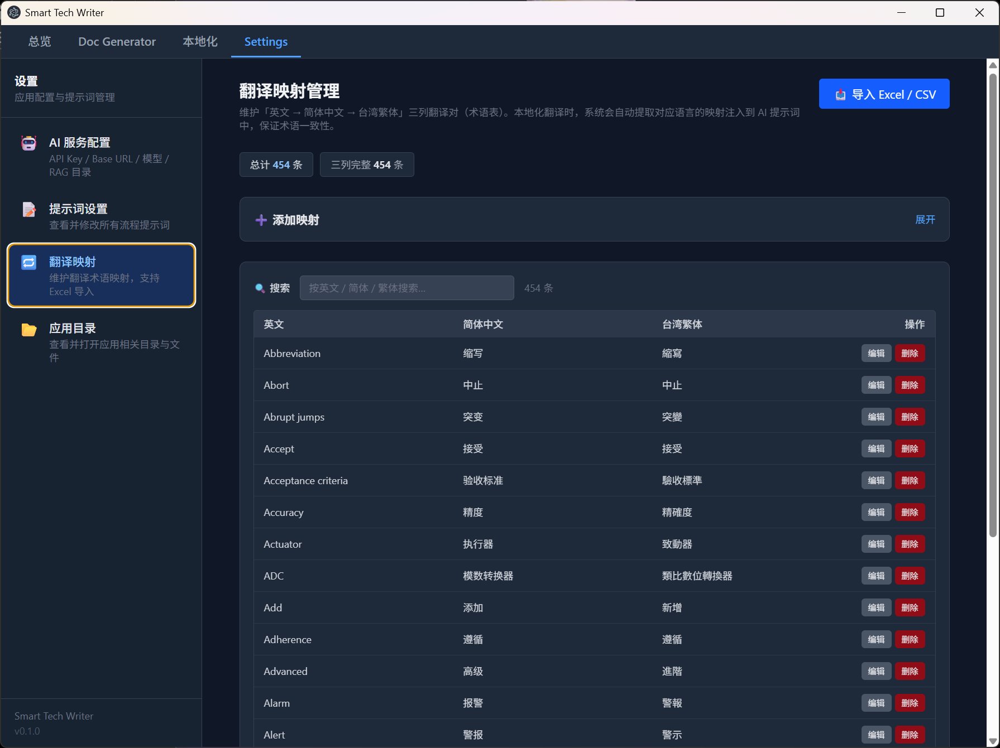

# Smart Tech Writer

> AI 驱动的桌面端技术文档生成器 —— 面向工业自动化领域，将零散源材料编排为一条带人工检查点的 AI 文档工程流水线，最终产出 **DITA 1.3** 结构化技术文档。


---

## 目录

- [项目介绍](#项目介绍)
- [功能特性](#功能特性)
- [界面预览](#界面预览)
- [技术栈](#技术栈)
- [快速开始](#快速开始)
- [开发与调试](#开发与调试)
- [构建与打包](#构建与打包)
- [发布](#发布)
- [项目结构](#项目结构)
- [架构文档](#架构文档)
- [常见问题](#常见问题)
- [License](#license)

---

## 项目介绍

Smart Tech Writer 是一款基于 **Electron + React + LangGraph** 的桌面端 AI 技术文档生成工具。它把「阅读零散源材料 → 分析技术要点 → 撰写技术文档 → 多轮质检 → 本地化 → 输出结构化 XML」这一完整文档工程流程，编排为一条带有人工检查点（Human-in-the-loop）的 **20 阶段 AI 流水线**。

用户只需上传源文件（Word / PDF / 邮件 / 文本 / 代码），系统即可：

1. **AI 解析** 每个文件并生成可追溯的完整 Markdown 提炼文档；
2. **AI 分析** 结合语义检索（RAG）参考资料提炼技术要点；
3. **AI 撰写** 综合多文件内容生成一份连贯的技术文档（Markdown）；
4. **多轮 AI + 人工审查** 逐阶段确认、接受/拒绝建议、直接编辑；
5. **本地化** 翻译为 简体中文 / 繁體中文 / English（可跳过，由独立本地化工具承接）；
6. **生成 DITA 1.3** Concept Topic XML 并导出 `.dita` + `.docx` 文件。

> 面向领域：工业自动化（PLC / HMI / SCADA / 嵌入式等），内置对应术语体系与提示词。

---

## 功能特性

### 📄 Doc Generator —— 文档生成主流程

- **多格式输入**：`.docx` / `.pdf` / `.eml` / `.txt` / `.md` / `.csv` / `.log` + 24 种代码文件；
- **20 阶段人机协作流水线**：9 个人工暂停点，每步可确认、可回退，并可通过 AI 对话持续优化当前产出物；
- **自定义文档大纲**：章节结构可编辑（默认 6 章节），不再固定模板；
- **两级解析提示词**：全局解析思路 + 单文件特殊处理指令；
- **语义 RAG**：本地向量索引（`rag_chunks` 表）余弦相似度检索，无索引时自动回退关键词搜索；
- **长文档完整提炼**：逐块提取并合并唯一事实、参数、步骤、关系、冲突和未决项，避免上下文截断丢失关键信息；
- **解析/分析 Markdown 工件**：完整提炼文档和跨文件综合分析以 Markdown 存储、审核并传递给下游；
- **全确认点 AI 对话编辑**：解析 Markdown、跨文件分析、Markdown 草稿/译文、DITA XML 均可在人工确认 step 中用自然语言连续优化；
- **多轮 AI 审查**：AI Review → 人工 Review → 编辑后 Review → 本地化 Review → DITA Review；
- **暂停 / 继续**：运行中可随时暂停（取消在途 AI 调用），从检查点继续；
- **检查点回退**：基于 LangGraph 检查点时间旅行，回退到任意已完成阶段；
- **DITA 1.3 输出**：Markdown → DITA Concept Topic XML，内置 well-formedness 校验与自动修复；
- **双格式导出**：每篇文档同时导出 `.dita` + `.docx`，支持单文件另存 / 批量导出 / ZIP 打包；
- **崩溃恢复**：状态持久化到 SQLite + LangGraph 检查点，重启后可继续。

### 🌐 本地化 —— 独立 DITA 翻译工具

- 批量选择已生成的 `.dita` 文件，翻译为 简体中文 / 繁體中文 / English；
- **完整复刻本地化工作流**：AI 翻译 → 人工审阅（可编辑 + AI 对话）→ AI 评审 → 人工审核（可编辑 + AI 对话）→ AI 修改建议 → 人工确认（可编辑 + AI 对话）→ 导出；
- **术语表（翻译映射）**：内置约 400 条默认术语，翻译时注入提示词保证术语一致；
- **XML 自动修复**：翻译结果自动校验并修复未转义字符 / 未闭合标签；
- **运行记录持久化**：每次翻译运行保存到 `localization_runs` 表，可随时打开/继续。

### 🏠 总览 —— 工作台首页

- 功能入口卡片，一键跳转各功能；
- **最近项目**：Doc Generator 项目列表，可「继续 / 打开」恢复完整状态；
- **本地化记录**：历史翻译运行列表，可「打开」恢复。

### ⚙️ 设置

- **AI 服务配置**：API Key / Base URL（支持任意 OpenAI 兼容端点，如 302.ai）/ 模型 / RAG 搜索目录；
- **提示词设置**：所有 Agent 提示词集中管理，默认以 Markdown 的 Role Definition / Task / Output Format 三章节组织，可整体编辑 / 预览 / 恢复默认；
- **翻译映射管理**：术语表 CRUD + Excel / CSV 批量导入 + 分页浏览。

---

## 界面预览

> 截图待补充 —— 以下为占位图，后续替换为实际运行截图。

### 总览页（默认首页）

功能入口 + 最近项目 + 本地化记录。




### Doc Generator —— 上传 & 解析



### Doc Generator —— AI 处理（流式输出）



### Doc Generator —— 人工审查（ReviewPanel）



### Doc Generator —— 导出



### 本地化 —— DITA 翻译



### 设置







---

## 技术栈

| 层 | 技术 | 版本 |
|---|---|---|
| 桌面框架 | Electron + Electron Forge (Vite 插件) | 42.4.1 / 7.11.2 |
| 构建 | Vite | 5.4.21 |
| 前端 | React / TypeScript | 19.2 / 5.9 |
| 样式 | Tailwind CSS | 4.3.1 |
| 状态管理 | Zustand | 5.0.14 |
| 工作流编排 | LangGraph（`@langchain/langgraph` + SqliteSaver 检查点） | 1.4.4 |
| AI 调用 | openai SDK（自研 `AIProvider` 抽象层） | 6.44.0 |
| 存储 | better-sqlite3（WAL 模式） | 12.11.1 |
| 文档解析 | mammoth / pdf-parse / mailparser | — |
| 文档生成 | 自研 DITA builder / docx | 9.7.1 |
| 表格导入 | exceljs（翻译映射 Excel 导入） | 4.4.0 |
| 日志 | electron-log | 5.4.4 |
| 打包 | electron-forge + electron-builder（portable） | — |

---

## 快速开始

### 环境要求

- **Node.js** ≥ 20
- **npm** ≥ 10
- **Windows / macOS / Linux**（原生模块 `better-sqlite3` 需对应平台预编译或 rebuild）

### 安装依赖

```bash
npm install
```

### 配置 AI 服务

首次启动后进入 **Settings → AI 服务配置**：

| 配置项 | 说明 | 示例 |
|---|---|---|
| API Key | OpenAI 兼容服务的密钥 | `sk-xxx` |
| Base URL | OpenAI 兼容端点（可选） | `https://api.302.ai/v1` |
| 模型 | 使用的模型名 | `gpt-4o` / `deepseek-v4-flash` |
| RAG 目录 | 语义检索的参考文档目录（可选） | `D:\refs` |

> 支持任意 OpenAI 兼容端点（如 302.ai、OpenAI 官方等）。未配置 API Key 时，RAG 自动回退关键词搜索，AI 阶段会报认证错误。

### 启动开发模式

```bash
npm start
```

---

## 开发与调试

### 常用命令

| 命令 | 说明 |
|---|---|
| `npm start` | 启动 Electron Forge 开发模式（Vite 热更新 + 自动打开 DevTools） |
| `npm run lint` | ESLint 全量检查（`.ts` / `.tsx`） |
| `npx tsc --noEmit` | TypeScript 类型检查 |
| `npm run test:unit` | Vitest 单元测试（`test/unit/**`） |
| `npm run eval:glossary` | 术语匹配评测集（`test/glossary-eval/`，输出基线并写 `baseline.json`） |
| `npm run gen:glossary-sample` | 重新生成术语导入样例（`test/mock-case-02/`） |
| `npm run spike:embedding` | 本地 embedding 技术验证（模型需先下载，见 `test/spike-embedding/README.md`） |
| `npx vite build --config vite.renderer.config.ts` | 单独构建渲染进程（快速验证 UI 编译） |
| `npm run version:bump` | 本地升级版本号（`patch` / `minor` / `major` / 指定版本） |

### 调试技巧

#### 1. 主进程调试（VS Code）

项目已配置 Electron 远程调试端口（`ELECTRON_REMOTE_DEBUG_PORT`）。在 VS Code 中：

- 使用 **JavaScript Debug Terminal** 运行 `npm start`；
- 或配置 `launch.json` 附加到 Electron 主进程；
- 主进程代码修改后需重启应用（Vite 只热更新渲染进程）。

#### 2. 渲染进程调试

- 开发模式下自动打开 DevTools（`mainWindow.webContents.openDevTools()`）；
- 渲染层代码修改由 Vite 热更新，无需重启。

#### 3. 端到端追踪日志

代码内置跨层日志前缀约定，用于端到端排障：

| 前缀 | 层 |
|---|---|
| `[WF][UI]` | 用户操作（渲染层） |
| `[WF][Renderer]` | 渲染层逻辑 |
| `[WF][IPC]` | IPC 层 |
| `[WF][Engine]` | 工作流引擎 |
| `[WF][Progress]` | 进度事件 |

主进程日志由 `electron-log` 写入 `userData/logs/`。

#### 4. 数据与状态检查

| 数据 | 位置 |
|---|---|
| 应用数据库 | `userData/smart-tech-writer.db`（settings / projects / rag_chunks / localization_runs / translation_mappings） |
| LangGraph 检查点 | `userData/langgraph.db`（thread_id = projectId） |
| 项目输出文件 | `userData/projects/<projectId>/` |
| 日志 | `userData/logs/` |

> `userData` 在 Windows 下为 `%APPDATA%/smart-tech-writter`，macOS 为 `~/Library/Application Support/smart-tech-writter`。

#### 5. 常见调试场景

- **AI 阶段无输出 / 空文档**：DeepSeek 等推理模型可能把输出预算花在 `reasoning_content` 上。系统已内置「流式为空 → 非流式重试」兜底；仍失败会置工作流 `FAILED` 并显示错误。
- **回退后状态异常**：go-back 基于 LangGraph 检查点时间旅行，回退到已完成阶段即可；若目标阶段无检查点会忽略。
- **暂停后继续**：`PAUSED:USER` 状态点击「继续执行」从检查点续跑（会重跑被中断的节点）。

---

## 构建与打包

### 打包应用目录

```bash
npm run package
```

产出：`out/smart-tech-writter-win32-x64/`（含 `app.asar` + 原生模块解包）。

### 生成安装包

```bash
npm run make
```

产出（Windows）：`out/make/squirrel.windows/x64/`（`Setup.exe` + `.nupkg` + `RELEASES`）。

### 生成单文件便携版

```bash
npm run dist:portable
```

产出：`dist/Smart Tech Writer <version>.exe`（electron-builder portable，自解压运行，无需安装）。

> ⚠️ 构建前若应用进程仍在运行会锁住 `out/` 目录（EBUSY），先结束进程：
> ```powershell
> Stop-Process -Name smart-tech-writter
> ```

### 打包注意事项

- `better-sqlite3` 是原生 N-API 模块：`forge.config.ts` 已覆盖 `ignore` 保留 `node_modules`，并注册 `AutoUnpackNativesPlugin` 解包 `.node` 文件；
- Electron 大版本升级（如 42.x）后需重新 rebuild 原生模块；
- 打包产物默认启用安全 Fuses：`RunAsNode` 关闭、asar 完整性校验、仅从 asar 加载。

---

## 发布

项目内置 GitHub Actions 一键发布流程（`.github/workflows/`）：

### 手动构建（不改版本号）

仓库页面 → **Actions → Build Windows → Run workflow**：构建安装包 + 单文件 exe 并上传为构建产物。

### 发布新版本（自动升级版本号）

仓库页面 → **Actions → Release → Run workflow**：

1. 选择版本升级类型（`patch` / `minor` / `major`）或直接填写指定版本号；
2. 自动完成：升级 `package.json` 版本 → 构建安装包 + 单文件 exe → 提交版本号 → 打 tag → 创建 GitHub Release（附带全部构建产物）。

---

## 项目结构

```
smart-tech-writter/
├── forge.config.ts              # Electron Forge：Vite 插件 + makers + Fuses + 打包 ignore
├── vite.main.config.ts          # 主进程构建（external: better-sqlite3 / electron）
├── vite.preload.config.ts       # preload 构建
├── vite.renderer.config.ts      # 渲染进程构建（React + postcss）
├── tailwind.config.js           # Tailwind 4
├── index.html                   # 渲染入口 HTML（含 CSP）
├── .github/workflows/           # CI：build.yml（手动构建）+ release.yml（一键发布）
├── scripts/
│   └── bump-version.mjs         # 版本自动升级脚本
├── docs/architecture/           # 架构文档（见下方「架构文档」）
├── test/mock-case-01/           # 样例输入（esp32-pwm .eml/.txt/.dita/.docx）
└── src/
    ├── main.ts / renderer.ts    # ⚠ Forge 模板残留（未被构建引用）
    ├── preload.ts               # preload 构建入口（re-export ./preload/index）
    ├── main/                    # 主进程
    │   ├── index.ts             # 入口：窗口 + 服务初始化
    │   ├── ipc/                 # 6 组 IPC 注册器（workflow/file/rag/settings/localization/mapping）
    │   └── modules/
    │       ├── agents/          # 7 个 Agent（Parser/Analyzer/Writer/Reviewer/Localizer/DitaLocalizer/DitaReviewer）
    │       ├── ai-providers/    # AIProvider 抽象 + OpenAI 实现 + 工厂
    │       ├── context/         # map-reduce 长文本摘要
    │       ├── document-builder/# dita.builder（校验+修复）+ docx.builder
    │       ├── file-readers/    # 5 种读取器（Word/PDF/Email/Text/Code）
    │       ├── localization/    # 独立本地化服务 + 翻译映射（术语表）
    │       ├── prompts/         # 提示词统一管理（PROMPTS 注册表 + 覆盖）
    │       ├── rag/             # SemanticSearchService（语义检索 + 关键词回退）
    │       ├── security/        # PathGuard 路径白名单
    │       ├── storage/         # SQLite + 项目文件存储
    │       └── workflow/        # WorkflowEngine facade + LangGraph 图 + pipeline + state-machine
    ├── preload/
    │   ├── index.ts             # contextBridge 暴露 window.electronAPI
    │   └── api.types.ts         # ElectronAPI 类型 + Window 全局声明
    ├── renderer/                # 渲染进程（React）
    │   ├── main.tsx             # React 根
    │   ├── App.tsx              # 4 Tab 切换（总览/Doc Generator/本地化/Settings）
    │   ├── navigation.ts        # Tab 元数据（单一来源）
    │   ├── api/                 # workflow / localization / mapping API 封装
    │   ├── stores/              # zustand stores（workflow/localization/mapping/settings）
    │   ├── components/          # 公共组件（AppLayout / StepNavigation）
    │   └── features/
    │       ├── overview/        # 总览页（功能入口 + 最近项目 + 本地化记录）
    │       ├── doc-generator/   # 文档生成主流程（20 阶段 UI）
    │       ├── localization/    # 独立 DITA 本地化
    │       └── settings/        # AI 配置 / 提示词 / 翻译映射
    └── shared/types/            # 共享类型（document/workflow/ipc/localization/mapping/prompts）
```

---

## 架构文档

详细的系统架构文档位于 [`docs/architecture/`](docs/architecture/README.md)：

| 编号 | 文档 | 内容 |
|---|---|---|
| [01](docs/architecture/01-overview.md) | 系统概述与设计目标 | 产品定位、核心能力、端到端用户旅程、关键设计决策 |
| [02](docs/architecture/02-architecture.md) | 总体架构 | Electron 三进程模型、运行时结构、目录结构、构建与打包 |
| [03](docs/architecture/03-workflow-engine.md) | 工作流引擎 | 20 阶段 LangGraph 图、暂停/恢复、回退、事件广播 |
| [04](docs/architecture/04-ai-layer.md) | AI 层 | Provider 抽象、7 个 Agent、提示词管理、流式输出 |
| [05](docs/architecture/05-file-processing.md) | 文件处理与文档构建 | 5 种文件读取器、语义 RAG、DITA/DOCX 构建器 |
| [06](docs/architecture/06-storage-ipc.md) | 存储、IPC 与 Preload | SQLite 持久化、IPC 通道全集、contextBridge |
| [07](docs/architecture/07-renderer.md) | 渲染进程（UI） | 4 Tab 组件树、Zustand 状态管理、各功能视图 |
| [08](docs/architecture/08-data-models.md) | 数据模型与状态流转 | 共享类型系统、DocGenState 全字段、数据生命周期 |
| [09](docs/architecture/09-dependencies.md) | 技术栈与依赖库详解 | 依赖库的版本、用途与使用位置 |

---

## 常见问题

### Q1：AI 阶段报认证错误 / 401？

检查 Settings → AI 服务配置的 API Key 与 Base URL 是否正确。未配置 Key 时 RAG 会回退关键词搜索，但 AI 生成阶段必须配置。

### Q2：长文档生成质量差 / 关键信息丢失？

系统已内置 map-reduce 分段完整提炼（chunk 4000 / overlap 200，逐段处理后合并），替代硬截断和高层摘要。解析结果保留 Markdown 工件、结构化证据和原文基线；若需侧重某些内容，可在上传阶段使用「解析提示词」引导 AI 关注重点，或在人工审核阶段通过对话继续调整。

### Q3：如何让 AI 使用特定术语？

在 **Settings → 翻译映射** 维护术语表（内置约 400 条默认术语），本地化翻译时会自动注入提示词。也可在 **Settings → 提示词设置** 调整各 Agent 的提示词。

### Q4：暂停后「继续执行」会重跑吗？

会。`PAUSED:USER` 是中止在途 AI 调用，继续时从最后一个检查点重跑被中断的节点（会重新消耗一次该节点的 token）。

### Q5：如何清理测试数据？

删除 `userData/smart-tech-writer.db` 与 `userData/langgraph.db` 即可重置全部项目/设置/索引（注意会丢失所有数据）。

---

## License

[MIT](LICENSE) © Tim Wang
