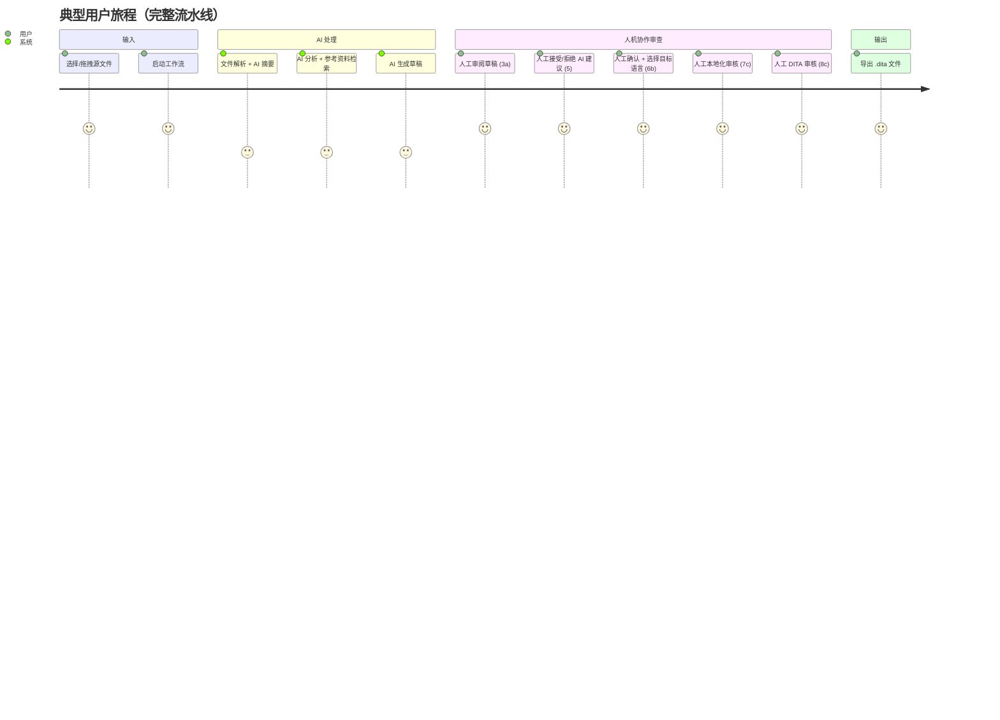

# 01 — 系统概述与设计目标

## 1.1 产品定位

Smart Tech Writer（产品名 `smart-tech-writter`）是一个**面向工业自动化领域技术文档工程师的 AI 辅助文档生成桌面工具**。它把"阅读零散源材料 → 分析技术要点 → 撰写技术文档 → 多轮质检 → 本地化 → 输出结构化 XML"这一完整文档工程流程，编排为一条带有人工检查点（Human-in-the-loop）的 20 阶段流水线。

领域证据（从代码中的提示词可见）：

- `FileParserAgent` system prompt 定位为 "technical document analyst for industrial automation systems"；
- 术语示例：PLC、HMI、SCADA；
- `LocalizerAgent` 内置 zh-CN / zh-TW / zh-HK 三套工业自动化术语对照表。

## 1.2 核心能力清单

| 能力 | 实现方式 | 对应模块 |
|---|---|---|
| 多格式输入解析 | `.docx` `.pdf` `.eml` `.txt/.md/.csv/.log` + 24 种代码文件 | `file-readers/*` |
| AI 文档解析 | 每文件生成 summary（长文本 map-reduce 分段摘要） | `FileParserAgent` |
| AI 深度分析 | 每文件生成 keyPoints / keywords / technicalTerms | `AnalyzerAgent` |
| 参考资料检索 | 语义向量检索（无索引/embed 失败时回退关键词） | `SemanticSearchService` |
| AI 草稿生成 | 基于分析结果生成 Markdown 文档 | `WriterAgent` |
| AI 质量审查 | 4 种审查模式输出 JSON 评论数组 | `ReviewerAgent` |
| 人工审查 | 9 个暂停点，可接受/拒绝 AI 建议、手改文本 | `ReviewPanel` |
| AI 指令改稿 | 自然语言指令流式改稿（Stage 3a） | `WorkflowEngine.aiEditDraft` |
| 本地化 | zh-CN / zh-TW / zh-HK 三语种 | `LocalizerAgent` |
| 结构化输出 | Markdown → DITA 1.3 Concept Topic XML | `dita.builder.ts` |
| 导出 | 单文件另存 / 批量导出 / ZIP 下载 | `file.ipc.ts` |
| 项目持久化 | SQLite 状态快照，重启可恢复 | `storage/database.ts` |

## 1.3 端到端用户旅程

## 1.4 关键设计决策（及其在代码中的落点）

| # | 决策 | 理由/落点 |
|---|---|---|
| D1 | **顺序流水线而非 LangGraph** | `WorkflowEngine.runPipeline` 是 `while` 循环 + 阶段执行器表；`package.json` 虽声明 `@langchain/langgraph`，但代码零引用（见 09/10 篇） |
| D2 | **暂停点 = Promise 挂起** | `pendingResume: Map<projectId, (data)=>void>`，流水线在 PAUSE_STAGES 处 `await new Promise(...)`，由 IPC `resumeFromHumanInput` 解除 |
| D3 | **状态整快照持久化** | 每个阶段变更后 `INSERT OR REPLACE projects.state_json`，恢复时整体 `JSON.parse` + 字段回填（`skipLocalization`） |
| D4 | **provider 抽象解耦 LLM 厂商** | `AIProvider` 接口（complete/stream/embed），工厂 `createProvider` 目前仅实现 openai，预留 anthropic/ollama |
| D5 | **流式优先** | `BaseAgent.callLLM` 在设置了 `_streamCallback` 时走 `provider.stream()`；8 个 AI 阶段全部开启流式 |
| D6 | **humanEdits 不覆写 drafts** | 提交的人工编辑存 `humanEdits` 字符串，仅在向下游执行器传入时临时套用到 `drafts[0].content`，保证"回退到人工审查"时仍显示原始草稿 |
| D7 | **pipelineRunId 防陈旧结果** | 回退会递增 `pipelineRunId`，仍在飞行中的旧阶段执行器完成时通过 `isActiveRun()` 丢弃结果 |
| D8 | **DITA 是最终唯一产物** | `runExportStage` 只写 `.dita`；`docx.builder.ts` 存在但未接入（`OutputDocument.format` 类型仍保留 `'docx' | 'pdf'`） |
| D9 | **安全基线** | `contextIsolation: true`、`nodeIntegration: false`、Forge Fuses 关闭 `RunAsNode`、启用 asar 完整性校验 |

## 1.5 术语表

| 术语 | 含义 | 代码位置 |
|---|---|---|
| Stage / 阶段 | 流水线中的一步，共 20 个 | `state-machine.ts STAGE_ORDER` |
| PAUSE_STAGES | 9 个人工暂停阶段 | `state-machine.ts PAUSE_STAGES` |
| DocGenState | 单个项目的完整工作流状态 | `workflow.types.ts` |
| humanEdits | Stage 5 人工编辑后的整篇内容（字符串） | `DocGenState.humanEdits` |
| effective drafts | 套用 humanEdits 后的草稿（不持久化） | `workflow/index.ts runPipeline` |
| pipelineRunId | 每次流水线运行的单调递增标识 | `DocGenState.pipelineRunId` |
| RAG | 检索增强生成；语义向量索引（`rag_chunks` 表）+ 关键词回退 | `SemanticSearchService` |
