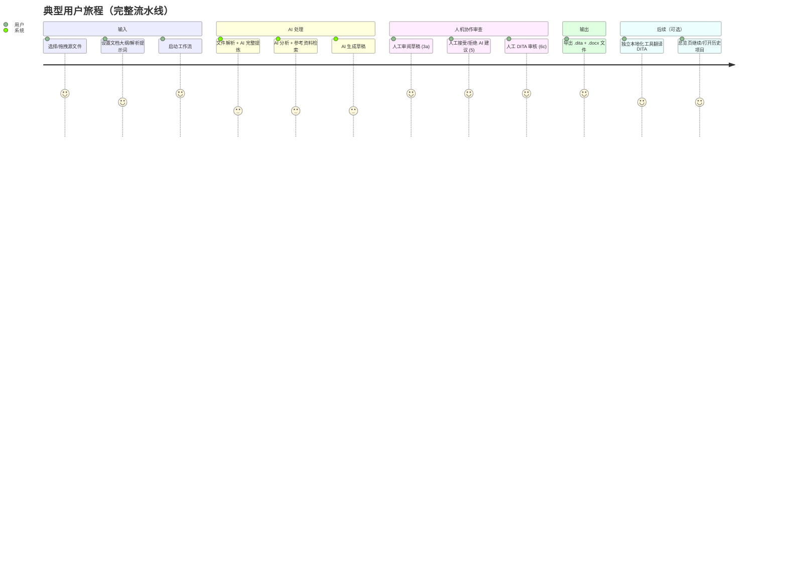

# 01 — 系统概述与设计目标

## 1.1 产品定位

Smart Tech Writer（产品名 `smart-tech-writter`）是一个**面向工业自动化领域技术文档工程师的 AI 辅助文档生成桌面工具**。它把"阅读零散源材料 → 分析技术要点 → 撰写技术文档 → 人工质检 → 输出结构化 XML"这一文档工程流程，编排为一条带有人工检查点（Human-in-the-loop）的流水线（LangGraph 图编排）。

除文档生成主流程外，产品还提供：

- **独立 DITA 本地化工具**：将已生成的 `.dita` 文件批量翻译为多语言版本（完整复刻本地化工作流 + 术语表驱动）；
- **总览工作台**：功能入口 + 最近项目/本地化运行记录，可「继续 / 打开」恢复完整状态。

领域证据（从代码中的提示词可见）：

- `FileParserAgent` system prompt 定位为 "technical document analyst for industrial automation systems"；
- 术语示例：PLC、HMI、SCADA；
- 内置约 400 条默认翻译术语（`default-mappings.ts`，取自 esp32-pwm 文档：文档结构/电子嵌入式/PWM 信号/电源电气/工业自动化/软件 IT）。

## 1.2 核心能力清单

| 能力 | 实现方式 | 对应模块 |
|---|---|---|
| 多格式输入解析 | `.docx` `.pdf` `.eml` `.txt/.md/.csv/.log` + 24 种代码文件 | `file-readers/*` |
| AI 文档解析 | 每文件生成完整 Markdown 提炼（长文本逐块完整提取，支持全局/单文件解析提示词） | `FileParserAgent` |
| AI 深度分析 | 每文件生成 keyPoints / keywords / technicalTerms | `AnalyzerAgent` |
| 参考资料检索 | 语义向量检索（无索引/embed 失败时回退关键词） | `SemanticSearchService` |
| AI 草稿生成 | 基于分析结果生成 1 篇综合 Markdown 文档（章节结构可自定义） | `WriterAgent` |
| AI 质量审查 | 4 种审查模式输出 JSON 评论数组 | `ReviewerAgent` |
| 人工审查 | 7 个暂停点，可接受/拒绝 AI 建议、手改文本 | `ReviewPanel` |
| AI 指令改稿 | 自然语言指令流式改稿（Stage 3a） | `WorkflowEngine.aiEditDraft` |
| 本地化 | Gen Doc 主流程已移除；由独立 DITA 本地化工具承接 | `LocalizationService` |
| 独立 DITA 本地化 | 批量翻译 `.dita` 文件，7 阶段工作流 + 术语表注入 | `LocalizationService` |
| 术语表管理 | 三列映射（en/zh-CN/zh-TW）CRUD + Excel/CSV 导入 | `MappingService` |
| 结构化输出 | Markdown → DITA 1.3 Concept Topic XML（校验 + 自动修复） | `dita.builder.ts` |
| 导出 | 每篇同时导出 `.dita` + `.docx`；单文件另存 / 批量导出 / ZIP | `file.ipc.ts` |
| 项目持久化 | SQLite 状态镜像 + LangGraph 检查点，重启可恢复 | `storage/database.ts` |
| 提示词管理 | 全部 Agent 提示词集中管理，设置页可覆盖 | `prompts/` |

## 1.3 端到端用户旅程

## 1.4 关键设计决策（及其在代码中的落点）

| # | 决策 | 理由/落点 |
|---|---|---|
| D1 | **LangGraph 图编排** | `WorkflowEngine` 是 facade，`langgraph/{graph,graph-state,emitter,checkpointer}.ts` 承载 20 节点 StateGraph + 9 个 `interrupt()` 暂停点；SqliteSaver 检查点持久化（`userData/langgraph.db`，thread_id = projectId） |
| D2 | **暂停 = `interrupt()`** | 暂停节点调用 `interrupt({stage})` 抛出 `GraphInterrupt` 暂停；恢复时 `graph.invoke(new Command({resume: data}))`，`interrupt()` 返回 data 合并进图状态 |
| D3 | **状态双写持久化** | 每个阶段变更后写 `projects.state_json` 镜像（同步 getState）+ LangGraph 检查点（崩溃恢复）；重启后 `getState` 从镜像恢复 |
| D4 | **provider 抽象解耦 LLM 厂商** | `AIProvider` 接口（complete/stream/streamDetailed/embed），工厂 `createProvider` 目前仅实现 openai，预留 anthropic/ollama |
| D5 | **流式优先 + 思考过程显示** | `BaseAgent.callLLM` 走 `provider.streamDetailed()`，`AIStreamChunk {type:'thinking'|'content'}` 区分推理过程与可见输出；8 个 AI 阶段全部开启流式 |
| D6 | **humanEdits 不覆写 drafts** | 提交的人工编辑存 `humanEdits`/`humanEditedDrafts`，仅在向下游执行器传入时临时套用，保证"回退到人工审查"时仍显示原始草稿 |
| D7 | **go-back = 检查点时间旅行** | `goBackToStage` 从 `getStateHistory` 找目标检查点重放；RUNNING 时先 AbortController 中止在途 invoke（替代旧 `pipelineRunId` 陈旧防护） |
| D8 | **DITA + DOCX 双格式导出** | `runExportStage` 每篇同时写 `.dita` + `.docx`（`buildDocx` 接入）；DITA 构建后 `validateDitaXml` 校验并输出警告 |
| D9 | **安全基线** | `contextIsolation: true`、`nodeIntegration: false`、Forge Fuses 关闭 `RunAsNode`、启用 asar 完整性校验、`PathGuard` 文件读取白名单 |
| D10 | **默认跳过本地化** | `skipLocalization` 默认 `true`（英文文档直接生成 DITA），本地化由独立工具承接；用户显式选语言时仍启用 |
| D11 | **提示词集中管理** | 所有 Agent 提示词定义在 `prompts/` 模块（PROMPTS 注册表），以完整 Markdown 工作定义维护，支持设置页整体覆盖（`prompts.overrides`） |
| D12 | **文档大纲参数化** | `DocumentOutline {sections, mergeIntoSingle}` 控制撰写章节结构，不再固定模板 |

## 1.5 术语表

| 术语 | 含义 | 代码位置 |
|---|---|---|
| Stage / 阶段 | 流水线中的一步，共 20 个 | `state-machine.ts STAGE_ORDER` |
| PAUSE_STAGES | 9 个人工暂停阶段 | `state-machine.ts PAUSE_STAGES` |
| PAUSED:USER | 用户主动暂停（中止在途 AI 调用） | `WorkflowEngine.pauseWorkflow` |
| DocGenState | 单个项目的完整工作流状态 | `workflow.types.ts` |
| humanEdits | Stage 5 人工编辑后的整篇内容（字符串，兼容旧版） | `DocGenState.humanEdits` |
| humanEditedDrafts | 按草稿粒度保存的人工编辑（多草稿支持） | `DocGenState.humanEditedDrafts` |
| effective drafts | 套用人工编辑后的草稿（不持久化） | `graph.ts makeExecutionNode` |
| ingestContext | ingest 阶段汇总的 Markdown 证据上下文（完整提炼 + 原文基线） | `DocGenState.ingestContext` |
| documentOutline | 文档大纲（章节结构，可自定义） | `DocGenState.documentOutline` |
| parseInstruction | 全局/单文件解析提示词 | `DocGenState.parseInstruction` / `UploadedFile.parseInstruction` |
| RAG | 检索增强生成；语义向量索引（`rag_chunks` 表）+ 关键词回退 | `SemanticSearchService` |
| LocalizeRun | 独立本地化的一次运行记录（持久化） | `localization.types.ts` |
| TranslationMapping | 翻译映射（术语表，en/zh-CN/zh-TW 三列） | `mapping.types.ts` |
