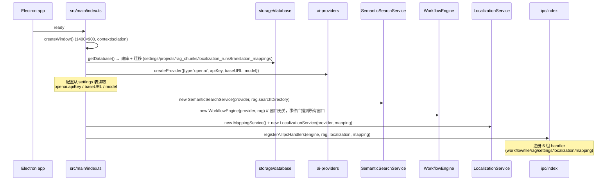
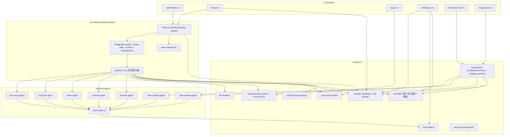
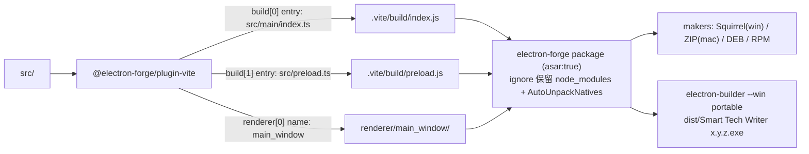
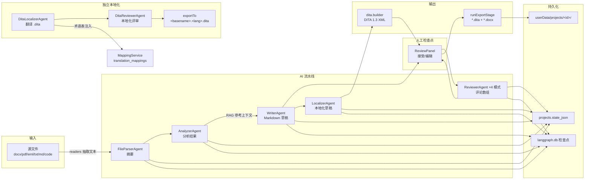

# 02 — 总体架构

## 2.1 Electron 三进程模型

```mermaid
flowchart LR
    subgraph P1["① 主进程 (Main / Node.js)"]
        direction TB
        M1["app 生命周期<br/>src/main/index.ts"]
        M2["服务初始化<br/>DB → Provider → RAG → Engine → Localization → IPC"]
        M3["WorkflowEngine + LangGraph + Pipeline + Agents"]
        M4["better-sqlite3 / fs 文件系统"]
    end
    subgraph P2["② Preload (沙箱桥)"]
        P2A["src/preload.ts → ./preload/index<br/>contextBridge.exposeInMainWorld('electronAPI')"]
    end
    subgraph P3["③ 渲染进程 (Renderer / Chromium)"]
        direction TB
        R1["React 19 + Tailwind 4<br/>4 Tab：总览 / Doc Generator / 本地化 / Settings"]
        R2["Zustand stores"]
        R3["workflow.api / localization.api / mapping.api<br/>(仅经 window.electronAPI)"]
    end
    LLM["外部 LLM API<br/>(OpenAI 兼容)"]

    P3 -->|"ipcRenderer.invoke / .on<br/>(50+ 通道)"| P2
    P2 -->|"ipcMain.handle / webContents.send"| P1
    P1 -->|"HTTPS chat.completions<br/>(complete / stream / embed)"| LLM
```



安全约束（`src/main/index.ts` 与 `forge.config.ts`）：

| 配置 | 值 | 意义 |
|---|---|---|
| `contextIsolation` | `true` | 渲染进程 JS 与 preload/主进程世界隔离 |
| `nodeIntegration` | `false` | 渲染进程无 Node 能力，只能走桥 |
| Fuses `RunAsNode` | `false` | 打包后禁止以 Node 模式运行 |
| Fuses `EnableEmbeddedAsarIntegrityValidation` | `true` | 校验内嵌 asar 完整性 |
| Fuses `OnlyLoadAppFromAsar` | `true` | 仅从 asar 加载应用代码 |
| Fuses `EnableCookieEncryption` | `true` | Cookie 加密 |
| `PathGuard` | 白名单 | `file:read` 仅允许用户选中文件 + `userData/projects` + RAG 目录，扩展名限文本/代码 |

## 2.2 主进程初始化时序



## 2.3 模块依赖关系（主进程内部）



依赖方向说明：`ipc → workflow → langgraph → pipeline → agents → ai-providers`；`pipeline → file-readers / rag / document-builder / storage / prompts / context`；`localization → agents / document-builder / prompts / storage`；`file:read → security/path-guard`。不存在反向依赖。共享类型统一来自 `src/shared/types/`。

## 2.4 目录结构（含职责标注）

```
smart-tech-writter/
├── forge.config.ts            # Electron Forge：VitePlugin + makers + Fuses + 打包 ignore（保留 node_modules）
├── vite.main.config.ts        # 主进程构建；external: ['better-sqlite3','electron']
├── vite.preload.config.ts     # preload 构建（空配置）
├── vite.renderer.config.ts    # react 插件 + postcss
├── tailwind.config.js         # Tailwind 4（content 指向 renderer）
├── postcss.config.js          # @tailwindcss/postcss + autoprefixer
├── index.html                 # 渲染入口 HTML（含 CSP）
├── forge.env.d.ts             # MAIN_WINDOW_VITE_* 全局类型
├── .github/workflows/         # CI：build.yml（手动构建）+ release.yml（一键发布）
├── scripts/
│   └── bump-version.mjs       # 版本自动升级脚本（patch/minor/major/指定版本）
├── docs/architecture/         # 本文档集
├── test/mock-case-01/         # 样例输入（esp32-pwm .eml/.txt/.dita/.docx）
├── local.md                   # 本地 AI API 配置备忘（不入库）
└── src/
    ├── main.ts                # ⚠ Forge 模板残留（未被构建引用）
    ├── renderer.ts            # ⚠ Forge 模板残留（未被引用）
    ├── preload.ts             # ✅ preload 构建入口（转 re-export ./preload/index）
    ├── main/
    │   ├── index.ts           # 主进程入口：窗口 + 服务初始化
    │   ├── ipc/
    │   │   ├── index.ts       # 统一注册器（6 组）
    │   │   ├── workflow.ipc.ts# 工作流 13 通道
    │   │   ├── file.ipc.ts    # 文件对话框/导出 6 通道
    │   │   ├── rag.ipc.ts     # RAG 5 通道
    │   │   ├── settings.ipc.ts# 设置+提示词+项目 12 通道
    │   │   ├── localization.ipc.ts # 独立本地化 12 通道
    │   │   └── mapping.ipc.ts # 翻译映射 7 通道
    │   └── modules/
    │       ├── agents/        # 7 个 Agent + 基类
    │       ├── ai-providers/  # Provider 抽象 + OpenAI 实现 + 工厂
    │       ├── context/       # map-reduce 长文本摘要
    │       ├── document-builder/ # dita.builder(校验+修复) + docx.builder
    │       ├── file-readers/  # 5 种读取器 + 工厂
    │       ├── localization/  # LocalizationService + MappingService + 默认术语表
    │       ├── prompts/       # 提示词注册表 + 覆盖管理
    │       ├── rag/           # SemanticSearchService + LocalSearchService 回退
    │       ├── security/      # PathGuard 路径白名单
    │       ├── storage/       # SQLite + 项目文件存储
    │       └── workflow/      # Engine facade + LangGraph + Pipeline + StateMachine
    ├── preload/
    │   ├── index.ts           # contextBridge 暴露 electronAPI
    │   └── api.types.ts       # ElectronAPI 类型 + window 全局声明
    ├── renderer/
    │   ├── main.tsx           # React 根
    │   ├── App.tsx            # 4 Tab 切换（总览/Doc Generator/本地化/Settings）
    │   ├── navigation.ts      # Tab 元数据（单一来源）
    │   ├── api/               # workflow / localization / mapping API 封装
    │   ├── stores/            # workflow / localization / mapping / settings store (zustand)
    │   ├── components/        # AppLayout + StepNavigation（公共步骤导航）
    │   └── features/
    │       ├── overview/      # 总览页（功能入口 + 最近项目 + 本地化记录）
    │       ├── doc-generator/ # 主功能：20 阶段 UI + 组件 + useWorkflow
    │       ├── localization/  # 独立 DITA 本地化
    │       └── settings/      # AI 配置 + 提示词 + 翻译映射
    └── shared/types/          # document / workflow / ipc / localization / mapping / prompts
```

## 2.5 构建与打包



要点：

- 运行时窗口加载路径：开发 `MAIN_WINDOW_VITE_DEV_SERVER_URL`，生产 `../renderer/main_window/index.html`；
- `better-sqlite3` 与 `electron` 在主进程 Vite 构建中 external；`forge.config.ts` 覆盖 `ignore` 保留 `node_modules`（否则运行时 `require('better-sqlite3')` 报 Cannot find module），由 `@electron-forge/plugin-auto-unpack-natives` 解包原生模块；
- 单文件便携版用 electron-builder（`npm run dist:portable`），自解压运行无需安装；
- CI：`.github/workflows/build.yml`（手动构建安装包 + portable exe）、`release.yml`（一键发布：`bump-version.mjs` 升级版本 → 构建 → 打 tag → GitHub Release）。

## 2.6 运行时数据流全景（读 → 写）


