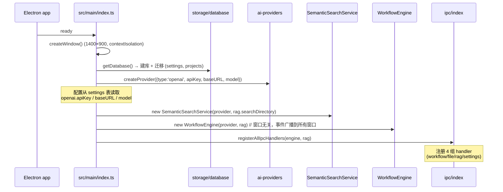
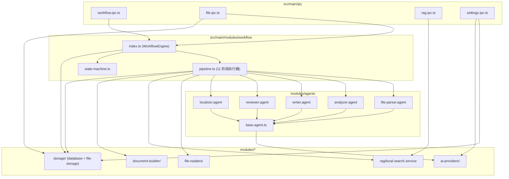
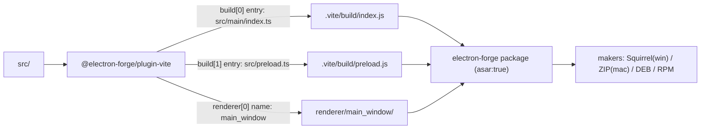
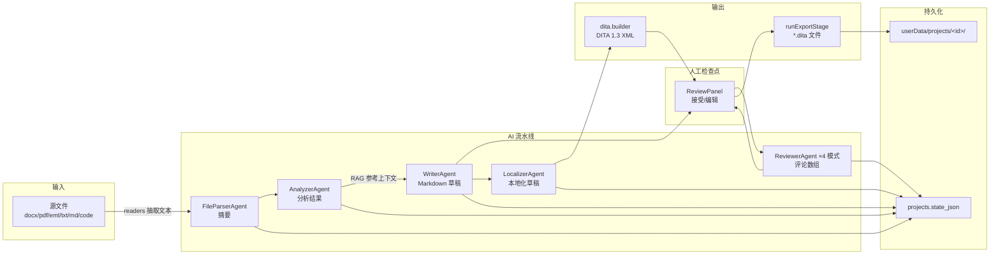

# 02 — 总体架构

## 2.1 Electron 三进程模型

```mermaid
flowchart LR
    subgraph P1["① 主进程 (Main / Node.js)"]
        direction TB
        M1["app 生命周期<br/>src/main/index.ts"]
        M2["服务初始化<br/>DB → Provider → RAG → Engine → IPC"]
        M3["WorkflowEngine + Pipeline + Agents"]
        M4["better-sqlite3 / fs 文件系统"]
    end
    subgraph P2["② Preload (沙箱桥)"]
        P2A["src/preload.ts → ./preload/index<br/>contextBridge.exposeInMainWorld('electronAPI')"]
    end
    subgraph P3["③ 渲染进程 (Renderer / Chromium)"]
        direction TB
        R1["React 19 + Tailwind 4"]
        R2["Zustand stores"]
        R3["workflow.api.ts (仅经 window.electronAPI)"]
    end
    LLM["外部 LLM API<br/>(OpenAI 兼容)"]

    P3 -->|"ipcRenderer.invoke / .on<br/>(25+2 通道)"| P2
    P2 -->|"ipcMain.handle / webContents.send"| P1
    P1 -->|"HTTPS chat.completions<br/>(complete / stream)"| LLM
```



安全约束（`src/main/index.ts` 与 `forge.config.ts`）：

| 配置 | 值 | 意义 |
|---|---|---|
| `contextIsolation` | `true` | 渲染进程 JS 与 preload/主进程世界隔离 |
| `nodeIntegration` | `false` | 渲染进程无 Node 能力，只能走桥 |
| Fuses `RunAsNode` | `false` | 打包后禁止以 Node 模式运行 |
| Fuses `EnableEmbeddedAsarIntegrityValidation` | `true` | 校验内嵌 asar 完整性 |
| Fuses `OnlyLoadAppFromAsar` | `true` | 仅从 asar 加载应用代码 |
| `index.html` CSP | `default-src 'self' 'unsafe-inline'` | 基本 CSP（保留了 dev 所需的内联） |

## 2.2 主进程初始化时序



## 2.3 模块依赖关系（主进程内部）



依赖方向说明：`ipc → workflow → agents → ai-providers`，`pipeline → file-readers / rag / document-builder / storage`；不存在反向依赖。共享类型统一来自 `src/shared/types/`。

## 2.4 目录结构（含职责标注）

```
smart-tech-writter/
├── forge.config.ts            # Electron Forge：makers(Squirrel/ZIP/RPM/DEB) + VitePlugin + Fuses
├── vite.main.config.ts        # 主进程构建；external: ['better-sqlite3','electron']
├── vite.preload.config.ts     # preload 构建（空配置）
├── vite.renderer.config.ts    # react 插件 + postcss
├── tailwind.config.js         # Tailwind 4（content 指向 renderer）
├── postcss.config.js          # @tailwindcss/postcss + autoprefixer
├── index.html                 # 渲染入口 HTML（含 CSP）
├── forge.env.d.ts             # MAIN_WINDOW_VITE_* 全局类型
├── src/
│   ├── main.ts                # ⚠ Forge 模板残留（未被构建引用，见 10 篇）
│   ├── renderer.ts            # ⚠ Forge 模板残留（未被引用）
│   ├── preload.ts             # ✅ preload 构建入口（转 re-export ./preload/index）
│   ├── main/
│   │   ├── index.ts           # 主进程入口：窗口 + 服务初始化
│   │   ├── ipc/
│   │   │   ├── index.ts       # 统一注册器
│   │   │   ├── workflow.ipc.ts# 工作流 13 通道
│   │   │   ├── file.ipc.ts    # 文件对话框/导出 6 通道
│   │   │   ├── rag.ipc.ts     # RAG 2 通道
│   │   │   └── settings.ipc.ts# 设置+项目 6 通道
│   │   └── modules/
│   │       ├── agents/        # 5 个 Agent + 基类
│   │       ├── ai-providers/  # Provider 抽象 + OpenAI 实现 + 工厂
│   │       ├── document-builder/ # dita.builder(在用) + docx.builder(休眠)
│   │       ├── file-readers/  # 5 种读取器 + 工厂
│   │       ├── rag/           # SemanticSearchService + LocalSearchService 回退
│   │       ├── storage/       # SQLite + 项目文件存储
│   │       └── workflow/      # Engine + Pipeline + StateMachine
│   ├── preload/
│   │   ├── index.ts           # contextBridge 暴露 electronAPI
│   │   └── api.types.ts       # ElectronAPI 类型 + window 全局声明
│   ├── renderer/
│   │   ├── main.tsx           # React 根（含 QueryClientProvider）
│   │   ├── App.tsx            # 双 Tab 切换
│   │   ├── api/workflow.api.ts# 渲染侧 API 封装（带 [WF] 追踪日志）
│   │   ├── stores/            # workflow.store.ts / settings.store.ts (zustand)
│   │   ├── components/Layout/ # AppLayout（顶栏 + 内容区）
│   │   └── features/
│   │       ├── doc-generator/ # 主功能：index.tsx + 13 组件 + useWorkflow
│   │       └── settings/      # SettingsTab（AI 配置 + RAG 目录）
│   └── shared/types/          # document / workflow / ipc 三种共享类型
├── docs/learning-plan.md      # 学习计划书 v3（产品愿景文档）
├── test/mock-case-01/         # 样例输入（esp32-pwm .eml/.txt）
└── local.md
```

## 2.5 构建与打包



要点：

- 运行时窗口加载路径：开发 `MAIN_WINDOW_VITE_DEV_SERVER_URL`，生产 `../renderer/main_window/index.html`；
- `better-sqlite3` 与 `electron` 在主进程 Vite 构建中 external，由 `@electron-forge/plugin-auto-unpack-natives` 处理原生模块；
- preload 以 `src/preload.ts` 为入口（仅一行 `import './preload/index'`），保证产物固定名为 `preload.js`（与 `mainWindow` 的 `preload: path.join(__dirname, 'preload.js')` 对应）。

## 2.6 运行时数据流全景（读 → 写）


