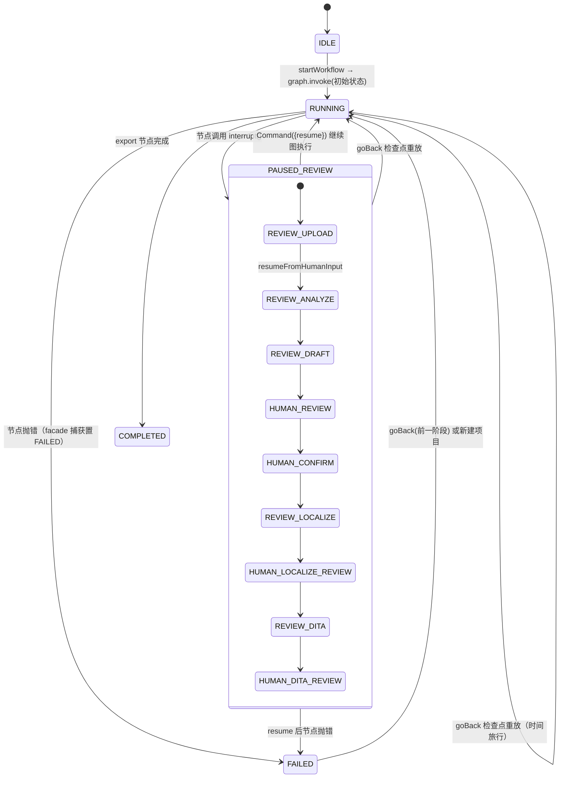
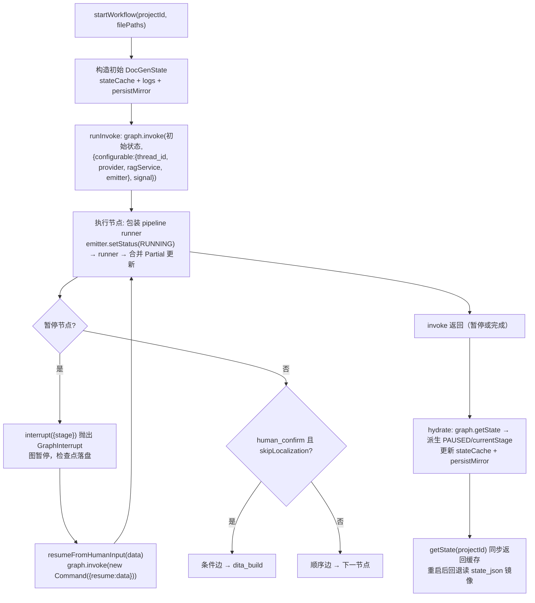
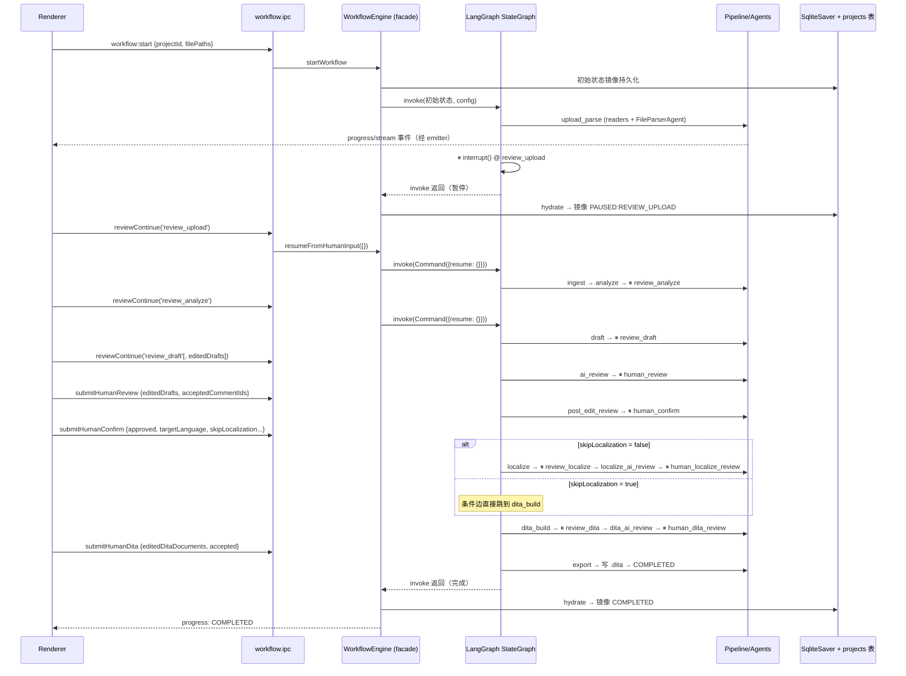

# 03 — 工作流引擎（LangGraph 图编排 + WorkflowEngine Facade）

> 文件：`src/main/modules/workflow/index.ts`（facade）、`langgraph/{graph,graph-state,emitter,checkpointer}.ts`、`pipeline.ts`、`state-machine.ts`
>
> 2026-08-22 从自研顺序循环引擎迁移至 LangGraph 图编排。对外公共 API 与 IPC 契约不变。
> 2026-08-23 补充：`PAUSED:USER` 用户暂停、`documentOutline`/`parseInstruction` 参数化、独立本地化工具（`LocalizationService`，见 06 篇）与文档生成工作流并行存在。

## 3.1 文件职责切分

| 文件 | 角色 | 关键导出 |
|---|---|---|
| `state-machine.ts` | 纯函数阶段定义：顺序、暂停集合、状态派生 | `STAGE_ORDER`、`PAUSE_STAGES`、`getStatusForStage`、`nextStage` |
| `pipeline.ts` | 11 个阶段执行器（纯函数，返回 `Partial<DocGenState>`） | `runUploadParseStage` … `runExportStage` |
| `langgraph/graph-state.ts` | LangGraph 状态 schema（`DocGenState` 去掉 facade 自有字段） | `WorkflowStateAnnotation`、`WorkflowGraphState` |
| `langgraph/graph.ts` | StateGraph 构建：20 节点 + 9 个 `interrupt()` 暂停节点 + 条件边 | `buildWorkflowGraph()` |
| `langgraph/emitter.ts` | 进度/流式事件广播 + 日志累积（经 `configurable.emitter` 注入节点） | `WorkflowEmitter`、`WorkflowEmitterImpl` |
| `langgraph/checkpointer.ts` | SqliteSaver 懒加载单例（`userData/langgraph.db`，`thread_id = projectId`） | `getCheckpointer()` |
| `index.ts` | `WorkflowEngine` facade：同步状态缓存、invoke 编排、go-back 重放、镜像持久化 | `WorkflowEngine` 类 |

## 3.2 20 阶段全表（LangGraph 节点）

| # | StageName | 类型 | 节点 | 状态映射 | 说明 |
|---|---|---|---|---|---|
| 0 | `upload_parse` | AI | 执行节点 | RUNNING | 读取器抽文本 → FileParserAgent 逐文件 AI 摘要 |
| 0a | `review_upload` | ⏸ 暂停 | `interrupt()` | PAUSED:REVIEW_UPLOAD | 确认文件解析结果 |
| 1 | `ingest` | 汇总 | 执行节点 | RUNNING | 汇总就绪文件为 `ingestContext`（元数据 + AI 摘要 + 提取文本，M7） |
| 2 | `analyze` | AI | 执行节点 | RUNNING | RAG 检索 + AnalyzerAgent 分析 |
| 2a | `review_analyze` | ⏸ 暂停 | `interrupt()` | PAUSED:REVIEW_ANALYZE | 确认分析结果 + 参考资料 |
| 3 | `draft` | AI | 执行节点 | RUNNING | WriterAgent 生成 Markdown 草稿 |
| 3a | `review_draft` | ⏸ 暂停 | `interrupt()` | PAUSED:REVIEW_DRAFT | 审阅草稿（可 AI 指令改稿） |
| 4 | `ai_review` | AI | 执行节点 | RUNNING | ReviewerAgent（mode=ai_review） |
| 5 | `human_review` | ⏸ 暂停 | `interrupt()` | PAUSED:HUMAN_REVIEW | 人工接受/拒绝 AI 建议、手改 |
| 6 | `post_edit_review` | AI | 执行节点 | RUNNING | ReviewerAgent（mode=post_edit_review） |
| 6b | `human_confirm` | ⏸ 暂停 | `interrupt()` | PAUSED:HUMAN_CONFIRM | 最终确认 + 选语言 + 可跳过本地化 |
| 7 | `localize` | AI | 执行节点 | RUNNING | LocalizerAgent 翻译本地化 |
| 7a | `review_localize` | ⏸ 暂停 | `interrupt()` | PAUSED:REVIEW_LOCALIZE | 原文 vs 本地化对照 |
| 7b | `localize_ai_review` | AI | 执行节点 | RUNNING | ReviewerAgent（mode=localize_ai_review） |
| 7c | `human_localize_review` | ⏸ 暂停 | `interrupt()` | PAUSED:HUMAN_LOCALIZE_REVIEW | 人工本地化审核 |
| 8 | `dita_build` | 本地 | 执行节点 | RUNNING | Markdown → DITA XML（不落盘） |
| 8a | `review_dita` | ⏸ 暂停 | `interrupt()` | PAUSED:REVIEW_DITA | 查看原始 DITA XML |
| 8b | `dita_ai_review` | AI | 执行节点 | RUNNING | ReviewerAgent（mode=dita_ai_review） |
| 8c | `human_dita_review` | ⏸ 暂停 | `interrupt()` | PAUSED:HUMAN_DITA_REVIEW | 人工 DITA 审核 |
| 9 | `export` | 本地 | 执行节点 | COMPLETED | 写 `*.dita` 文件 + 置 COMPLETED |

## 3.3 状态机视图



`WorkflowStatus` 全集：`IDLE` | `RUNNING` | `COMPLETED` | `FAILED` | 9 个 `PAUSED:*`。暂停状态由 facade 从图的 `next` 字段派生（检查点本身存的是暂停前阶段 + RUNNING）。

## 3.4 图执行与 Facade 编排



### 核心机制逐条解读

1. **暂停 = `interrupt()`**：暂停节点调用 `interrupt({ stage })`，图抛出 `GraphInterrupt` 并暂停，检查点落盘。恢复时 `graph.invoke(new Command({ resume: data }))`，`interrupt()` 返回 `data`，暂停节点将其合并进图状态（对应旧 `resumeFromHumanInput` 的 data 语义）。

2. **检查点持久化（SqliteSaver）**：`userData/langgraph.db`，`thread_id = projectId`。每个节点完成后写检查点，天然支持崩溃恢复（重启后 `getState` 从检查点恢复 PAUSED 状态并可继续）。

3. **go-back = 检查点时间旅行**：`goBackToStage` 从 `getStateHistory` 找到 `next` 含目标阶段的检查点，`invoke(null, { configurable: { checkpoint_id } })` 重放。目标之后阶段产生的字段自动回到该点状态（替代旧 `getFieldsToResetAfterStage` + `pipelineRunId`）。

4. **go-back 中止在途 invoke**：RUNNING 阶段点 go-back 时，用 `AbortController` 中止在途 invoke（LangGraph 支持 `config.signal`），等待 settle 后重放；被中止的 emitter 置 `setActive(false)` 抑制陈旧进度事件。

5. **humanEdits 延迟套用**：执行节点包装器在 `humanEdits` 非空时构造 `effectiveS`（`drafts[].content = humanEdits`）传给 runner，但**不持久化**该映射——回退到 human_review 仍显示原始草稿。

6. **同步 getState**：facade 维护 `stateCache`（emitter 每次进度事件更新 currentStage/status，invoke 完成后 `hydrate` 全量刷新）+ `projects.state_json` 镜像（重启后同步回退读取）。IPC 层无需改动。

7. **跳过本地化**：`human_confirm` 节点恢复后，条件边按 `state.skipLocalization` 分支到 `dita_build` 或 `localize`。

## 3.5 阶段执行器细节（pipeline.ts，未改动）

| 执行器 | 关键行为 |
|---|---|
| `runUploadParseStage` | ① 逐文件 `createReader(path).read()` → `extractedText/metadata`，失败置 error；② 对 `parsing` 状态文件用 `FileParserAgent` 逐文件 AI 摘要（长文本走 map-reduce 分段摘要），JSON 解析失败则以整段文本为 summary |
| `runIngestStage` | 汇总 done 文件为 `ingestContext`（元数据 + AI 摘要 + 提取文本拼接，M7）；AnalyzerAgent 优先使用，避免重复读取/摘要 |
| `runAnalyzeStage` | ① 用 `parseSummary ?? name` 拼接查询串；② `ragService.search()` 取参考（默认最多 10 条，语义索引优先）；③ `AnalyzerAgent.execute`（每文件长文本走 map-reduce 摘要） |
| `runDraftStage` | `WriterAgent` 合并全部文件的 analysisResults，生成 1 篇标题为「综合技术文档」的 Markdown（章节结构由 `documentOutline` 参数化） |
| `runAiReviewStage` | `ReviewerAgent(mode:'ai_review')` → `aiReviewComments` |
| `runPostEditReviewStage` | `ReviewerAgent(mode:'post_edit_review')`，附带 humanEdits 备注 → `postEditReviewComments` |
| `runLocalizeStage` | `LocalizerAgent`，按 `targetLanguage` 翻译每篇草稿 → `localizedDrafts` |
| `runLocalizeAiReviewStage` | `ReviewerAgent(mode:'localize_ai_review')` → `localizeReviewComments` |
| `runDitaBuildStage` | 源 = `localizedDrafts`（空则 `drafts`）；`buildDitaXml` → `ditaDocuments`（content 为 XML 文本，不落盘、不置 COMPLETED）；构建后 `validateDitaXml` 校验并输出警告 |
| `runDitaAiReviewStage` | `ReviewerAgent(mode:'dita_ai_review')` → `ditaReviewComments` |
| `runExportStage` | 优先 `ditaDocuments`（空则现场重建）；逐篇写 `userData/projects/<id>/<title>.dita` **并同时生成 `<title>.docx`**（`buildDocx`，M2）；返回 `{ outputDocuments, status:'COMPLETED', currentStage:'export' }` |

## 3.6 全流程交互时序（happy path）



## 3.7 事件广播（emitter）

- `WorkflowEmitterImpl` 持有 `window`、`projectId`、`onEvent` 回调。`emitProgress` 生成 `WorkflowLogEntry`（uuid + 时间戳 + 阶段 + level=info + 截断 500 字符 detail）→ 调 `onEvent(entry, status)`（facade 用它累积日志 + 刷新同步缓存）→ `webContents.send('workflow:progress', {...})`。
- `emitStream` 转发 `workflow:stream {projectId, stage, chunk}`。
- `setStatus`/`setActive`：节点进入时置 RUNNING/PAUSED；go-back 中止的 invoke 置 inactive 抑制陈旧事件。
- 渲染侧策略不变：progress 事件只更新轻量字段；**仅在阶段切换时**拉取完整 `workflow:status` 并保留本地日志。

## 3.8 失败与恢复

- 节点抛错 → `graph.invoke` reject → facade catch → 状态置 `FAILED` + `error` 字符串，更新缓存 + 镜像 + 广播；
- UI 的 FAILED 视图提供「返回上一步重试」（goBack 重放）与「重新开始」（reset 状态回 IDLE）两条路径；
- 单文件解析失败不会中断流水线：文件标记 `parseStatus:'error'` 继续执行，后续 AI 阶段只处理 `done` 文件；
- 崩溃恢复：检查点落盘在 `langgraph.db`，重启后 `getState` 从 `state_json` 镜像恢复 PAUSED 状态，`resumeFromHumanInput` 从检查点继续。

## 3.9 集成测试（历史）

> ⚠ 2026-08-23 起 `test/langgraph/` 已从仓库移除（未纳入正式测试套件）。以下为历史记录，供重建测试时参考。

`test/langgraph/integration-test.ts`（Vite SSR 打包 + Electron 运行）曾用 mock AI provider 驱动真实 facade 验证：20 阶段 happy path、9 个暂停点逐个继续、skipLocalization 分支、humanEdits 存储、go-back 重放与字段重置、崩溃恢复（新引擎实例读同一检查点）、并发双项目、deleteProject 清理、思考流式（thinking+content）、空流式兜底。

```bash
npx vite build --config test/langgraph/vite.test.config.ts
npx electron test/langgraph/dist/integration-test.js
```