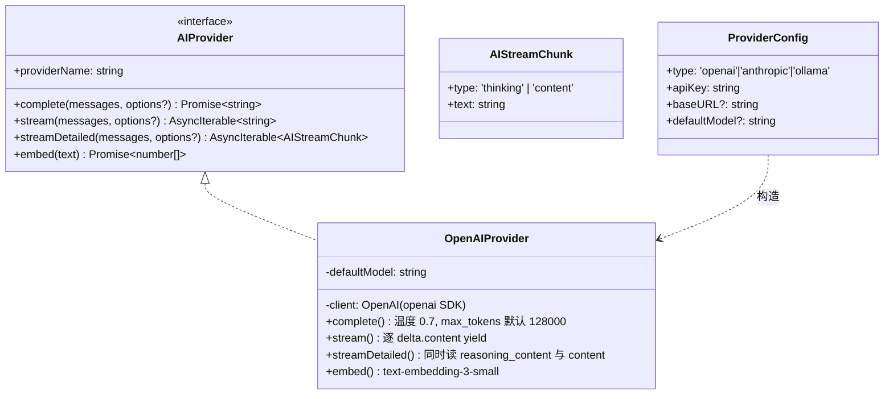
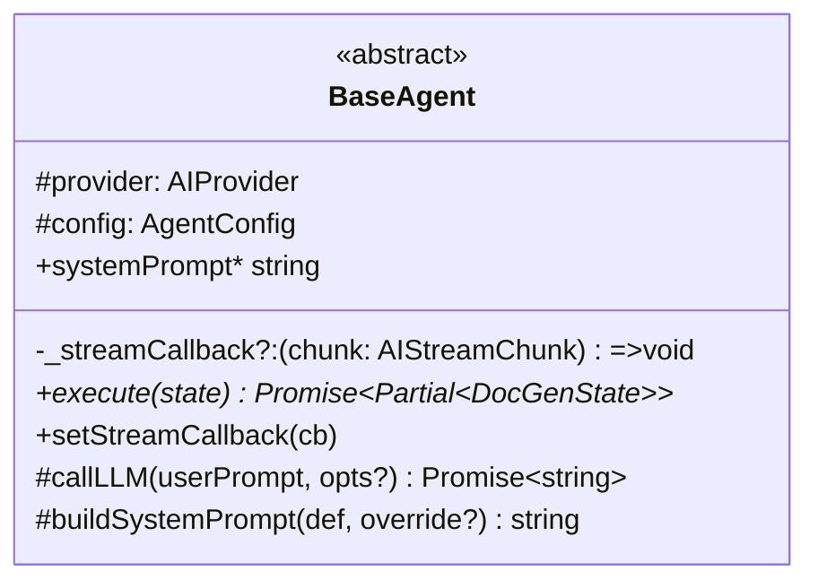
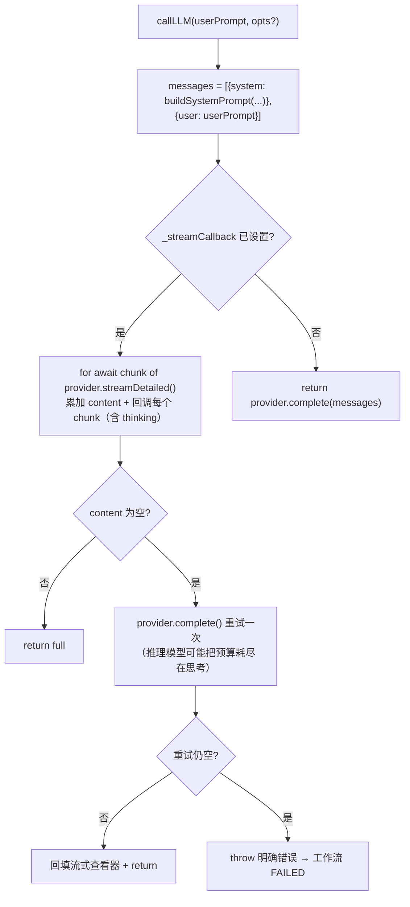

# 04 — AI 层（Providers 与 Agents）

> 文件：`src/main/modules/ai-providers/*`、`src/main/modules/agents/*`、`src/main/modules/prompts/*`

## 4.1 Provider 抽象



- `src/main/modules/ai-providers/base.provider.ts`：接口 + 配置类型 + `AIStreamChunk`；
- `openai.provider.ts`：SDK 封装。空 apiKey 时以占位符 `'NOT_CONFIGURED'` 构造（请求时才报认证错误）；`baseURL` 支持任意 OpenAI 兼容端点（设置页提示 302.ai）；`streamDetailed` 同时读取 `delta.reasoning_content`（非标字段，cast 读取）与 `delta.content`，支持 DeepSeek 等推理模型的思考过程流式显示；`max_tokens` 默认 128000（匹配 DeepSeek V4 Flash 128K 上下文，防止推理模型把输出预算耗尽在思考上导致空 content）；
- `index.ts`：`createProvider(config)` 工厂——`anthropic`/`ollama` 仅有注释占位，未实现；
- 运行时热更新：`settings:reloadProvider` → `engine.updateProvider(newProvider)` + `localizationService.updateProvider(newProvider)`。

## 4.2 BaseAgent 基类



`callLLM` 的双模式：



## 4.3 七个 Agent 详解

| Agent | 阶段 | 输入 | 输出 | 提示词要点 |
|---|---|---|---|---|
| `FileParserAgent` | upload_parse | 每文件 extractedText（长文档逐块完整提炼）+ 解析提示词 | `parseMarkdown` + `parseExtraction`（完整 Markdown、证据、原文基线） | 工业自动化文档分析员；结构字段用于校验，Markdown 是审核/下游权威工件 |
| `AnalyzerAgent` | analyze | 全部文件的 Markdown 提炼 + RAG 参考片段 + ingestContext | `analysisResults[]`（逐文件完整分析）+ `analysisSynthesisMarkdown`（跨文件综合分析） | 资深技术分析师；要求解释关系、依赖、冲突、风险、缺口和结论，不得只做摘要或分类 |
| `WriterAgent` | draft | 全部分析 Markdown + 跨文件综合 Markdown + 文档大纲 | `DocumentDraft[]`（恒为 1 篇综合文档，标题「综合技术文档」） | 专家技术写手；保留所有源证据并综合构建连贯文档；章节结构由 `documentOutline` 参数化（默认 6 段） |
| `ReviewerAgent` | ai_review / dita_ai_review | 目标草稿集 | 对应评论数组字段（见下） | Gen Doc 只保留通用 AI 评审与 DITA 评审；仅输出 JSON 数组 |
| `LocalizerAgent` | 独立本地化 localize | 每篇 draft + 语言指令 | `localizedDrafts`（标题追加语言后缀） | 三语种术语约定（zh-CN / zh-TW / en） |
| `DitaLocalizerAgent` | 独立本地化 localize | `.dita` XML + 目标语言 + 术语表上下文 | 翻译后的 DITA XML 字符串 | 只翻译文本、保留 XML 结构/属性/实体、codeblock/codeph/xref 原样 |
| `DitaReviewerAgent` | 独立本地化 localize_ai_review / post_edit_review | 译文 + 原文 + 语言 + 术语表 | `ReviewComment[]`（draftId = sourcePath） | 本地化质量评审（翻译准确性/术语一致/语言流畅） |

`ReviewerAgent` 的 4 种模式 → 写入字段映射：

| mode | 审查对象 | 输出字段 |
|---|---|---|
| `ai_review` | `state.drafts` | `aiReviewComments` |
| `post_edit_review` | 独立本地化流程中的译文 + 人工编辑 | `postEditReviewComments` |
| `localize_ai_review` | 独立本地化流程中的译文 | `localizeReviewComments` |
| `dita_ai_review` | `state.ditaDocuments` | `ditaReviewComments` |

## 4.4 提示词统一管理（prompts 模块）

> 2026-08-23 起，所有 Agent 提示词从各 Agent 内联字符串迁移到 `src/main/modules/prompts/` 集中管理。

- **PROMPTS 注册表**：每个 Agent 使用一份完整 Markdown 工作定义提示词；默认内容按 `Role Definition` / `Task` / `Output Format` 三章节组织，`buildSystemPrompt(def, override)` 直接将完整内容作为 system prompt 使用；旧版分段覆盖在读取时兼容迁移；
- **PROMPT_CATALOG**：12 个可配置提示词条目（按 group 分组：解析/分析/撰写/评审/本地化/摘要/编辑），每条标注对应 workflow step（`stage`/`stageLabel`）；
- **覆盖持久化**：`loadPromptOverrides/savePromptOverrides/resetPromptOverrides`（settings 表 key=`prompts.overrides`，JSON）；保存时与默认值 diff，仅存有差异部分；
- **生效链路**：engine `runInvoke`/`goBackToStage` 每次 invoke 从 DB 加载 → `NodeRuntime.promptOverrides` → `PipelineConfig.promptOverrides` → 各 Agent `promptOverride`（按 key 取）；map-reduce 的 map/reduce system prompt 每次调用动态构建；
- **user prompt 构建函数**：`buildFileParserUserPrompt` / `buildAnalyzerUserPrompt` / `buildWriterPrompt` / `buildDitaLocalizerUserPrompt` / `buildDitaReviewUserPrompt` / `buildAiEditDraftUserPrompt` 等，支持注入解析提示词、文档大纲、术语表上下文。

## 4.5 JSON 输出容错链（重要实现细节）

AI 返回的 JSON 常带 markdown 围栏或杂散文本，系统做了**三层容错**：

1. **后端 `extractJsonArray()`**（reviewer.agent.ts）：剥 ```json 围栏 → 取最外层 `[ ... ]` 子串 → `JSON.parse`；仍失败则整段存为单条 `type:'info'` 评论（explanation=原文）。解析失败后还有一次修复重试（要求 AI 只输出修正后的 JSON 数组）。
2. **前端 `normalizeComments()`**（ReviewCommentsView.tsx）：检测"单条 info + explanation 内含 JSON 数组"的降级形态，重新解析为结构化卡片（ReviewPanel 与 6b 左侧面板共用）。
3. **流式查看器多形态解析**（AIStreamViewer.tsx）：单个 JSON / 围栏 JSON 块 / 花括号深度计数的**串联 JSON 流** `{...}{...}` 三种解析路径，且对未完成的尾部 JSON 优雅跳过。

## 4.6 本地化语言与术语

`LOCALIZE_LANGUAGE_PROMPTS: Record<LocalizeLanguage, {label, instruction}>`，支持 **en / zh-CN / zh-TW**（2026-08-23 移除 zh-HK）。

术语约定从 `LocalizerAgent` 内联表迁移为 **SQLite 术语表**（`translation_mappings` 表，三列 en/zh_cn/zh_tw，内置约 400 条默认术语 `default-mappings.ts`）：

- `MappingService.getMappingContext(targetLang)` 提取目标语言相关列，格式化为 glossary 提示块（上限 500 条）；
- zh-CN 取 en→zh_cn，zh-TW 取 en→zh_tw，en 取 zh_cn/zh_tw→en（反向）；
- 独立本地化工具会注入术语表，保证术语一致；Gen Doc 不再包含本地化阶段。

## 4.7 AI 调用规模统计

| 阶段 | 调用次数 | 流式 |
|---|---|---|
| upload_parse | N 文件 × 1 | ✅ |
| analyze | 1 | ✅ |
| draft | 1 | ✅ |
| ai_review / dita_ai_review | 各 1 | ✅ |
| 独立本地化 localize | N 草稿 × 1 | ✅ |
| aiEditDraft（按需） | 1/次 | ✅ |
| 独立本地化 localize | N 文件 × 1 | ✅ |
| 独立本地化 localize_ai_review / post_edit_review | N 文件 × 1 | ✅ |

默认参数：model `gpt-4o`（可配置）、temperature 0.7、maxTokens 默认 128000（匹配 DeepSeek V4 Flash 128K 上下文）。

> 空结果兜底（2026-08-23 修复）：DeepSeek 等推理模型可能把输出预算全部花在 `reasoning_content` 上导致 `content` 为空。`BaseAgent.callLLM` 在流式结果为空时自动用非流式 `complete()` 重试一次；仍为空则抛错使工作流 FAILED（不再静默生成空文档）。`OpenAIProvider` 对空内容记录 warn 日志（含 finish_reason 与 reasoning_content 长度，仅诊断用）。

## 4.8 上下文窗口管理（现状）

| 位置 | 截断策略 |
|---|---|
| FileParserAgent | 长文本走 `summarizeLongText` 分块 map-reduce（≤4000 字符原样返回） |
| AnalyzerAgent | 原样消费解析 Markdown，产出逐文件分析 + 跨文件综合 Markdown，参考片段全文拼接 |
| LocalSearchService.scoreFile | 仅作语义索引缺失时的回退（前 5000 字节关键词） |
| ReviewerAgent | 草稿全文（无截断） |
| LocalizerAgent | 草稿全文（无截断） |
| DitaLocalizerAgent / DitaReviewerAgent | 单文件 DITA XML 全文（maxTokens 128000） |

> `summarizeLongText`（`modules/context/map-reduce.ts`）：chunk 4000/overlap 200，逐段完整提炼（map）再合并（reduce），不做均匀采样；用于解析阶段避免硬截断，支持注入用户解析提示词（`SummarizeOptions.instruction`）。分析阶段直接消费审核后的 Markdown 工件，不再二次摘要。
