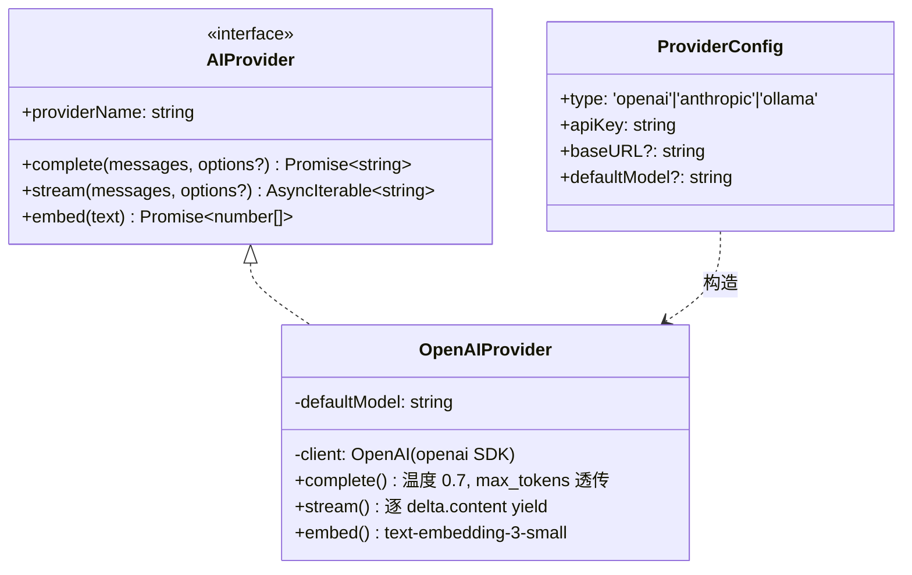
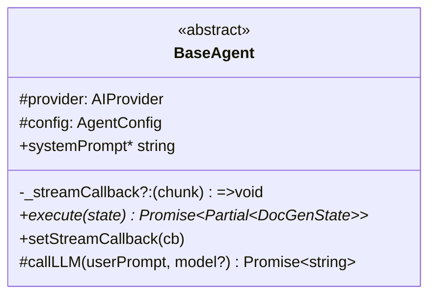
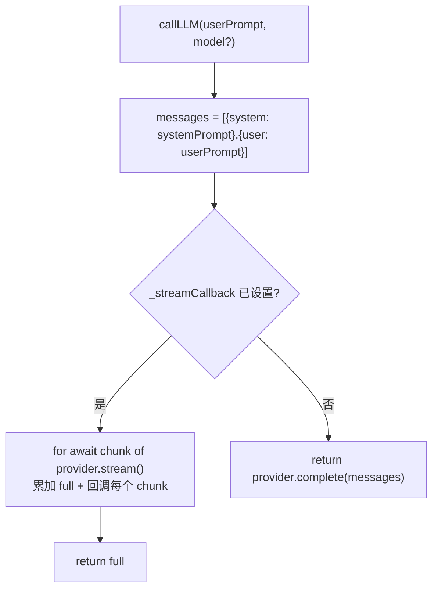

# 04 — AI 层（Providers 与 Agents）

> 文件：`src/main/modules/ai-providers/*`、`src/main/modules/agents/*`

## 4.1 Provider 抽象



- `src/main/modules/ai-providers/base.provider.ts`：接口 + 配置类型；
- `openai.provider.ts`：SDK 封装。空 apiKey 时以占位符 `'NOT_CONFIGURED'` 构造（请求时才报认证错误）；`baseURL` 支持任意 OpenAI 兼容端点（设置页提示 302.ai）；
- `index.ts`：`createProvider(config)` 工厂——`anthropic`/`ollama` 仅有注释占位，未实现；
- 运行时热更新：`settings:reloadProvider` → `engine.updateProvider(newProvider)`。

## 4.2 BaseAgent 基类



`callLLM` 的双模式：



## 4.3 五个 Agent 详解

| Agent | 阶段 | 输入 | 输出 | 提示词要点 |
|---|---|---|---|---|
| `FileParserAgent` | upload_parse | 每文件 extractedText（截 4000 字符） | `parseSummary`（JSON: summary/keyPoints/keywords/technicalTerms，解析失败则以全文为 summary） | 工业自动化文档分析员；仅输出 JSON |
| `AnalyzerAgent` | analyze | done 文件（每文件截 2000 字符）+ RAG 参考片段 | `AnalysisResult[]`（JSON 数组；失败则降级为每文件一条 summary=全文） | 资深技术写手；要求 fileId/fileName/summary/keyPoints/keywords/technicalTerms |
| `WriterAgent` | draft | 全部文件的 analysisResults 汇总文本 | `DocumentDraft[]`（恒为 1 篇综合文档，标题「综合技术文档」） | 专家技术写手；要求把多文件分析结果合并为一份连贯文档；固定 6 段结构（Executive Summary / Overview / Specs / Features / Requirements / Implementation Notes） |
| `ReviewerAgent` | ai_review / post_edit_review / localize_ai_review / dita_ai_review | 目标草稿集 +（post_edit 时）humanEdits 备注 | 对应评论数组字段（见下） | 4 套模式化 system prompt；仅输出 JSON 数组 |
| `LocalizerAgent` | localize | 每篇 draft + 语言指令 | `localizedDrafts`（标题追加语言后缀） | 三语种术语表（见 4.5） |

`ReviewerAgent` 的 4 种模式 → 写入字段映射：

| mode | 审查对象 | 输出字段 |
|---|---|---|
| `ai_review` | `state.drafts` | `aiReviewComments` |
| `post_edit_review` | `state.drafts` + humanEdits 备注 | `postEditReviewComments` |
| `localize_ai_review` | `state.localizedDrafts` | `localizeReviewComments` |
| `dita_ai_review` | `state.ditaDocuments` | `ditaReviewComments` |

## 4.4 JSON 输出容错链（重要实现细节）

AI 返回的 JSON 常带 markdown 围栏或杂散文本，系统做了**三层容错**：

1. **后端 `extractJsonArray()`**（reviewer.agent.ts）：剥 ```json 围栏 → 取最外层 `[ ... ]` 子串 → `JSON.parse`；仍失败则整段存为单条 `type:'info'` 评论（explanation=原文）。
2. **前端 `normalizeComments()`**（ReviewCommentsView.tsx）：检测"单条 info + explanation 内含 JSON 数组"的降级形态，重新解析为结构化卡片（ReviewPanel 与 6b 左侧面板共用）。
3. **流式查看器多形态解析**（AIStreamViewer.tsx）：单个 JSON / 围栏 JSON 块 / 花括号深度计数的**串联 JSON 流** `{...}{...}` 三种解析路径，且对未完成的尾部 JSON 优雅跳过。

## 4.5 本地化术语设计（LocalizerAgent）

`LANGUAGE_PROMPTS: Record<LocalizeLanguage, {label, instruction}>`：

| 术语 | zh-CN | zh-TW | zh-HK |
|---|---|---|---|
| 程序 | 程序 | **程式** | 程式 |
| 文件 | 文件 | **檔案** | 檔案 |
| 信息 | 信息 | **資訊** | 資訊 |
| 软件/软体 | 软件 | **軟體** | 軟件/軟體（正式文档偏好軟件） |
| 硬件 | 硬件 | **硬體** | 硬件 |
| 服务器 | 服务器 | 伺服器 | 伺服器 |
| 数据库 | 数据库 | 資料庫 | 資料庫 |
| 网络 | 网络 | **網路** | **網絡** |
| 数字/数码 | 数字 | **數位** | **數碼** |
| 队列 | 队列 | 佇列 | 隊列/佇列 |
| 对象 | 对象 | 物件 | 物件 |
| 指针 | 指针 | 指標 | 指標（编程上下文） |
| 总线 | 总线 | 匯流排 | 匯流排/總線 |
| 固件 | 固件 | **韌體** | 韌體/固件（工业场景用固件） |

## 4.6 AI 调用规模统计

| 阶段 | 调用次数 | 流式 |
|---|---|---|
| upload_parse | N 文件 × 1 | ✅ |
| analyze | 1 | ✅ |
| draft | 1 | ✅ |
| ai_review / post_edit_review / localize_ai_review / dita_ai_review | 各 1 | ✅ |
| localize | N 草稿 × 1 | ✅ |
| aiEditDraft（按需） | 1/次 | ✅ |

默认参数：model `gpt-4o`（可配置）、temperature 0.7、maxTokens 未设置。

## 4.7 上下文窗口管理（现状）

| 位置 | 截断策略 |
|---|---|
| FileParserAgent | 长文本走 `summarizeLongText` 分块 map-reduce（≤4000 字符原样返回） |
| AnalyzerAgent | 每文件长文本走 map-reduce 摘要，参考片段全文拼接 |
| LocalSearchService.scoreFile | 仅作语义索引缺失时的回退（前 5000 字节关键词） |
| ReviewerAgent | 草稿全文（无截断） |
| LocalizerAgent | 草稿全文（无截断） |

> `summarizeLongText`（`modules/context/map-reduce.ts`）：chunk 4000/overlap 200/上限 20 段均匀采样，先逐段摘要（map）再合并（reduce），替代 parse/analyze 阶段的硬截断（见 10 篇 R2 已修复）。
