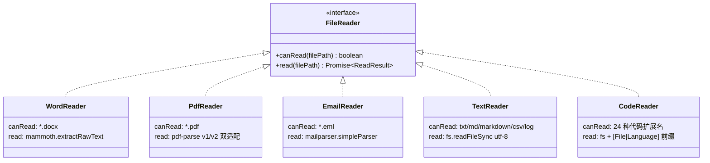
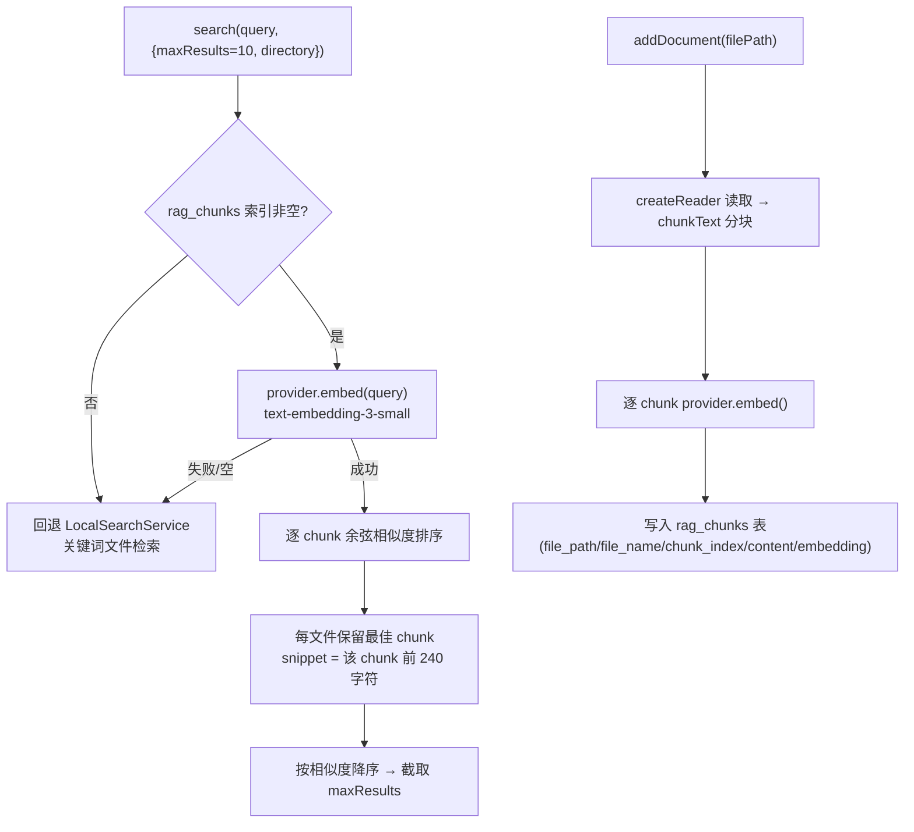

# 05 — 文件处理与文档构建

> 文件：`src/main/modules/file-readers/*`、`src/main/modules/rag/*`、`src/main/modules/document-builder/*`

## 5.1 文件读取器（策略模式 + 工厂）



`createReader(filePath)` 按注册顺序 **Word → PDF → Email → Text → Code** 匹配第一个 `canRead` 为 true 的读取器；无匹配抛错（该文件置 `parseStatus:'error'`）。

`ReadResult` 结构：`{ text, metadata{title,author,created,pages,wordCount}, chunks }`；`chunkText(text, chunkSize=1000, overlap=100)` 生成重叠分块（当前分块产物仅存于 ReadResult，下游 AI 阶段实际使用截断后的全文而非 chunks）。

### PdfReader 的 v1/v2 双兼容适配（实现细节）

`pdf-parse` v2 改成了类 API（`new PDFParse({data}).getText()`），而 v1 是函数导出。`resolvePdfParseModule()` 依次探测：函数导出（legacy）→ `mod.PDFParse` 类 → `mod.default` 函数 → `mod.default.PDFParse` 类，并保证 v2 实例用完调用 `destroy()`。

### EmailReader 输出构造

`Subject/From/Date` 头 + `parsed.text ?? parsed.html` 拼接为纯文本；metadata 填 title/author/created。

## 5.2 RAG —— SemanticSearchService（语义检索 + 关键词回退）



- 索引持久化在 SQLite `rag_chunks` 表（`database.ts` 迁移创建，`file_path` 建索引）；
- `rag:addDocument` 落地为真实索引写入：读取 → 分块 → embed → upsert（重复索引同一文件先删旧 chunk）；
- 无索引 / embed 失败（如未配置 API Key）时自动回退 `LocalSearchService` 关键词搜索，保证可用性；
- 配套 IPC：`rag:removeDocument`、`rag:clearIndex`、`rag:indexStats`。

## 5.3 文档构建器

### dita.builder.ts（流水线在用的构建器）

Markdown → DITA 1.3 Concept Topic 的两阶段转换：


| Markdown 元素 | DITA 映射 |
|---|---|
| 第一个 H1 | `<title>`（后续 H1/H2 → `<section><title>`） |
| H3 | section 内 `<p><b>...</b></p>` |
| 段落 | `<p>` |
| `-`/`*`/`+` 列表 | `<ul><li><p>` |
| `1.` 列表 | `<ol><li><p>` |
| ``` 代码围栏 | `<codeblock outputclass="language-xxx">` |
| `---` | 结束当前 section |
| 空行 | 折叠跳过 |

- `escapeXml`：`& < > " '` 五字符转义；
- `slugify`：小写 + 非 `[a-z0-9\u4e00-\u9fff]` 转连字符（保留中文），生成 `concept id`；
- 导出 `buildDitaXml(draft): string`（**流水线使用**）与 `buildDita(draft): Promise<Buffer>`（**历史遗留，无调用方**）。

### docx.builder.ts（休眠代码）

基于 `docx` 库：`Document` + `Paragraph/HeadingLevel/TextRun/Packer`。支持标题/项目符号/编号/空行/正文的行级正则映射。`buildDocx()` 已实现，但**流水线没有任何阶段调用它**（export 只写 `.dita`）。类型上 `OutputDocument.format` 仍允许 `'docx' | 'pdf'`。

## 5.4 导出落盘（runExportStage + file-storage）

```
userData/projects/<projectId>/<安全文件名>.dita
```

- 文件名清洗：`title.replace(/[/\\?%*:|"<>]/g, '-')`；
- 写入经 `writeProjectBinaryFile(projectId, fileName, buffer)`；
- 结果注册为 `OutputDocument{id,title,fileName,filePath,format:'dita',size,createdAt}`；
- 用户级导出：`file:saveDita`（另存对话框 + copyFileSync）、`file:exportAll`（选目录 + 批量 copyFileSync）、`file:downloadZip`（archiver zip 打包全部）。
