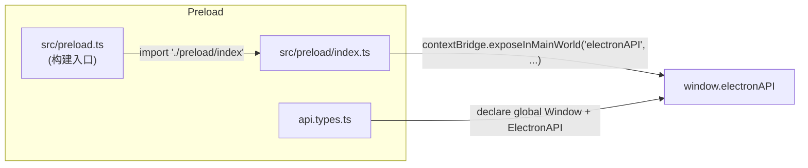

# 06 — 存储、IPC 与 Preload

## 6.1 SQLite 存储（`src/main/modules/storage/database.ts`）

- 引擎：`better-sqlite3`（同步 API），文件位置 `app.getPath('userData')/smart-tech-writer.db`；
- PRAGMA：`journal_mode = WAL`、`foreign_keys = ON`；
- 迁移（`runMigrations`，幂等 `CREATE TABLE IF NOT EXISTS`）：

```sql
CREATE TABLE settings (
  key   TEXT PRIMARY KEY,
  value TEXT NOT NULL
);

CREATE TABLE projects (
  id            TEXT PRIMARY KEY,
  name          TEXT NOT NULL,
  status        TEXT NOT NULL DEFAULT 'IDLE',
  current_stage TEXT NOT NULL DEFAULT 'upload_parse',
  state_json    TEXT,          -- DocGenState 全量 JSON 快照
  created_at    TEXT NOT NULL,
  updated_at    TEXT NOT NULL
);

-- 语义 RAG 索引：每行一个已嵌入文本块
CREATE TABLE rag_chunks (
  id          INTEGER PRIMARY KEY AUTOINCREMENT,
  file_path   TEXT NOT NULL,
  file_name   TEXT NOT NULL,
  chunk_index INTEGER NOT NULL,
  content     TEXT NOT NULL,
  embedding   TEXT NOT NULL,   -- JSON 数组
  created_at  TEXT NOT NULL
);
CREATE INDEX idx_rag_chunks_file_path ON rag_chunks(file_path);

-- 独立本地化运行记录：每次翻译运行全量镜像
CREATE TABLE localization_runs (
  id              TEXT PRIMARY KEY,
  status          TEXT NOT NULL,
  stage           TEXT NOT NULL,
  target_language TEXT NOT NULL,
  state_json      TEXT,
  created_at      TEXT NOT NULL,
  updated_at      TEXT NOT NULL
);

-- 翻译映射（术语表）：一行 = 英文 + 简体 + 台湾繁体
CREATE TABLE translation_mappings (
  id          TEXT PRIMARY KEY,
  en          TEXT NOT NULL,
  zh_cn       TEXT NOT NULL,
  zh_tw       TEXT NOT NULL,
  created_at  TEXT NOT NULL,
  updated_at  TEXT NOT NULL
);
CREATE UNIQUE INDEX idx_translation_mappings_en ON translation_mappings(en COLLATE NOCASE);
```

关键行为：

| 行为 | 实现 |
|---|---|
| 写状态 | `persistState`：`INSERT OR REPLACE INTO projects(...)` 整状态序列化；每次阶段进入/完成/暂停/失败都会写 |
| 读状态 | `loadState`：`SELECT state_json` → `JSON.parse`，并对旧快照回填新字段（`skipLocalization=true`、`humanEditedDrafts=[]`、`ingestContext=''`、`documentOutline`） |
| 设置 | `getSetting/setSetting`，键约定 `openai.apiKey` `openai.baseURL` `openai.model` `rag.searchDirectory` `prompts.overrides` |
| 项目列表 | `projects:list` 按 `updated_at DESC` 返回 `Project[]`（不含 state_json） |
| 术语表 | `translation_mappings` 建表后 `seedDefaultMappings` 用 `INSERT OR IGNORE` 种入约 400 条默认术语（不覆盖用户数据） |
| 单例 | 模块级 `let db` 单例；`closeDatabase` 于 `window-all-closed` 调用 |

> ⚠ API Key 以明文存于 settings 表（安全建议：Electron `safeStorage` 加密，见演进路线）。

## 6.2 项目文件存储（`storage/file-storage.ts`）

| 函数 | 行为 |
|---|---|
| `getProjectsDir()` | `userData/projects`（递归创建） |
| `getProjectDir(id)` | `userData/projects/<id>` |
| `writeProjectFile(id, name, content)` | UTF-8 文本写入，返回绝对路径 |
| `readProjectFile(id, name)` | 读取文本，不存在返回 null |
| `writeProjectBinaryFile(id, name, buffer)` | 二进制写入（DITA/DOCX 导出用），返回绝对路径 |

## 6.3 IPC 协议全集（50+ 通道）

通道常量定义于 `src/shared/types/ipc.types.ts`（`IPC_CHANNELS`）。方向：`invoke` = 渲染→主请求/响应，`send` = 主→渲染事件推送。

### 工作流组（13，`workflow.ipc.ts`）

| 通道 | 方向 | Payload → 返回 | 说明 |
|---|---|---|---|
| `workflow:start` | invoke | `{projectId, filePaths, documentOutline?, parseInstruction?, fileInstructions?}` → `DocGenState` | 创建并异步启动流水线 |
| `workflow:status` | invoke | `{projectId}` → `DocGenState\|null` | 内存态优先，回退 DB 镜像 |
| `workflow:pause` | invoke | `{projectId}` | **真实暂停**（M3）：AbortController 中止在途 invoke，置 `PAUSED:USER` |
| `workflow:resume` | invoke | `{projectId}` | 从检查点继续（`graph.invoke(null, config)`） |
| `workflow:goBack` | invoke | `{projectId, targetStage}` | 检查点时间旅行回退重跑 |
| `workflow:progress` | send | `WorkflowProgressEvent` | 阶段/状态/消息 + 日志条目 |
| `workflow:stream` | send | `WorkflowStreamEvent` | AI 流式 chunk（`{type:'thinking'\|'content', text}`） |
| `workflow:humanReviewSubmit` | invoke | `{projectId, editedDrafts, acceptedCommentIds}` | 存 humanEditedDrafts + humanEdits + 标记 accepted |
| `workflow:humanConfirmSubmit` | invoke | `{projectId, approved, targetLanguage?, skipLocalization?, editedDrafts?, acceptedCommentIds?}` | 确认 + 语言 + 跳本地化 |
| `workflow:humanLocalizeSubmit` | invoke | `{projectId, editedLocalizedDrafts, acceptedCommentIds}` | 本地化人工提交 |
| `workflow:humanDitaSubmit` | invoke | `{projectId, editedDitaDocuments, acceptedCommentIds}` | DITA 人工提交 |
| `workflow:reviewContinue` | invoke | `{projectId, stage, editedDrafts?}` | 通用审核继续（可带改后草稿） |
| `workflow:aiEditDraft` | invoke | `{projectId, currentContent, instruction}` → `string` | AI 指令改稿（流式经 stream 通道） |

### 文件组（6，`file.ipc.ts`）

| 通道 | 方向 | 说明 |
|---|---|---|
| `file:select` | invoke | `dialog.showOpenDialog` 多选，扩展名过滤器含全部支持格式；选中文件注册进 `PathGuard` 白名单 |
| `file:read` | invoke | `PathGuard` 白名单校验（用户选中文件 + `userData/projects` + RAG 目录，扩展名限文本/代码）后 UTF-8 读取（预览用） |
| `file:showInFolder` | invoke | `shell.showItemInFolder` |
| `file:downloadZip` | invoke | 保存对话框 + archiver 打 ZIP |
| `file:saveDita` | invoke | 另存单个 DITA/DOCX 文件（按 format 选过滤器） |
| `file:exportAll` | invoke | 选目录批量复制输出文件 |

### RAG 组（5，`rag.ipc.ts`）

| 通道 | 说明 |
|---|---|
| `rag:query` | 实时读取 `rag.searchDirectory` 设置并搜索（语义索引优先，回退关键词） |
| `rag:addDocument` | 真实索引：读取 → 分块 → embed → 写入 `rag_chunks` 表（重复索引先删旧 chunk） |
| `rag:removeDocument` | 删除某文件的索引 chunk |
| `rag:clearIndex` | 清空整个索引 |
| `rag:indexStats` | 返回已索引 chunk 数 |

### 设置/应用/提示词/项目组（12，`settings.ipc.ts`）

| 通道 | 说明 |
|---|---|
| `settings:get` / `settings:set` | 键值读写 |
| `settings:reloadProvider` | 重建 OpenAIProvider 并 `engine.updateProvider` + `localizationService.updateProvider` |
| `app:getVersion` | 返回应用版本号（设置页显示） |
| `prompts:get` / `prompts:set` / `prompts:reset` | 提示词目录 + 覆盖读写/重置 |
| `projects:list` / `projects:get` / `projects:getState` / `projects:delete` | 项目元数据 CRUD + 完整状态恢复 |

### 独立本地化组（12，`localization.ipc.ts`）

| 通道 | 说明 |
|---|---|
| `localize:selectFiles` | 多选 `.dita` 文件 |
| `localize:start` | 启动翻译（fire-and-forget） |
| `localize:status` | 返回当前运行状态（status/stage/results） |
| `localize:export` | 选择目录导出 `<basename>.<lang>.dita` |
| `localize:progress` / `localize:stream` | send 事件（逐文件进度 + AI 流式 chunk） |
| `localize:continue` | 从 review_localize 继续（可带人工编辑） |
| `localize:humanLocalizeSubmit` / `localize:humanConfirmSubmit` | 人工提交 |
| `localize:goBack` | 回退到更早阶段 |
| `localize:runsList` / `localize:runsGet` / `localize:runsDelete` / `localize:runsLoad` | 运行记录 CRUD + 恢复 |

### 翻译映射组（7，`mapping.ipc.ts`）

| 通道 | 说明 |
|---|---|
| `mapping:list` | 列表（可选三列 LIKE 搜索） |
| `mapping:add` / `mapping:update` / `mapping:delete` | 术语 CRUD（按 en 去重） |
| `mapping:importParse` | 选文件解析（`.xlsx` 用 exceljs，`.csv` 自写解析器，首行表头跳过） |
| `mapping:import` | 批量导入（事务 + 去重 + 报告跳过） |
| `mapping:stats` | 统计（total / complete） |

## 6.4 Preload 桥（`src/preload/`）



暴露面：`workflow`（13）· `file`（6）· `rag`（5）· `settings`（3）· `app`（1）· `prompts`（3）· `projects`（4）· `localization`（12）· `mapping`（7）。事件订阅返回**取消订阅函数**（`ipcRenderer.removeListener`），供 React effect 清理。

安全约定：渲染进程**只允许**通过 `window.electronAPI` 通信；`api.types.ts` 同时声明 `Window` 全局类型供 TypeScript 校验。
