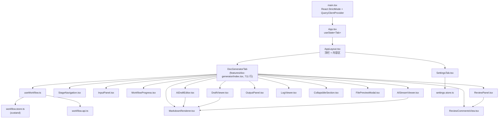
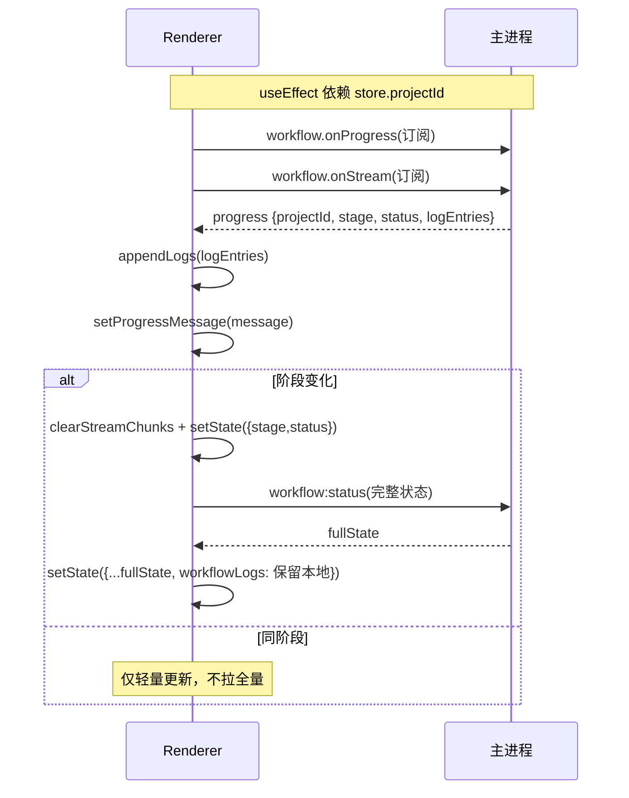

# 07 — 渲染进程（React UI 架构）

> 文件：`src/renderer/**`

## 7.1 组件树

## 7.2 视图路由（按 WorkflowStatus 渲染）

`DocGeneratorTab.renderContent()` 是纯条件渲染，无路由库：

| 状态 | 渲染 |
|---|---|
| `IDLE` | `InputPanel`（拖拽/选择文件、启动按钮；仅 IDLE 时显示，避免启动后 UI 假死） |
| `RUNNING` | `WorkflowProgress` + 返回上一步按钮 + 文件列表(upload_parse) + `AIStreamViewer` + 草稿/DITA 实时预览 + 分析结果折叠区 |
| `PAUSED:REVIEW_UPLOAD` | 文件解析结果卡片 + 提取文本 details + 返回/继续 |
| `PAUSED:REVIEW_ANALYZE` | 分析卡片（要点/术语/关键词）+ 参考资料 + 原文预览按钮(`FilePreviewModal`) |
| `PAUSED:REVIEW_DRAFT` | `DraftViewer` + `AiDraftEditor`（左侧编辑 + 右侧预览 + AI 指令栏） |
| `PAUSED:HUMAN_REVIEW` | `ReviewPanel`（Stage 5） |
| `PAUSED:HUMAN_CONFIRM` | `ReviewPanel`（6b）+ 语言选择 + 跳过本地化勾选（footerLeft） |
| `PAUSED:REVIEW_LOCALIZE` | 原文(只读) ‖ 本地化结果 双栏 |
| `PAUSED:HUMAN_LOCALIZE_REVIEW` | 原文(只读，可折叠) ‖ `ReviewPanel`(7c) |
| `PAUSED:REVIEW_DITA` | DITA XML `<pre>` 卡片 |
| `PAUSED:HUMAN_DITA_REVIEW` | `ReviewPanel`(8c) |
| `COMPLETED` | `OutputPanel`（另存/批量导出/ZIP/新建项目） |
| `FAILED` | 错误卡片 + 返回上一步重试 + 重新开始 |

## 7.3 状态管理（Zustand）

### workflow.store.ts

`DocGenState` 全部字段 + 两个渲染侧扩展：

| 扩展字段 | 说明 |
|---|---|
| `streamChunks: {stage, content, timestamp}[]` | 流式 chunk 累积，阶段切换时清空 |
| `currentProgressMessage: string` | 最新进度消息 |

动作：`setState(partial)`、`appendLogs`、`setTargetLanguage`、`reset`、`appendStreamChunk`、`clearStreamChunks`、`setProgressMessage`。

### settings.store.ts

`openaiApiKey / openaiBaseURL / openaiModel / ragSearchDirectory` + `loadFromIpc`（`Promise.all` 并行读 4 键）+ `saveToIpc`（写 4 键后 `reloadProvider`）。

## 7.4 useWorkflow hook（事件订阅核心）

设计要点：progress 高频事件只做轻量更新；**阶段切换时**才拉取全量状态，并用「保留本地 logs」策略防止覆盖累积日志（race condition 防护）。所有回调打印 `[WF][Renderer][Hook]` 前缀追踪日志。

## 7.5 关键组件职责与实现要点

| 组件 | 行数 | 职责与关键实现 |
|---|---|---|
| `ReviewPanel.tsx` | 389 | 人工审查核心。**接受/拒绝不写 manualEdits**；`effectiveContent = applyAcceptedSuggestions(manualEdits ?? drafts)` 纯派生；`replaceFirst` 三级匹配（精确 → CRLF 归一化带回映射 → 空白折叠模糊），失败计入 `failedAcceptIds` 黄色告警；多草稿 tab；`acceptAll` 仅接受含 suggestedText 的建议 |
| `AIStreamViewer.tsx` | 377 | 流式输出展示：JSON 结构卡片（`tryParseJson`/围栏块/串联 JSON 深度计数）+ 原始文本切换；7 个 AI 阶段有标签（**不含 dita_ai_review**） |
| `MarkdownRenderer.tsx` | 113 | react-markdown + remark-gfm，20+ 元素暗色主题自定义渲染 |
| `ReviewCommentsView.tsx` | 172 | 评论卡片 + `normalizeComments` 降级重解析 + 类型图标/标签/颜色（兼容 AI 返回的 "Technical Accuracy" 等任意类型） |
| `AiDraftEditor.tsx` | 162 | 左右分栏编辑/预览 + 底部 AI 指令栏 + 撤销上次 AI 修改 |
| `FilePreviewModal.tsx` | 153 | 按类型取内容：pdf/word/eml 用 `extractedText`，code/text 走 `file:read`，image 提示不支持；Esc/背景点击关闭 |
| `LogViewer.tsx` | 145 | 底部可折叠日志：自动滚动、时间/阶段/级别着色 |
| `InputPanel.tsx` | 129 | 拖拽（`File.path` 取原生路径）+ 文件选择对话框 + 去重 + 启动 |
| `OutputPanel.tsx` | 106 | 导出操作三件套 |
| `StageNavigation.tsx` | 96 | 20 项侧边栏，已完成项可点击回退 |
| `WorkflowProgress.tsx` | 61 | 阶段标签 + 状态圆点 + 消息 |
| `CollapsibleSection.tsx` | 39 | 通用折叠容器 |
| `DraftViewer.tsx` | 36 | 草稿列表渲染（Markdown） |

## 7.6 布局与样式

- Tailwind CSS 4：`@import "tailwindcss"` + `@tailwindcss/postcss`，暗色主题（`bg-gray-900` 基底，body 背景 `#111827`）；
- 经典 flex 布局：`h-screen overflow-hidden` + `flex-1 min-h-0 overflow-hidden` 保证内部滚动（多次踩坑后固定下来的模式）；
- 顶层仅双 Tab（Doc Generator / Settings）。

## 7.7 追踪日志约定

跨层统一 `console.info` 前缀：`[WF][UI]`（用户操作）、`[WF][Renderer]`（渲染层）、`[WF][IPC]`（IPC 层）、`[WF][Engine]`（引擎）、`[WF][Progress]`（事件），用于端到端排障。
