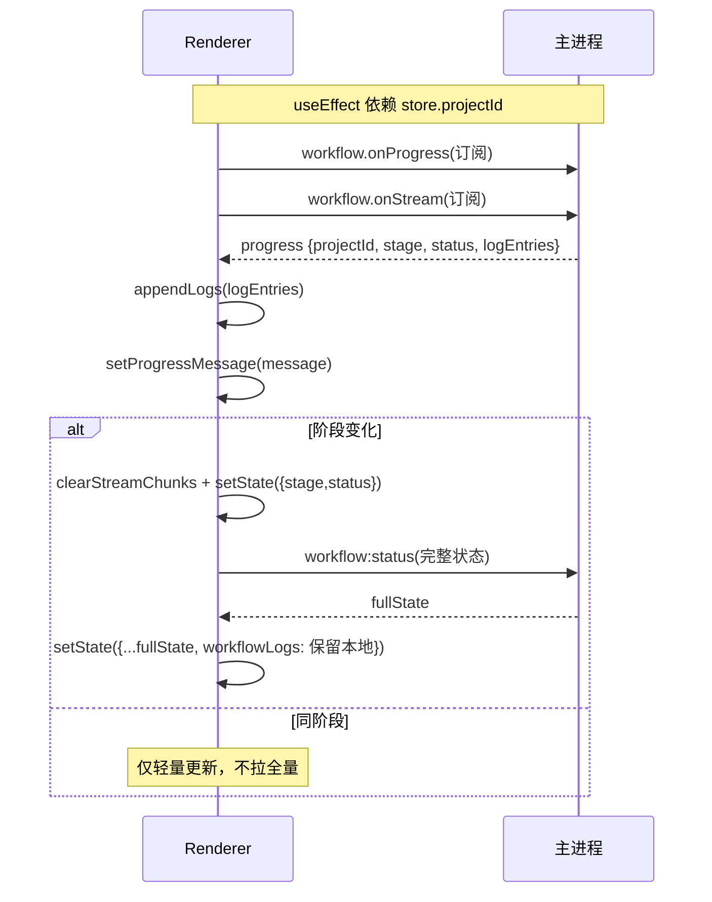

# 07 — 渲染进程（React UI 架构）

> 文件：`src/renderer/**`

## 7.1 组件树（4 Tab）

```mermaid
flowchart TD
    RT["main.tsx<br/>React.StrictMode"] --> APP["App.tsx<br/>useState&lt;TabId&gt;"]
    APP --> LAYOUT["AppLayout.tsx<br/>顶栏 Tab 导航 + 内容区"]
    LAYOUT --> OV["OverviewTab<br/>(features/overview/index.tsx)"]
    LAYOUT --> DG["DocGeneratorTab<br/>(features/doc-generator/index.tsx)"]
    LAYOUT --> LT["LocalizationTab<br/>(features/localization/index.tsx)"]
    LAYOUT --> ST["SettingsTab.tsx<br/>(features/settings/SettingsTab.tsx)"]

    OV --> WSTORE["workflow.store.ts"]
    OV --> LSTORE["localization.store.ts"]

    DG --> HOOK["useWorkflow.ts"]
    HOOK --> WSTORE
    HOOK --> WAPI["workflow.api.ts"]
    DG --> SN["StageNavigation.tsx<br/>(薄封装 StepNavigation)"]
    DG --> IP["InputPanel.tsx"]
    DG --> WP["WorkflowProgress.tsx"]
    DG --> ASV["AIStreamViewer.tsx"]
    DG --> DV["DraftViewer.tsx"]
    DG --> RP["ReviewPanel.tsx"]
    DG --> OP["OutputPanel.tsx"]
    DG --> LV["LogViewer.tsx"]
    DG --> MR["MarkdownRenderer.tsx"]
    DG --> CS["CollapsibleSection.tsx"]
    DG --> FPM["FilePreviewModal.tsx"]
    DG --> ADE["AiDraftEditor.tsx"]
    DG --> RCV["ReviewCommentsView.tsx"]
    DG --> XH["xml/XmlHighlight.tsx"]

    LT --> LHOOK["useLocalization.ts"]
    LHOOK --> LSTORE
    LHOOK --> LAPI["localization.api.ts"]
    LT --> SN2["StepNavigation.tsx"]
    LT --> RP
    LT --> XH
    LT --> LPM["LocalizePreviewModal.tsx"]
    LT --> MSTORE["mapping.store.ts"]

    ST --> AI["AiServicePanel.tsx"]
    ST --> PP["PromptsPanel.tsx"]
    ST --> MP["MappingPanel.tsx"]
    MP --> MIM["MappingImportModal.tsx"]
    ST --> SSTORE["settings.store.ts"]

    RP --> RCV
    ADE --> MR
    DV --> MR
    ASV --> MR
    SN --> STEPNAV["components/StepNavigation.tsx"]
```

## 7.2 视图路由（按状态渲染）

`DocGeneratorTab.renderContent()` 是纯条件渲染，无路由库：

| 状态 | 渲染 |
|---|---|
| `IDLE` | `InputPanel`（拖拽/选择文件、文档大纲设置、解析提示词设置、启动按钮） |
| `RUNNING` | 三段式布局：固定头部（进度 + 返回上一步 + ⏸ 暂停按钮）+ 唯一滚动区（文件列表/AI 流式/草稿/DITA 实时预览/分析结果）+ 固定底部提示条 |
| `PAUSED:USER` | 暂停提示 + 「继续执行」按钮（从检查点续跑） |
| `PAUSED:REVIEW_UPLOAD` | 完整文件提炼 Markdown + 提取文本 details + `AiArtifactChat`（Markdown）+ 返回/继续 |
| `PAUSED:REVIEW_ANALYZE` | 跨文件综合 Markdown + 逐文件分析 Markdown + 参考资料 + `AiArtifactChat`（Markdown） |
| `PAUSED:REVIEW_DRAFT` | `AiDraftEditor`（左侧编辑 + 右侧预览 + `AiArtifactChat` Markdown 对话） |
| `PAUSED:HUMAN_REVIEW` | `ReviewPanel`（Stage 5）+ Markdown `AiArtifactChat` |
| `PAUSED:REVIEW_DITA` | `ReviewPanel` DITA XML 高亮编辑 + XML `AiArtifactChat` |
| `PAUSED:HUMAN_DITA_REVIEW` | `ReviewPanel`(8c, editorMode="xml" 高亮编辑) + XML `AiArtifactChat` |
| `COMPLETED` | `OutputPanel`（另存/批量导出/ZIP/新建项目） |
| `FAILED` | 错误卡片 + 返回上一步重试 + 重新开始 |

`LocalizationTab` 是独立本地化工具，按 `LocalizationStatus` 渲染：`idle`（文件选择 + 语言 + 术语表条数提示）/ `running`（三段式流式）/ `paused:review_localize`（原文对照 + 译文 XML 可编辑 + `AiArtifactChat`）/ `paused:human_localize_review`（ReviewPanel + `AiArtifactChat`）/ `paused:human_confirm`（最终确认 + `AiArtifactChat`）/ `done`（结果列表 + 校验徽标 + 导出）/ `failed`。这些状态不属于 Gen Doc 主流程。

## 7.3 状态管理（Zustand）

### workflow.store.ts

`DocGenState` 全部字段 + 两个渲染侧扩展：

| 扩展字段 | 说明 |
|---|---|
| `streamChunks: {stage, content, timestamp}[]` | 流式 chunk 累积（含 thinking/content 类型），阶段切换时清空 |
| `currentProgressMessage: string` | 最新进度消息 |

动作：`setState(partial)`、`appendLogs`、`setTargetLanguage`、`reset`、`appendStreamChunk`、`clearStreamChunks`、`setProgressMessage`。

### localization.store.ts

`files / targetLanguage / status / stage / currentFile / results / streamChunks / logs / exportResult / localizedDrafts / originalDrafts / reviewComments / postEditComments` + 动作（selectFiles/start/continue/submitHumanLocalizeReview/submitHumanConfirm/goBack/exportTo/setTargetLanguage/reset）。

### mapping.store.ts

`mappings / stats / loaded / search` + 动作（load/add/update/remove/importParse/import）。

### settings.store.ts

`openaiApiKey / openaiBaseURL / openaiModel / ragSearchDirectory / promptCatalog / promptEdits / promptsLoaded` + 动作（`loadFromIpc`、`saveToIpc`、`loadPromptsFromIpc`、`setPromptPart`、`savePromptsToIpc`、`resetPrompts`）。

## 7.4 useWorkflow hook（事件订阅核心）

设计要点：progress 高频事件只做轻量更新；**阶段切换时**才拉取全量状态，并用「保留本地 logs」策略防止覆盖累积日志（race condition 防护）。所有回调打印 `[WF][Renderer][Hook]` 前缀追踪日志。`useLocalization` 同理订阅 `localize:progress` / `localize:stream`。

## 7.5 关键组件职责与实现要点

| 组件 | 职责与关键实现 |
|---|---|
| `StepNavigation.tsx` | **公共步骤导航**：纵向步骤列表（done/active/paused 状态），paused 检测大小写不敏感（兼容 `PAUSED:` 与 `paused:`），done 步骤可点击返回；doc-generator 的 `StageNavigation` 与 localization 均复用 |
| `ReviewPanel.tsx` | 人工审查核心。**接受/拒绝不写 manualEdits**；`effectiveContent = applyAcceptedSuggestions(manualEdits ?? drafts)` 纯派生；`replaceFirst` 三级匹配（精确 → CRLF 归一化带回映射 → 空白折叠模糊），失败计入 `failedAcceptIds` 黄色告警；多草稿 tab；`acceptAll` 仅接受含 suggestedText 的建议；`editorMode:'markdown'\|'xml'`（xml 用 HighlightedTextarea 高亮编辑）；`leftPanel:'comments'\|'original'`（original 模式显示原文对照）；可选内嵌 `AiArtifactChat` |
| `AIStreamViewer.tsx` | 流式输出展示：thinking（琥珀色可折叠，自动滚动）+ content（JSON 结构卡片/围栏块/串联 JSON 深度计数 + 原始文本切换）；8 个 AI 阶段有标签（含 `dita_ai_review`） |
| `MarkdownRenderer.tsx` | react-markdown + remark-gfm，20+ 元素暗色主题自定义渲染 |
| `ReviewCommentsView.tsx` | 评论卡片 + `normalizeComments` 降级重解析 + 类型图标/标签/颜色 |
| `AiDraftEditor.tsx` | 左右分栏编辑/预览 + Markdown `AiArtifactChat` + 撤销上次 AI 修改 |
| `AiArtifactChat.tsx` | 共享聊天式产出物编辑：连续指令、当前内容快照、应用结果与错误反馈 |
| `FilePreviewModal.tsx` | 按类型取内容：pdf/word/eml 用 `extractedText`，code/text 走 `file:read`，image 提示不支持 |
| `LogViewer.tsx` | 底部可折叠日志：自动滚动、时间/阶段/级别着色 |
| `InputPanel.tsx` | 拖拽（`File.path` 取原生路径）+ 文件选择对话框 + 去重 + **文档大纲设置**（textarea 每行一章 + 恢复默认）+ **解析提示词设置**（全局 + 每文件） |
| `OutputPanel.tsx` | 导出操作三件套（另存/批量导出/ZIP） |
| `xml/XmlHighlight.tsx` | DITA XML 语法高亮（`xmlTokenizer.ts` 逐字符保真 tokenizer + 只读高亮 `<pre>`） |
| `HighlightedTextarea.tsx` | 可编辑高亮 textarea（透明 textarea 叠彩色 div，滚动同步） |
| `LocalizePreviewModal.tsx` | 本地化结果预览（导出文件名 + 语言徽标 + 校验状态 + XmlHighlight） |
| `OverviewTab` | 功能入口卡片 + 最近项目（继续/打开/删除）+ 本地化记录（打开/删除），固定高度滚动容器 |
| `PromptsPanel.tsx` | 提示词按 group 分组可折叠卡片，完整 Markdown 工作定义编辑器、步骤徽标、保存/恢复默认与大窗口预览 |
| `MappingPanel.tsx` | 术语表三列表格 + 添加表单 + 搜索 + 分页（PAGE_SIZE=20）+ 统计 |
| `AiServicePanel.tsx` | AI 配置（API Key/Base URL/模型）+ RAG 目录 |

## 7.6 布局与样式

- Tailwind CSS 4：`@import "tailwindcss"` + `@tailwindcss/postcss`，暗色主题（`bg-gray-900` 基底，body 背景 `#111827`）；
- 经典 flex 布局：`h-screen overflow-hidden` + `flex-1 min-h-0 overflow-hidden` 保证内部滚动（多次踩坑后固定下来的模式）；
- RUNNING 类视图三段式约定：固定头部（`shrink-0`）+ 唯一滚动区（`flex-1 min-h-0 overflow-y-auto`）+ 固定底部提示条（`shrink-0 border-t`），消除多层滚动条与空白；
- 顶层 4 Tab（总览 / Doc Generator / 本地化 / Settings），Tab 元数据定义于 `navigation.ts`（单一来源）。

## 7.7 追踪日志约定

跨层统一 `console.info` 前缀：`[WF][UI]`（用户操作）、`[WF][Renderer]`（渲染层）、`[WF][IPC]`（IPC 层）、`[WF][Engine]`（引擎）、`[WF][Progress]`（事件），用于端到端排障。
## 7.8 术语库相关界面（P3 / P4）

| 组件 | 作用 |
|---|---|
| `MappingPanel.tsx` | 三列表格 + 「⛔ Do not use」列（P4-6）+ 服务端分页 + 使用范围开关 + P4 高级开关（分析注入 / 禁用检查 / 向量快照 / 写作工具） |
| `MappingImportModal.tsx` | 列识别/导入模式/冲突策略/计划明细；新增列以 `forbidden` 展示 |
| `GlossaryModelCard.tsx` | 语义模型状态、后端、向量进度 |
| `GlossaryHitsPanel.tsx` | `review_analyze` 人工确认命中条目 |
| `GlossaryUsageReportModal.tsx`（P4-4） | 导出后的术语使用报告（used / variant / missing / 禁用写法） |
| `MappingPanel` 维护区（P4-1/P4-2） | 备份列表恢复 + 导入批次撤销 |

「按章节拆分导出」入口在 `OutputPanel`（✂️），与术语使用报告（📊）并列。