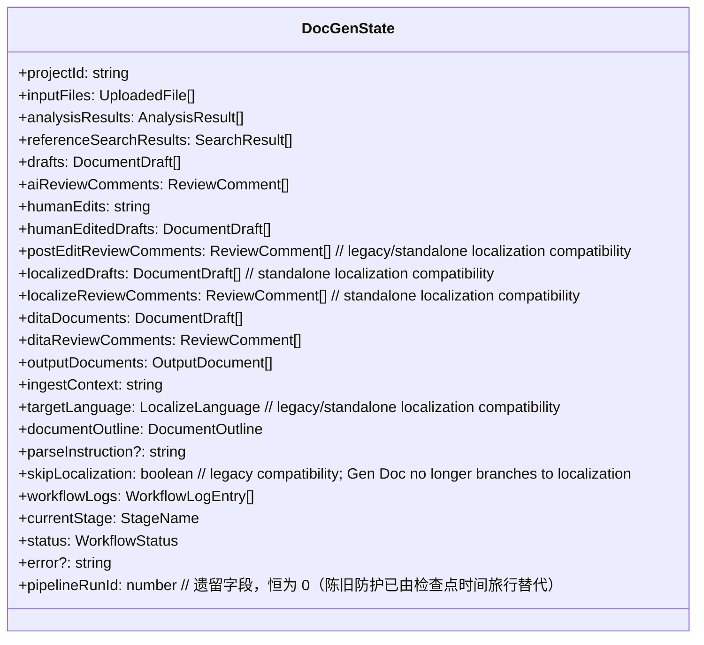
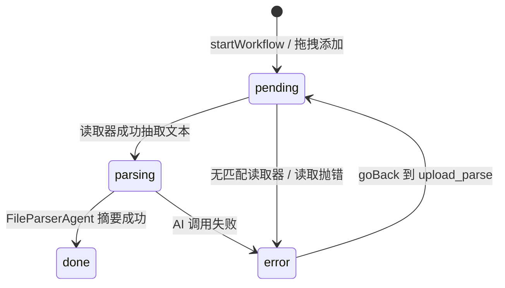

# 08 — 数据模型与状态流转

> 文件：`src/shared/types/document.types.ts`、`workflow.types.ts`、`ipc.types.ts`、`localization.types.ts`、`mapping.types.ts`、`prompts.types.ts`

## 8.1 共享类型全景

```mermaid
classDiagram
    class UploadedFile {
        +id: string
        +name: string
        +path: string
        +size: number
        +type: string
        +parseStatus: pending|parsing|done|error
        +parseError?: string
        +extractedText?: string
        +metadata?: FileMetadata
        +parseSummary?: string
        +parseInstruction?: string
    }
    class AnalysisResult {
        +fileId: string
        +fileName: string
        +summary: string
        +keyPoints: string[]
        +keywords: string[]
        +technicalTerms: string[]
    }
    class SearchResult {
        +filePath: string
        +fileName: string
        +relevanceScore: number
        +snippet: string
        +matchedKeywords: string[]
    }
    class DocumentDraft {
        +id: string
        +title: string
        +content: string  (Markdown / DITA XML)
        +createdAt: string
        +updatedAt: string
    }
    class ReviewComment {
        +id: string
        +draftId: string
        +type: suggestion|error|warning|info
        +section?: string
        +originalText?: string
        +suggestedText?: string
        +explanation: string
        +accepted?: boolean
    }
    class OutputDocument {
        +id: string
        +title: string
        +fileName: string
        +filePath: string
        +format: dita|docx|pdf
        +size: number
        +createdAt: string
    }
    class DocumentOutline {
        +sections: string[]
        +mergeIntoSingle: boolean
    }
    class Project {
        +id: string
        +name: string
        +status: WorkflowStatus
        +currentStage: StageName
        +createdAt: string
        +updatedAt: string
    }
    class WorkflowLogEntry {
        +id: string
        +timestamp: string
        +stage: StageName
        +level: info|warn|error|debug
        +message: string
        +detail?: string
    }
    class LocalizationFileResult {
        +sourcePath: string
        +fileName: string
        +exportFileName: string
        +targetLanguage: LocalizeLanguage
        +originalContent: string
        +aiContent: string
        +humanLocalizeContent?: string
        +content: string
        +status: done|failed
        +validated: boolean
        +repaired?: boolean
        +validationErrors?: string[]
        +reviewComments: ReviewComment[]
        +postEditComments: ReviewComment[]
    }
    class LocalizeRun {
        +id: string
        +status: LocalizationStatus
        +stage: LocalizationStage
        +targetLanguage: LocalizeLanguage
        +createdAt: string
        +updatedAt: string
        +fileCount: number
    }
    class TranslationMapping {
        +id: string
        +en: string
        +zhCN: string
        +zhTW: string
        +createdAt: string
        +updatedAt: string
    }
```

## 8.2 DocGenState —— 系统核心状态

### 字段 → 产出阶段 → 消费阶段

| 字段 | 产出 | 消费 |
|---|---|---|
| `inputFiles` | startWorkflow 初始化；upload_parse 填充 | ingest/analyze/UI |
| `analysisResults` / `referenceSearchResults` | analyze | draft/UI |
| `ingestContext` | ingest（完整 Markdown 提炼 + 原文基线汇总） | analyze |
| `drafts` | draft | ai_review/human_review/dita_build/UI |
| `aiReviewComments` | ai_review | human_review/UI |
| `humanEdits` | human_review 提交（兼容旧版单字符串） | downstream effective drafts（旧版 post-edit/confirm 字段仍兼容读取） |
| `humanEditedDrafts` | human_review 提交（按草稿粒度） | 下游 effective drafts（优先于 humanEdits） |
| `postEditReviewComments` | 旧版/独立本地化兼容字段 | 兼容读取/UI |
| `targetLanguage` / `skipLocalization` | 旧版状态兼容字段 | 不再驱动 Gen Doc 分支；独立本地化使用自己的 run state |
| `documentOutline` | startWorkflow（可选） | draft（WriterAgent 章节结构） |
| `parseInstruction` | startWorkflow（可选） | upload_parse（FileParserAgent + map-reduce） |
| `localizedDrafts` | 独立本地化 localize | 独立本地化 review/localize export |
| `localizeReviewComments` | 独立本地化 review | 独立本地化 UI |
| `ditaDocuments` | dita_build | review_dita/dita_ai_review/human_dita_review/export |
| `ditaReviewComments` | dita_ai_review | human_dita_review/UI |
| `outputDocuments` | export | OutputPanel/文件导出 IPC |

### 回退机制（检查点时间旅行）

> 2026-08-22 起，`getFieldsToResetAfterStage` 重置矩阵已被 **LangGraph 检查点时间旅行**替代：`goBackToStage` 从 `getStateHistory` 找到 `next` 含目标阶段的检查点并重放，目标之后阶段产生的字段自动回到该点状态。`pipelineRunId` 陈旧防护已移除（字段保留但恒为 0）。

## 8.3 上传文件的生命周期

## 8.4 持久化与恢复

- 每个阶段边界（进入/完成/暂停/失败）→ `projects.state_json` 全量镜像 + `langgraph.db` 检查点；
- 应用重启后 `getState` 内存未命中 → `loadMirror` 从 DB 恢复并回填新字段（`skipLocalization=true`、`humanEditedDrafts=[]`、`ingestContext=''`、`documentOutline`）；
- 渲染进程状态是主进程状态的投影：progress 事件驱动轻量更新，阶段切换时拉全量；
- 独立本地化运行持久化在 `localization_runs` 表（`LocalizeRunState` 含 results），总览页可 `loadRun` 恢复。

## 8.5 IPC 载荷类型速查

| 类型 | 关键字段 |
|---|---|
| `WorkflowStartPayload` | projectId, filePaths, documentOutline?, parseInstruction?, fileInstructions? |
| `WorkflowProgressEvent` | projectId, stage, status, message?, data?, logEntries? |
| `WorkflowStreamEvent` | projectId, stage, chunk{type:'thinking'\|'content', text} |
| `WorkflowGoBackPayload` | projectId, targetStage |
| `HumanReviewSubmitPayload` | projectId, editedDrafts, acceptedCommentIds |
| `HumanConfirmSubmitPayload` | projectId, approved, targetLanguage?, skipLocalization?, editedDrafts?, acceptedCommentIds? |
| `HumanLocalizeSubmitPayload` | projectId, editedLocalizedDrafts, acceptedCommentIds |
| `HumanDitaSubmitPayload` | projectId, editedDitaDocuments, acceptedCommentIds |
| `ReviewContinuePayload` | projectId, stage, editedDrafts? |
| `AiEditDraftPayload` | projectId, currentContent, instruction |
| `LocalizeStartPayload` | filePaths, targetLanguage |
| `LocalizeContinuePayload` | stage, editedDrafts? |
| `LocalizeHumanLocalizeSubmitPayload` / `LocalizeHumanConfirmSubmitPayload` | editedDrafts, acceptedCommentIds |
| `LocalizeGoBackPayload` | stage |
| `MappingListPayload` | search? |
| `MappingAddPayload` / `MappingUpdatePayload` | en, zhCN, zhTW（update 含 id） |
| `MappingImportPayload` | rows: MappingImportRow[] |
| `PromptsGetResult` | catalog, overrides |
| `PromptsSetPayload` | overrides |
