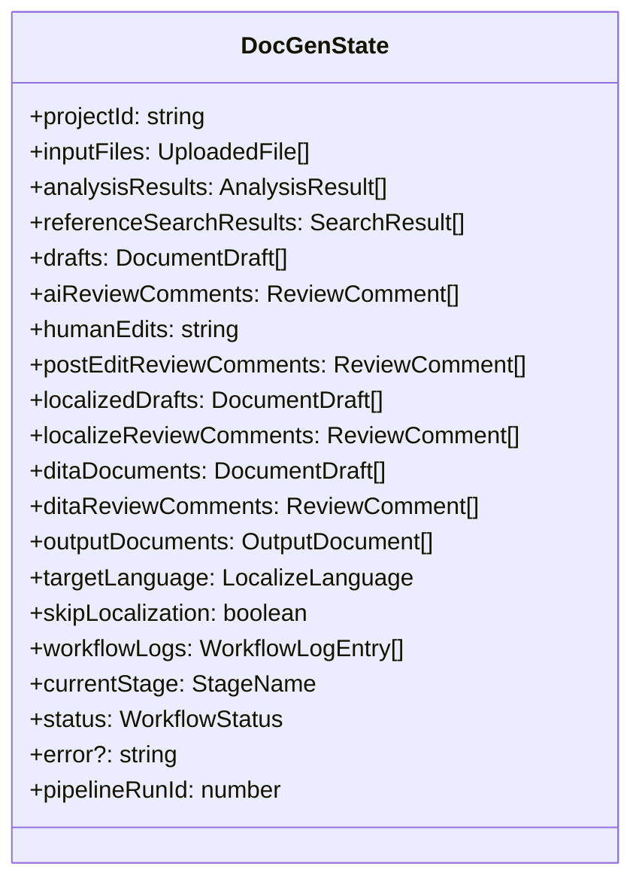
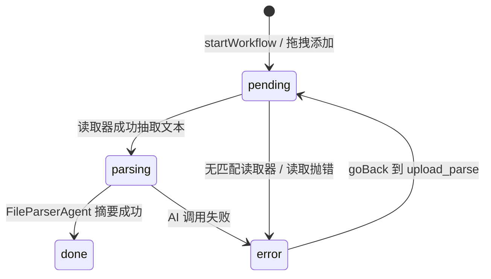

# 08 — 数据模型与状态流转

> 文件：`src/shared/types/document.types.ts`、`workflow.types.ts`、`ipc.types.ts`

## 8.1 共享类型全景

```mermaid
classDiagram
    class UploadedFile {
        +id: string
        +name: string
        +path: string
        +size: number
        +type: string
        +parseStatus: pending|parsing|done|error
        +parseError?: string
        +extractedText?: string
        +metadata?: FileMetadata
        +parseSummary?: string
    }
    class AnalysisResult {
        +fileId: string
        +fileName: string
        +summary: string
        +keyPoints: string[]
        +keywords: string[]
        +technicalTerms: string[]
    }
    class SearchResult {
        +filePath: string
        +fileName: string
        +relevanceScore: number
        +snippet: string
        +matchedKeywords: string[]
    }
    class DocumentDraft {
        +id: string
        +title: string
        +content: string  (Markdown / DITA XML)
        +createdAt: string
        +updatedAt: string
    }
    class ReviewComment {
        +id: string
        +draftId: string
        +type: suggestion|error|warning|info
        +section?: string
        +originalText?: string
        +suggestedText?: string
        +explanation: string
        +accepted?: boolean
    }
    class OutputDocument {
        +id: string
        +title: string
        +fileName: string
        +filePath: string
        +format: dita|docx|pdf
        +size: number
        +createdAt: string
    }
    class Project {
        +id: string
        +name: string
        +status: WorkflowStatus
        +currentStage: StageName
        +createdAt: string
        +updatedAt: string
    }
    class WorkflowLogEntry {
        +id: string
        +timestamp: string
        +stage: StageName
        +level: info|warn|error|debug
        +message: string
        +detail?: string
    }
```

## 8.2 DocGenState —— 系统核心状态

### 字段 → 产出阶段 → 消费阶段

| 字段 | 产出 | 消费 |
|---|---|---|
| `inputFiles` | startWorkflow 初始化；upload_parse 填充 | ingest/analyze/UI |
| `analysisResults` / `referenceSearchResults` | analyze | draft/UI |
| `drafts` | draft | ai_review/human_review/localize/dita_build/UI |
| `aiReviewComments` | ai_review | human_review/UI |
| `humanEdits` | human_review 提交 | post_edit_review/human_confirm/downstream effective drafts |
| `postEditReviewComments` | post_edit_review | human_confirm/UI |
| `targetLanguage` / `skipLocalization` | human_confirm 提交 | localize/引擎跳转逻辑 |
| `localizedDrafts` | localize | review_localize/localize_ai_review/human_localize_review/dita_build |
| `localizeReviewComments` | localize_ai_review | human_localize_review/UI |
| `ditaDocuments` | dita_build | review_dita/dita_ai_review/human_dita_review/export |
| `ditaReviewComments` | dita_ai_review | human_dita_review/UI |
| `outputDocuments` | export | OutputPanel/文件导出 IPC |
| `pipelineRunId` | startWorkflow(=1)、goBack(+1) | isActiveRun 陈旧防护 |

### 回退重置矩阵（`getFieldsToResetAfterStage`）

| 回退到 | 被重置字段 |
|---|---|
| `upload_parse` | inputFiles(重置为 pending 清文本)、analysisResults、referenceSearchResults、drafts、aiReviewComments、postEditReviewComments、localizedDrafts、localizeReviewComments、ditaDocuments、ditaReviewComments、outputDocuments |
| `analyze` | analysisResults、referenceSearchResults、drafts、aiReviewComments、postEditReviewComments、localizedDrafts、localizeReviewComments、ditaDocuments、ditaReviewComments、outputDocuments |
| `draft` | drafts 及其后全部 |
| `ai_review` | aiReviewComments 及其后全部 |
| `human_review` | postEditReviewComments、localizedDrafts、localizeReviewComments、ditaDocuments、ditaReviewComments、outputDocuments（且 humanEdits 清空） |
| `post_edit_review` | postEditReviewComments 及其后 |
| `localize` | localizedDrafts、localizeReviewComments、ditaDocuments、ditaReviewComments、outputDocuments |
| `localize_ai_review` | localizeReviewComments、ditaDocuments、ditaReviewComments、outputDocuments |
| `dita_build` | ditaDocuments、ditaReviewComments、outputDocuments |
| `dita_ai_review` | ditaReviewComments、outputDocuments |
| `export` | outputDocuments |

## 8.3 上传文件的生命周期

## 8.4 持久化与恢复

- 每个阶段边界（进入/完成/暂停/失败）→ `state_json` 全量快照；
- 应用重启后 `getState` 内存未命中 → `loadState` 从 DB 恢复并回填新字段；
- 渲染进程状态是主进程状态的投影：progress 事件驱动轻量更新，阶段切换时拉全量。

## 8.5 IPC 载荷类型速查

| 类型 | 关键字段 |
|---|---|
| `WorkflowStartPayload` | projectId, filePaths |
| `WorkflowProgressEvent` | projectId, stage, status, message?, data?, logEntries? |
| `WorkflowStreamEvent` | projectId, stage, chunk |
| `WorkflowGoBackPayload` | projectId, targetStage |
| `HumanReviewSubmitPayload` | projectId, editedDrafts, acceptedCommentIds |
| `HumanConfirmSubmitPayload` | projectId, approved, targetLanguage?, skipLocalization?, editedDrafts?, acceptedCommentIds? |
| `HumanLocalizeSubmitPayload` | projectId, editedLocalizedDrafts, acceptedCommentIds |
| `HumanDitaSubmitPayload` | projectId, editedDitaDocuments, acceptedCommentIds |
| `ReviewContinuePayload` | projectId, stage, editedDrafts? |
| `AiEditDraftPayload` | projectId, currentContent, instruction |
