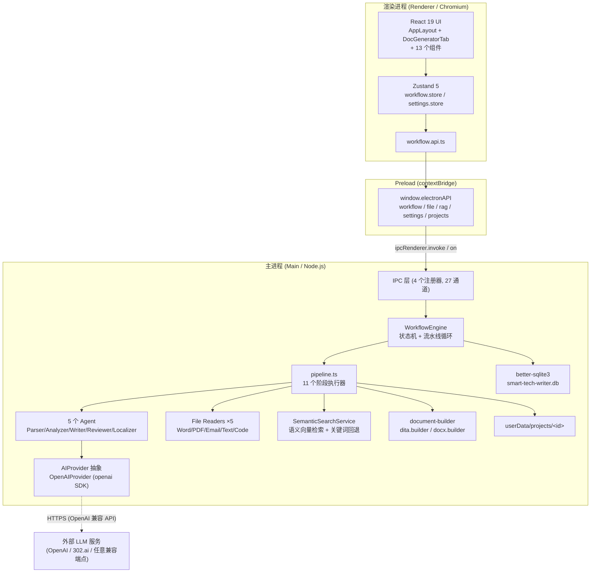

# Smart Tech Writer — 系统架构文档

> 基于源码 `d:\Projects\personal-project\smart-tech-writter` 的深度实现分析（分析日期：2026-08-22）。
> 本文档描述**当前代码的真实实现**，并在第 10 篇中标注已知问题与演进建议。

## 一句话概括

**Smart Tech Writer 是一款基于 Electron 的桌面端 AI 技术文档生成器**：用户输入源文件（Word / PDF / 邮件 / 文本 / 代码），系统通过 20 阶段人机协作流水线（AI 解析 → AI 分析 → AI 撰写 → 多轮 AI/人工审查 → 本地化 → DITA 生成 → 导出），最终产出 **DITA 1.3 Concept Topic** 结构化技术文档（面向工业自动化领域）。

## 文档地图

| 编号 | 文档 | 内容 |
|---|---|---|
| [01](01-overview.md) | 系统概述与设计目标 | 产品定位、核心能力、端到端用户旅程、关键设计决策 |
| [02](02-architecture.md) | 总体架构 | Electron 三进程模型、运行时结构、目录结构、构建与打包 |
| [03](03-workflow-engine.md) | 工作流引擎 | 20 阶段状态机、流水线执行器、暂停/恢复、回退、并发防护 |
| [04](04-ai-layer.md) | AI 层 | Provider 抽象、OpenAI 适配、5 个 Agent、提示词与流式输出 |
| [05](05-file-processing.md) | 文件处理与文档构建 | 5 种文件读取器、RAG 本地搜索、DITA/DOCX 构建器 |
| [06](06-storage-ipc.md) | 存储、IPC 与 Preload | SQLite 持久化、项目文件存储、27 个 IPC 通道、contextBridge |
| [07](07-renderer.md) | 渲染进程（UI） | React 组件树、Zustand 状态管理、useWorkflow hook、13 个组件 |
| [08](08-data-models.md) | 数据模型与状态流转 | 共享类型系统、DocGenState 全字段、数据生命周期 |
| [09](09-dependencies.md) | 技术栈与依赖库详解 | 35+ 依赖库的版本、用途与使用位置（含未使用依赖） |
| [10](10-issues-and-roadmap.md) | 已知问题与演进路线 | 12 项已知问题/风险 + 分阶段改进建议 |

## 全景架构速览

## 技术栈速览

| 层 | 技术 | 版本 |
|---|---|---|
| 桌面框架 | Electron + Electron Forge (Vite 插件) | 42.4.1 / 7.11.2 |
| 构建 | Vite | 5.4.21 |
| 前端 | React / TypeScript | 19.2 / 5.9 |
| 样式 | Tailwind CSS 4 | 4.3.1 |
| 状态 | Zustand | 5.0.14 |
| AI | openai SDK（自研 Provider 抽象层） | 6.44.0 |
| 存储 | better-sqlite3 | 12.11.1 |
| 文档解析 | mammoth / pdf-parse / mailparser | — |
| 文档生成 | 自研 DITA builder / docx | 9.7.1 |
| 日志 | electron-log | 5.4.4 |

## 快速事实

- **总代码量**：约 4,300 行 TypeScript/TSX（`src/` 下 48 个源文件）
- **工作流**：20 个阶段，其中 9 个为人工暂停点（PAUSED:*）
- **AI 调用**：8 个 AI 阶段全部支持流式输出
- **输出**：目前唯一落地格式为 `.dita`（DOCX 构建器存在但未接入流水线）
- **RAG**：当前为文件系统关键词搜索（简化实现，无向量索引）
- **持久化**：`projects.state_json` 整状态 JSON 快照 + 输出文件落盘
