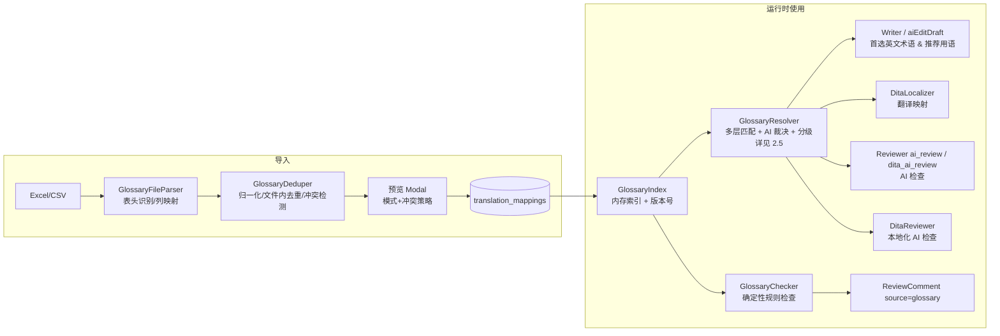
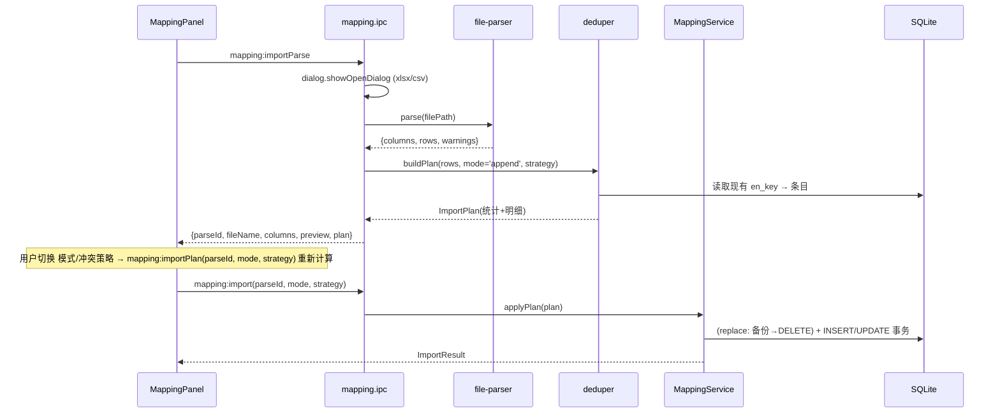
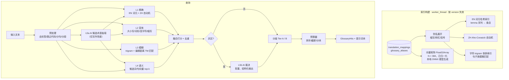
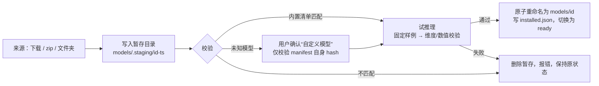
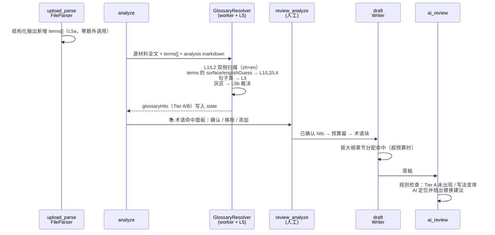
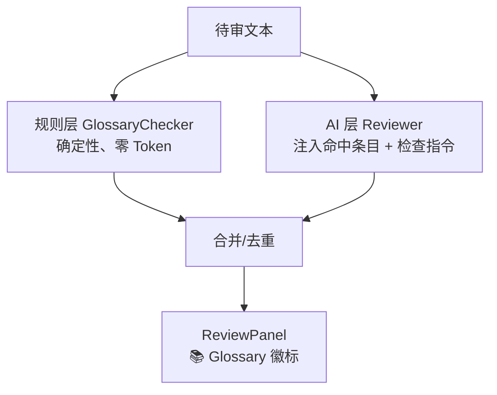
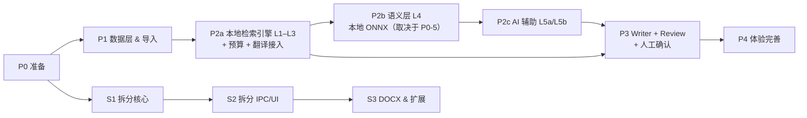

# 设计与实现方案：英中术语/用语映射库 & 按章节拆分导出

> 版本：v1.6 · 日期：2026-11-08 · 适用代码基线：当前 `main` 分支
> v1.1 变更：针对千–万级映射重写 2.5（分层匹配引擎：精确/变体/模糊/语义/AI 抽取与裁决、分级注入、上下文预算、worker 索引与加载优化、评测）；2.6–2.8 改为基于引擎的分块处理；实施计划拆出 P2a/P2b/P2c。
> v1.2 变更：L4 语义层改为**完全本地**（ONNX 多语种小模型 + SQLite BLOB + 内存暴力检索，不再依赖远程 embedding API），并给出成本评估与 go/no-go 标准；取消辅助模型；确认术语命中人工确认、句子类条目按推荐处理（Q10–Q13 已定）。
> v1.3 变更：新增 2.5.6.6（模型在线下载 + 离线安装包/文件夹安装、导出离线包、原子安装、状态机）与 2.5.6.7（下载/安装/加载/运行失败时的向后兼容与降级、熔断）；新增 2.11.3 模型卡片 UI；同步 IPC、配置、测试、计划、风险（Q14/Q15）。
> v1.4 变更：确定提供**兼容模式**（onnxruntime-web WASM 后端），新增 2.5.6.8；运行时后端可选「自动 / 原生 / 兼容模式」（Q15 已定）。
> v1.5 变更：P0 准备阶段已执行完成（7.1 记录）：P0-1 样例文件、P0-3 vitest、P0-4 评测集与基线、P0-5 本地 embedding spike 均交付；spike 结论 **GO**，按实测修订向量一致性门槛（Q16）与兼容模式内存预算（Q17），报告见 `p0-5-embedding-spike-report.md`。
> v1.6 变更：P4 体验完善已执行完成（7.4 记录）：备份列表/恢复、导入批次撤销、“Do not use”禁用写法（导入 + R7 规则）、analyze 阶段术语注入、术语使用报告、向量索引快照与可选 HNSW、Writer 工具调用查询；架构文档 04–08 同步更新。
> 范围：功能一「英中 mapping 列表导入与 AI 全链路参考」；功能二「最终导出按 Section Title 拆分子文件」

---

## 目录

- [0. 摘要](#0-摘要)
- [1. 现状分析](#1-现状分析)
- [2. 功能一：英中术语/用语映射库（Glossary）](#2-功能一英中术语用语映射库glossary)
  - [2.1 需求拆解](#21-需求拆解)
  - [2.2 总体架构](#22-总体架构)
  - [2.3 数据模型与迁移](#23-数据模型与迁移)
  - [2.4 文件导入：解析、列识别、去重、替换/追加](#24-文件导入解析列识别去重替换追加)
  - [2.5 大规模映射匹配引擎（千级 → 万级）](#25-大规模映射匹配引擎千级--万级)
  - [2.6 AI 接入点 ①：英文文档生成（Writer）](#26-ai-接入点-英文文档生成writer)
  - [2.7 AI 接入点 ②：国际化翻译（Localizer）](#27-ai-接入点-国际化翻译localizer)
  - [2.8 AI 接入点 ③：Review 检查（规则 + AI 双层）](#28-ai-接入点-review-检查规则--ai-双层)
  - [2.9 配置项](#29-配置项)
  - [2.10 IPC / Preload / 类型变更](#210-ipc--preload--类型变更)
  - [2.11 UI 设计](#211-ui-设计)
- [3. 功能二：按 Section Title 拆分导出](#3-功能二按-section-title-拆分导出)
  - [3.1 需求拆解与约定](#31-需求拆解与约定)
  - [3.2 拆分源与拆分算法](#32-拆分源与拆分算法)
  - [3.3 公共 Header 定义](#33-公共-header-定义)
  - [3.4 文件命名规则](#34-文件命名规则)
  - [3.5 DOCX 拆分](#35-docx-拆分)
  - [3.6 IPC 与安全](#36-ipc-与安全)
  - [3.7 UI 设计](#37-ui-设计)
- [4. 测试方案](#4-测试方案)
- [5. 分阶段实施计划](#5-分阶段实施计划)
- [6. 风险与对策](#6-风险与对策)
- [7. 待确认问题](#7-待确认问题)
- [附录 A：文件变更清单](#附录-a文件变更清单)
- [附录 B：提示词片段草案](#附录-b提示词片段草案)

---

## 0. 摘要

| 功能 | 核心交付 | 主要改动面 |
|---|---|---|
| 功能一：Glossary | 支持导入 `No. / en-US / zh-CN` 三列 Excel；替换/追加两种模式；自动去重与冲突报告；在 **文档撰写（英文用词/用语）**、**翻译（映射关系）**、**Review（规则检查 + AI 检查）** 三处作为参考 | DB 迁移、`MappingService` 重构、新增 `GlossaryResolver`（多层匹配引擎，worker 索引）/ `GlossaryChecker`、Writer / Reviewer / DitaLocalizer / DitaReviewer 提示词注入、设置页导入 UI |
| 功能二：按章节拆分导出 | 在导出完成页对最终 DITA 按顶层 `<section>` 拆分，每个子文件共享相同 header，命名为 `序号_SectionTitle.dita`（可选 `.docx`、`.ditamap`） | 新增 `section-splitter.ts`、`file:splitExport*` IPC、`OutputPanel` 拆分导出对话框 |

关键设计决策：

1. **复用并升级现有 `translation_mappings` 体系**，而不是另建一套表——当前已有映射库（en / zh_cn / zh_tw），只是它只在独立本地化里用、且导入格式与新文件不兼容。
2. **相关性筛选代替全量注入**：现在 `getMappingContext` 最多把 500 条全量塞进提示词，随着导入表变大会浪费上下文且干扰模型。改为“只注入在当前文本中命中的条目”。命中由本地多层检索（精确 → 变体 → 模糊 → 语义）与 AI 候选抽取、灰区裁决共同保证召回；分级注入、上下文预算与分块处理控制体量（见 2.5）。
3. **Review 采用“确定性规则 + AI”双层**：规则层保证“表里有、文中没按表用”的问题一定被报出；AI 层负责给出可一键接受的 `originalText → suggestedText` 修改建议。
4. **拆分基于最终 DITA XML**（人工审阅后的版本），而非原始 Markdown 草稿，保证人工修改不丢失。

---

## 1. 现状分析

### 1.1 已有映射能力

| 位置 | 现状 |
|---|---|
| `src/main/modules/storage/database.ts` | `translation_mappings(id, en, zh_cn, zh_tw, created_at, updated_at)`，三列均 `NOT NULL`，`en COLLATE NOCASE` 唯一索引；启动时 `seedDefaultMappings` 种入约 400 条默认术语（`id = default-xxx`） |
| `src/main/modules/localization/mapping.service.ts` | CRUD、`importMappings`（仅追加，按 en 去重）、`getStats`、`getMappingContext(targetLang)`（最多 500 条全量拼成 glossary 块） |
| `src/main/ipc/mapping.ipc.ts` | `mapping:importParse` 用 exceljs/CSV 解析，**按位置**取第 1/2/3 列为 en/zhCN/zhTW；`HEADER_RE` 只识别 `source/english/en/...` 等表头 |
| 使用方 | 仅独立本地化：`LocalizationService` → `DitaLocalizerAgent.translateDita` / `DitaReviewerAgent.review` |
| UI | 设置页「翻译映射」tab：`MappingPanel`（三列表格、分页、搜索）+ `MappingImportModal`（预览前 10 行） |

### 1.2 与新需求的差距

| # | 差距 | 影响 |
|---|---|---|
| G1 | 新文件列为 `No. / en-US / zh-CN`，现解析器按位置读取 → `No.` 被当成英文、`en-US` 当成简体、`zh-CN` 当成繁体；且表头 `No.` 不匹配 `HEADER_RE`，表头行也会被导入 | **新格式完全无法正确导入** |
| G2 | `zh_tw NOT NULL` 且 `addMapping/importMappings` 要求三列非空 | 新文件没有繁体列，所有行会被判为“空单元格”跳过 |
| G3 | 只有追加模式 | 不满足“替换/追加” |
| G4 | 去重只按 en 精确（大小写不敏感）匹配，同 en 不同译文直接跳过且无冲突提示 | 不满足“自动去重”的可解释性；用户无法选择覆盖 |
| G5 | 映射只用于独立本地化 | 不满足“生成英文文档时参考用词/用语”和“Review 时检查” |
| G6 | 全量注入 ≤500 条，与文本无关的条目也进入提示词 | 表规模变大后上下文浪费、模型被无关术语干扰、500 条后的条目永远用不上 |
| G7 | 不区分“词/术语”与“句子/用语” | 写作时句子类条目应作为“推荐表述”，与术语的约束强度不同 |

### 1.3 已有导出能力

| 位置 | 现状 |
|---|---|
| `pipeline.ts runExportStage` | 对 `state.ditaDocuments`（人工审阅后的 DITA XML）每篇写 `.dita` + `.docx` 到 `userData/projects/<projectId>/` |
| `dita.builder.ts` | Markdown → DITA concept：H1 → topic title；H2（及正文内 H1、无 section 时的 H3）→ 顶层 `<section><title>`；`validateDitaXml` / `repairDitaXml` 可复用 |
| `file.ipc.ts` | `file:saveDita`（单文件另存）、`file:exportAll`（复制到目录）、`file:downloadZip` |
| `OutputPanel.tsx` | 列表 + 另存/打开文件夹/全部导出/ZIP |

> ⚠️ 现存问题：`runExportStage` 调用 `buildDocx(doc)` 时传入的是 **DITA 文档**（`content` 为 XML），而 `buildDocx` 按 Markdown 解析 → 生成的 DOCX 内容是逐行 XML 文本。拆分导出 DOCX 前需要先解决（见 [3.5](#35-docx-拆分)）。

---

## 2. 功能一：英中术语/用语映射库（Glossary）

### 2.1 需求拆解

| 编号 | 需求 | 验收标准 |
|---|---|---|
| F1-1 | 导入 `No. / en-US / zh-CN` 格式 Excel（兼容 CSV 与旧三列格式） | 表头自动识别；`No.` 不被当作内容；无繁体列可正常导入 |
| F1-2 | 导入模式：**追加** / **替换** | 追加：新增+按策略处理冲突；替换：事务内清空后导入，失败自动回滚，替换前自动备份 |
| F1-3 | 自动去重 | 文件内重复、与库内重复均自动处理并在预览/结果中给出统计与明细 |
| F1-4 | 生成英文文档时参考英文列的词/句 | Writer 提示词中注入“命中的首选术语/推荐用语”；生成结果用词与表一致 |
| F1-5 | 翻译时参考映射关系 | en→zh-CN 用 en→zh-CN，zh-CN→en 反向；只注入命中条目 |
| F1-6 | Review 时按列表检查 | Draft AI Review、DITA AI Review、本地化 AI Review 均产出“术语一致性”问题；确定性规则不漏报 |

### 2.2 总体架构



模块划分（新增目录 `src/main/modules/glossary/`，现 `localization/mapping.service.ts` 迁入或保留为 facade）：

| 文件 | 职责 |
|---|---|
| `glossary/normalize.ts` | 文本归一化（NFKC、空白折叠、大小写、全半角标点、引号统一） |
| `glossary/file-parser.ts` | 从 `mapping.ipc.ts` 抽出 xlsx/csv 解析，新增表头识别与列映射 |
| `glossary/deduper.ts` | 文件内去重 + 与库对比生成 `ImportPlan` |
| `glossary/aliases.ts` | 别名展开（缩写/括号/斜杠/连字符变体）、specificity 计算 |
| `glossary/lemmatize.ts` | 英文轻量词形还原与词元化 |
| `glossary/worker/glossary.worker.ts` | worker_thread：索引构建、L1–L4 扫描、向量检索 |
| `glossary/worker/client.ts` | 主进程侧 `GlossaryWorkerClient`（消息 RPC、预热、版本失效） |
| `glossary/index/en-index.ts`、`zh-automaton.ts`、`trigram-index.ts`、`vector-index.ts` | L1/L2/L3/L4 索引实现；`VectorIndex` 接口可替换 HNSW |
| `glossary/embedding-job.ts` | 后台增量向量计算（分批、可暂停、断点续传） |
| `glossary/embedding/local-embedder.ts`、`model-manager.ts` | 本地 ONNX 推理（worker 内）、模型下载/校验/导入 |
| `glossary/resolver.ts` | 编排：多层匹配 → 融合打分 → L5b 裁决 → 分级 → `GlossaryHit[]`；对外 `resolveForWriting / resolveForTranslation / resolveForReview` |
| `glossary/budget.ts` | token 估算、预算分配、分块作用域、紧凑格式化 |
| `agents/term-extractor.agent.ts` | L5a 兜底候选术语抽取（FileParser 未产出 terms 时） |
| `agents/glossary-adjudicator.agent.ts` | L5b 灰区裁决（结构化输出） |
| `glossary/checker.ts` | 确定性一致性检查，产出 `ReviewComment[]` |
| `glossary/prompt-blocks.ts` | 将命中条目格式化为 Writer / Translate / Review 三类提示词块 |
| `localization/mapping.service.ts` | 保留 CRUD；`importMappings` 改为执行 `ImportPlan`；`getMappingContext` 改为调用 resolver |

### 2.3 数据模型与迁移

#### 2.3.1 表结构（新）

```sql
CREATE TABLE translation_mappings (
  id          TEXT PRIMARY KEY,
  seq_no      INTEGER,                 -- 源文件 "No."，仅用于展示/排序，可空
  en          TEXT NOT NULL,           -- en-US
  zh_cn       TEXT NOT NULL DEFAULT '',-- zh-CN（允许空：仅英文用语条目）
  zh_tw       TEXT NOT NULL DEFAULT '',-- zh-TW（新格式无此列，允许空）
  en_key      TEXT NOT NULL,           -- 归一化 en，去重键
  kind        TEXT NOT NULL DEFAULT 'term',  -- 'term' | 'phrase'
  origin      TEXT NOT NULL DEFAULT 'manual',-- 'default' | 'import' | 'manual'
  batch_id    TEXT,                    -- 导入批次，便于撤销/追溯
  created_at  TEXT NOT NULL,
  updated_at  TEXT NOT NULL
);
CREATE UNIQUE INDEX idx_translation_mappings_en_key ON translation_mappings(en_key);
CREATE INDEX idx_translation_mappings_zh_cn ON translation_mappings(zh_cn);

CREATE TABLE glossary_import_batches (
  id          TEXT PRIMARY KEY,
  file_name   TEXT NOT NULL,
  mode        TEXT NOT NULL,           -- 'append' | 'replace'
  stats_json  TEXT NOT NULL,           -- ImportResult 摘要
  backup_path TEXT,                    -- 替换模式备份文件
  created_at  TEXT NOT NULL
);
```

- `kind` 规则：归一化后英文 **≤ 6 个词且不以句末标点结尾** → `term`，否则 `phrase`（句子/用语）。导入时自动判定，UI 可手动改。
- `en_key` = `normalizeEn(en)`（见 2.4.3），替代原 `en COLLATE NOCASE` 唯一索引，使“`Duty  Cycle`”与“`duty cycle`”被识别为同一条。

#### 2.3.2 迁移步骤（`runMigrations` 内，幂等）

SQLite 无法 `ALTER COLUMN` 去掉 `NOT NULL`，采用重建表：

1. 检测 `PRAGMA table_info(translation_mappings)` 是否已有 `en_key` 列，有则跳过。
2. `BEGIN` → `CREATE TABLE translation_mappings_new (...)` → `INSERT INTO ... SELECT id, NULL, en, zh_cn, zh_tw, <en_key 由 JS 计算>, <kind 由 JS 计算>, CASE WHEN id LIKE 'default-%' THEN 'default' ELSE 'manual' END, NULL, created_at, updated_at`（`en_key`/`kind` 需 JS 逐行计算，故用 prepared statement 循环插入）→ `DROP` 旧表 → `RENAME` → 建索引 → `COMMIT`。
3. 若旧数据归一化后出现 `en_key` 冲突，保留 `updated_at` 最新的一条，其余写入日志。
4. `seedDefaultMappings` 改为：**仅当 `settings['glossary.defaultsSeeded']` 不存在时种入**，并写入该标记。否则“替换模式”清空后，下次启动默认术语会被重新种回，违背“替换”语义。

### 2.4 文件导入：解析、列识别、去重、替换/追加

#### 2.4.1 导入流程



- **parseId**：解析结果缓存在主进程（`Map<parseId, ParsedFile>`，10 分钟过期/导入后删除），renderer 只回传 `parseId` + 选项，不再回传全部 rows。这样既避免大文件反复跨进程传输，也避免 renderer 篡改导入数据。

#### 2.4.2 表头识别与列映射

在前 5 行内寻找表头行：某行中至少 2 个单元格命中下表别名即视为表头行。

| 逻辑列 | 别名（大小写/空白/标点不敏感） |
|---|---|
| `seq` | `no`、`no.`、`#`、`序号`、`编号`、`index`、`id` |
| `en` | `en-us`、`en_us`、`en`、`english`、`英文`、`source`、`term`、`原文` |
| `zhCN` | `zh-cn`、`zh_cn`、`zh-hans`、`简体中文`、`中文`、`chinese`、`简体` |
| `zhTW` | `zh-tw`、`zh_tw`、`zh-hant`、`繁體中文`、`繁体中文`、`繁體` |

- 找到表头 → 按表头建立 `columnIndex` 映射，表头行及之前的行全部跳过。
- 未找到表头 → 位置回退：若第 1 列在 ≥80% 的非空行中为正整数 → `seq/en/zhCN`（新格式无表头）；否则 → `en/zhCN/zhTW`（旧格式）。
- 缺少 `en` 列 → 报错“未识别到英文列”。
- 返回 `columns: { seq?: number; en: number; zhCN?: number; zhTW?: number; detectedBy: 'header' | 'position' }`，预览中展示“已识别：A 列=No.，B 列=en-US，C 列=zh-CN”，用户可在预览中下拉手动修正（重新调用 `mapping:importPlan` 并携带 `columnOverride`）。
- Excel 读取：仍用 `exceljs`，默认第一个 sheet；多 sheet 时预览提供 sheet 选择。`.xls`（BIFF8）exceljs 不支持，过滤器中移除 `xls` 或明确报错提示另存为 `.xlsx`。
- 单元格值：沿用 `cellToString`（富文本/公式结果/超链接），新增：去除零宽字符 `\u200B-\u200D\uFEFF`、不间断空格 `\u00A0` → 空格。

#### 2.4.3 归一化（去重键）

```ts
normalizeEn(s)  = NFKC(s)
                  .replace(/[\u2018\u2019]/g, "'").replace(/[\u201C\u201D]/g, '"')
                  .replace(/\s+/g, ' ').trim()
                  .replace(/[.。;；:：]+$/, '')     // 去掉句末标点，避免 "Reset." 与 "Reset" 被视为两条
                  .toLowerCase();
normalizeZh(s)  = NFKC(s).replace(/\s+/g, '').trim();  // 中文去除所有空白；NFKC 统一全角字母数字
```

#### 2.4.4 去重与冲突规则

对每一行计算 `enKey`，分类：

| 分类 | 判定 | 默认处理 |
|---|---|---|
| `invalid` | `en` 为空；或 `en`/`zhCN` 均为空 | 跳过，记录行号 |
| `dupInFile` | 文件内 `enKey` 已出现且译文归一化相同 | 自动去重（保留首行），计数 |
| `conflictInFile` | 文件内 `enKey` 已出现但 `zhCN` 不同 | 按冲突策略（默认保留 **后出现** 的行，视为文件内修订），明细列出 |
| `sameAsDb` | 库中存在相同 `enKey` 且译文相同 | 跳过（追加模式），计数 |
| `conflictWithDb` | 库中存在相同 `enKey`、译文不同 | 按冲突策略 |
| `new` | 其它 | 插入 |

冲突策略 `ConflictStrategy`（仅追加模式有意义）：

- `overwrite`（默认）：以导入文件为准，更新 `zh_cn`（若导入行有 `zh_tw` 也更新；导入行无 `zh_tw` 时**保留**库中原有 `zh_tw`）。
- `keepExisting`：保留库中值，计为跳过。

> 说明：中文侧的“一对多”（同一中文对应多个英文，例如“复位”→ `Reset` / `Restore`）**不视为重复**，允许存在；但在 2.7 反向翻译（zh→en）时需要消歧，见 2.7.2。

#### 2.4.5 替换 / 追加模式

| 模式 | 语义 | 实现 |
|---|---|---|
| `append` | 库中已有条目保留，导入条目按 2.4.4 合并 | 单事务：`INSERT` new + `UPDATE` conflict(overwrite) |
| `replace` | 导入完成后库内容 = 文件内容（去重后） | ① 备份：导出当前全部条目为 `userData/backups/glossary-<timestamp>.json`；② 单事务：`DELETE FROM translation_mappings` → 批量 `INSERT`；③ 任一步失败回滚，库保持原样 |

- 替换范围：默认清空 **全部**（含默认术语）。预览中提供勾选项「保留内置默认术语」（勾选时只删除 `origin <> 'default'`，再导入；冲突按 overwrite 处理）。
- UI 必须二次确认：“替换将删除现有 N 条映射（已自动备份到 …），是否继续？”
- 提供「从备份恢复」入口（设置页映射 tab 底部，列出最近 5 个备份）。—— 阶段 F1-P4 实现，非必需。
- 导入完成写 `glossary_import_batches`，并 `bumpGlossaryVersion()` 使缓存失效。

#### 2.4.6 ImportPlan / ImportResult 类型

```ts
export type GlossaryImportMode = 'append' | 'replace';
export type ConflictStrategy = 'overwrite' | 'keepExisting';

export interface GlossaryColumnMap {
  seq?: number; en: number; zhCN?: number; zhTW?: number;
  detectedBy: 'header' | 'position' | 'manual';
  headerRow?: number;           // 1-based
}

export interface ImportRowIssue {
  row: number;                  // 源文件行号（1-based）
  kind: 'invalid' | 'dupInFile' | 'conflictInFile' | 'sameAsDb' | 'conflictWithDb';
  en: string;
  incoming?: { zhCN: string; zhTW?: string };
  existing?: { zhCN: string; zhTW?: string };
  resolution: 'skipped' | 'merged' | 'overwritten' | 'kept';
}

export interface ImportPlan {
  mode: GlossaryImportMode;
  strategy: ConflictStrategy;
  keepDefaults: boolean;
  totalRows: number;
  toInsert: number;
  toUpdate: number;
  toDelete: number;             // replace 模式将删除的现有条数
  skipped: number;
  issues: ImportRowIssue[];     // UI 分组展示，最多返回前 500 条明细
}

export interface MappingImportResult extends ImportPlan {
  batchId: string;
  backupPath?: string;
  durationMs: number;
}
```

### 2.5 大规模映射匹配引擎（千级 → 万级）

> 本节是功能一的核心。映射表现有几千条，后续还会持续扩展。全量注入提示词既装不下、也会干扰模型，所以采用：
> **本地多层检索（精确 → 变体 → 模糊 → 语义）+ AI 辅助识别与裁决 + 分级注入 + 上下文预算管理**。
> 目标是“召回尽量完备、注入尽量精简”。

#### 2.5.1 规模假设与设计目标

| 项 | 当前 | 设计上限 | 备注 |
|---|---|---|---|
| 条目数 N | 3k–5k | 50k（超过 100k 时换 ANN 索引，见 2.5.6） | 术语 + 句子混合 |
| 单条长度 | en 平均约 20 字符，zh 平均约 8 字 | 句子类 ≤ 300 字符 | — |
| 单次处理文本 | 源材料 10–200k 字符；DITA 10–100k 字符 | 500k 字符 | — |

| 指标 | 目标 |
|---|---|
| 精确/变体召回率（文本中字面出现的条目） | ≥ 99% |
| 概念级召回率（换了说法的条目，用评测集衡量） | ≥ 90% |
| 注入精确率（注入条目确实与文本相关） | ≥ 85% |
| 本地匹配耗时（不含 AI 调用） | 200k 字符 × 50k 条 < 300 ms，在 worker 中运行，不阻塞主进程 |
| 提示词中术语块大小 | 不超过预算（默认 Writer 6k tokens / 翻译分块 4k / Review 分块 3k） |
| 索引常驻内存 | 5k 条 < 20 MB；50k 条 < 150 MB（含 384 维向量）；另加本地 embedding 模型加载时约 150–250 MB（空闲自动卸载） |

#### 2.5.2 分层匹配总览



各层职责与适用场景：

| 层 | 解决的问题 | 写作（中/英源材料 → 英文） | 翻译（en → zh） | 翻译（zh → en） | Review |
|---|---|---|---|---|---|
| L1 精确 | 字面完全出现 | ✅ zh+en 两侧 | ✅ en 侧 | ✅ zh 侧 | ✅ |
| L2 变体 | 大小写、复数/时态、连字符/空格、缩写↔全称 | ✅ | ✅ | ✅（全半角、简繁） | ✅（检测“写法不一致”） |
| L3 模糊（TM 式） | 句子/长短语近似，例如差一两个词、语序微调 | ✅ 句子类 | ✅ 句子类（70–99% 模糊参考） | ✅ | ✅ |
| L4 语义 | 换了说法、同义表达 | ✅（用 AI 候选词查询） | ⚪ 仅句子类 | ✅ | ✅（找“该用未用”的位置） |
| L5a AI 候选抽取 | 源材料里的概念与表中写法不同（中文口语、缩写、错别字） | ✅ | — | ⚪ 可选 | — |
| L5b AI 裁决 | 灰区候选、一对多歧义 | ✅ | ✅（仅歧义项） | ✅ | ✅ |

#### 2.5.3 索引期处理（入库/导入时完成，查询零成本）

1. **别名展开**：新增表 `glossary_aliases(entry_id, lang, alias, alias_key, alias_kind)`，导入或编辑时自动解析：
   - `Pulse Width Modulation (PWM)` → `pulse width modulation`（primary）、`pwm`（abbr）
   - `A / B`、`A; B`、`A, also B` → 多个 primary
   - `on-chip` → 同时生成 `on chip`、`onchip`（variant）
   - zh：`占空比（占空系数）` → 两个别名；全角括号与半角括号都识别
   - UI 中可手工增删别名；后续可扩展第 4 列“禁用写法（Do not use）”，作为 Review 强校验来源。
2. **英文词元化**：NFKC → 小写 → 按空白与标点切分（保留 `.` 在版本号/数字中）→ 轻量规则词形还原（`-ies→y`、`-es/-s`、`-ing/-ed`，配例外表；**全大写缩写、≤3 字符词、含数字的词不还原**）。key = 词元序列以空格拼接。
3. **通用词降权（specificity）**：每条计算 `specificity`：
   - 单词条目且属于常用英语词表（内置 top-5k 常用词）→ 低（如 `Power`、`Input`、`Yes`）
   - 多词、含缩写/数字、领域词 → 高
   - 低 specificity 条目：L1 只接受 **大小写完全一致** 的命中；不参与 L3/L4；排序靠后。这是控制千级条目噪音的关键。
4. **类型判定**：`kind = term | phrase`（规则见 2.3.1），phrase 才进入 trigram 索引。
5. **向量**：见 2.5.6，后台增量计算。

#### 2.5.4 L1/L2：精确与变体匹配（本地、确定性）

- **EN**：`Map<firstLemma, Entry[]>`（同一首词下按词数降序排列）。扫描文本词元序列，在每个位置取首词桶，从最长条目开始比较 → 最长匹配优先，复杂度 O(n × 平均桶内比较次数)。全部匹配都在词边界上进行，`PWM` 不会命中 `PWMA`。
- **ZH**：对 `zh_cn`、`zh_tw` 及其别名构建 Aho-Corasick 自动机（5 万条构建 < 500 ms，扫描为线性）。重叠命中取最长；被更长命中完全覆盖的短命中丢弃，例如“占空比”与“占空比寄存器”同位置时只保留后者。
- **简繁**：zh-TW 文本用 `zh_tw` 列匹配；`zh_tw` 为空的条目，可选用 `opencc-js`（MIT）把 `zh_cn` 转为繁体后加入自动机（配置项，默认开）。
- **L2 产出**：每个命中记录 `{entryId, layer: 'exact'|'variant', surface, offset, sentenceIdx}`。`surface` 与标准写法不同的命中（例如 `Duty Cycle` 对比 `Duty cycle`）会同时进入 Review 的 R2 规则。

#### 2.5.5 L3：模糊匹配（TM 式，面向句子/长短语）

- 对 `kind=phrase` 及 ≥4 个词（中文 ≥8 字）的条目建立 **字符 trigram 倒排索引**：`Map<trigram, Uint32Array(entryIds)>`。
- 查询以“句子”为单位：对句子取 trigram，在倒排表中累计共享计数，取 top-20 候选，再算
  `score = 0.5 × Dice(trigram) + 0.5 × (1 − tokenLevenshtein / maxLen)`。
- 分档（参考 CAT 工具的翻译记忆）：`≥ 0.95` 视同精确；`0.75–0.95` 为模糊参考（提示词中标注匹配度，例如 `(87% match)`）；`< 0.75` 丢弃。
- **术语拼写容错**（可选）：长度 ≥ 6 的英文词元用 SymSpell（删除式，编辑距离 1）建索引，命中只用于 Review（报“疑似拼写错误”），不用于注入，防止误召回。

#### 2.5.6 L4：语义匹配（本地向量，v1.2 定稿）

##### 2.5.6.1 可行性与成本评估（“向量数据库能否本地实现？成本高吗？”）

结论：**可以完全本地实现，总体成本中低，本版本采用**。前提是通过 P0-5 技术验证（go/no-go 标准见 2.5.6.5）；验证不通过则本版本放弃 L4，其余层不受影响。

“模糊匹配”包含两类，成本差别很大，分开评估：

| 能力 | 本地实现方式 | 新增依赖 | 运行成本 | 结论 |
|---|---|---|---|---|
| **字面模糊**（L3：近似句、拼写容错） | 纯 JS：trigram 倒排 + 编辑距离 + SymSpell | 无 | 毫秒级，内存几 MB | **成本很低，必做** |
| **向量存储与检索**（“向量数据库”） | 不需要独立向量库服务：SQLite BLOB 存向量 + 内存 `Float32Array` 暴力点积 | 无（复用 better-sqlite3） | 5k × 384 维：单次查询约 2M 次乘加，200 次 < 100 ms；50k 条 < 1 s | **成本很低** |
| **向量生成**（embedding 模型） | 本地 ONNX 推理：`onnxruntime-node` + 多语种小模型（int8 量化） | `onnxruntime-node`（N-API 原生模块）、纯 JS 分词器 | 见下表 | **成本中低**，主要开销在模型体积和打包 |

本地 embedding 的具体成本（数值为量级估算，P0-5 实测确认）：

| 项 | 估算 | 说明 |
|---|---|---|
| 模型 | `multilingual-e5-small`（约 118M 参数，384 维），int8 量化后约 120 MB | 中英跨语言对齐好：中文查询能命中英文条目，反之亦然。备选 `paraphrase-multilingual-MiniLM-L12-v2`（同量级） |
| 安装包体积 | 运行时约 +20–30 MB（只保留 win-x64 的 onnxruntime 二进制）；模型 **不打进安装包**，首次启用时下载到 `userData/models/` | 也提供“从本地文件导入模型”，用于离线或内网环境 |
| 内存 | 模型加载后约 150–250 MB（在 worker 中），空闲 5 分钟自动卸载 | 只有用到 L4 的阶段才会加载 |
| 建索引 | 5k 条短文本，CPU 单 worker 约 0.5–2 分钟（一次性、后台、可续）；之后只做增量 | 50k 条约 5–20 分钟，导入后在后台完成，不阻塞使用（期间 L4 只对已完成的部分生效） |
| 查询 | 每个短文本约 5–15 ms；一次写作匹配通常 100–300 个候选，约 1–4 s | 结果缓存在 `embedding_cache` |
| 费用 / 隐私 | 0 API 费用；术语表和源材料不出本机 | 优于远程 embedding API |
| 工程量 | 中：worker 内推理、分词器、模型下载与校验、Electron 打包原生模块 | 主要风险在打包，靠 P0-5 先验证 |

对比放弃 L4 的影响：L1–L3 + L5a（模型给出的 `englishGuess`）已经能覆盖大部分“换了说法”的情况，L4 主要补“源材料写法与表差异较大、模型猜测的英文也不同”的长尾，以及 Review 的 R5（同义替换检测）。因此 L4 被定位为**增强层**：失败时自动关闭，不影响主流程。

##### 2.5.6.2 存储

```sql
CREATE TABLE glossary_embeddings (
  entry_id     TEXT NOT NULL,
  model        TEXT NOT NULL,       -- 例如 multilingual-e5-small-int8
  dims         INTEGER NOT NULL,    -- 384
  content_hash TEXT NOT NULL,       -- sha1(en + '|' + zh_cn)，内容变化后重算
  vector       BLOB NOT NULL,       -- Float32Array，已做 L2 归一化
  PRIMARY KEY (entry_id, model, dims)
);
CREATE TABLE embedding_cache (     -- 查询侧缓存（候选词、句子）
  hash TEXT NOT NULL, model TEXT NOT NULL, dims INTEGER NOT NULL,
  vector BLOB NOT NULL, created_at TEXT NOT NULL,
  PRIMARY KEY (hash, model, dims)
);
```

- 向量用 **BLOB 存 Float32**，不用 JSON 文本（现有 `rag_chunks` 用 JSON，体积约为 4 倍且解析慢）。384 维时，5k 条约 7.7 MB，50k 条约 77 MB。
- **入库文本**：e5 模型要求加前缀，条目侧用 `"passage: {en} | {zh_cn}"`，查询侧用 `"query: {text}"`。中英双语合并编码，中文或英文查询都能命中。
- `embedding_cache` 按 LRU 清理，上限 50k 行。

##### 2.5.6.3 本地推理实现

```mermaid
flowchart LR
  subgraph Main[主进程]
    C[GlossaryWorkerClient]
    MD[ModelManager<br/>下载/校验/导入]
  end
  subgraph W[glossary.worker（worker_thread）]
    TK[分词器<br/>XLM-R SentencePiece，纯 JS]
    ORT[onnxruntime-node<br/>InferenceSession，intraOp 线程 = min(4, CPU/2)]
    POOL[mean pooling + L2 归一化]
    VI[VectorIndex<br/>Float32Array 暴力 top-k]
  end
  MD -->|模型路径| W
  C -->|embed / search| TK --> ORT --> POOL --> VI
```

- **模块**：`glossary/embedding/local-embedder.ts`（`LocalEmbedder.embed(texts, kind:'query'|'passage')`，批大小 32，最大 64 tokens 即可覆盖术语和短句）、`glossary/embedding/model-manager.ts`。
- **分词**：e5 / MiniLM 多语种模型使用 XLM-R SentencePiece 分词器，加载模型目录下的 `tokenizer.json`，用纯 JS 实现。优先评估 `@huggingface/transformers` 的分词器能否**单独引入**；它的完整包会带上 `sharp` 等图像处理原生依赖，不需要，能避免就避免。不行就自写一个只用于推理的 unigram 分词器，约 200 行。
- **模型管理**：在线下载、本地离线安装、校验、原子安装与存放见 **2.5.6.6**；任何环节失败时的降级与向后兼容见 **2.5.6.7**。
- **打包**：`onnxruntime-node` 的 `.node` 与 `.dll` 需要 asar unpack。forge 现有 `AutoUnpackNativesPlugin` 只覆盖 `*.node`，需追加 `**/onnxruntime-node/bin/**`；`package.json` 的 electron-builder `asarUnpack` 同步追加。打包时裁掉非 win-x64 的二进制以控制体积。
- **线程**：推理只在 worker 中运行；建索引任务让出时间片（每批之间 `setImmediate`），保证同一 worker 中的 L1–L3 查询不会被长时间阻塞。如有需要，可拆成“匹配 worker + 推理 worker”两个线程。

##### 2.5.6.4 后台建索引与检索

- 导入完成或首次启用时，由 `GlossaryEmbeddingJob` 在后台执行：按 `content_hash` 找出缺失或过期的条目，分批编码写入；进度推送到设置页（“向量索引 3,120 / 5,000”）；可暂停；应用重启后从断点继续。
- 检索：启动后惰性加载为连续的 `Float32Array(N × 384)`，点积即余弦；超过 10 万条时，通过 `VectorIndex` 接口切换为 HNSW（`hnswlib-node`），业务代码无需改动（P4）。
- **查询对象只用短文本**：AI 抽取的候选术语、句子类条目对应的句子、Review 中的名词短语。**不拿整段文本**去做查询，因为整段向量会稀释概念，准确率低。
- 阈值（e5 系列的余弦分布整体偏高，必须用评测集重新标定，以下为初值）：cos ≥ 0.88 记为候选（Tier B），0.84–0.88 进入灰区交给 L5b 裁决，< 0.84 丢弃。

##### 2.5.6.5 P0-5 技术验证的 go / no-go 标准

| 检查项 | 通过标准 |
|---|---|
| 打包 | `npm run make` 与 `dist:portable` 产物在干净的 Windows 机器上能加载 onnxruntime 并完成推理 |
| 体积 | 安装包增量 ≤ 40 MB（不含模型） |
| 性能 | 5k 条建索引 ≤ 3 分钟；单个短文本推理 ≤ 20 ms；模型加载 ≤ 3 s |
| 内存 | worker 峰值 ≤ 400 MB |
| 效果 | 评测集上，L4 相对 “L1–L3 + L5a” 的概念级召回提升 ≥ 3 个百分点，且精确率不下降 |

任一项不通过 → 本版本放弃 L4（以及依赖它的 R5），表结构保留，后续版本再启用；L3 字面模糊照常实现。

补充检查项（v1.3）：

| 检查项 | 通过标准 |
|---|---|
| 离线安装 | 断网机器上，用离线安装包（zip）和“从文件夹安装”都能装好并完成推理 |
| 降级 | 分别模拟：下载中断、校验失败、模型文件损坏、onnxruntime 原生模块加载失败、推理中 worker 崩溃。以上情况工作流都能继续完成，结果等同于“未启用 L4” |
| 兼容模式（WASM） | 原生后端不可用时，兼容模式能完成推理，且向量与原生后端余弦 ≥ 0.999。兼容模式**一定提供**；单条 ≤ 60 ms、建索引 5k ≤ 8 分钟为性能目标。达不到时仍保留并开启 2.5.6.8 的限流策略，不作为 no-go 条件 |

> **P0-5 实测结论（2026-11-08，详见 [p0-5-embedding-spike-report.md](./p0-5-embedding-spike-report.md)）**：
> 全部检查项通过（GO）。原生后端加载 344 ms、单条 1.8 ms、5k 建索引约 5.3 s、进程峰值 367 MB；
> 兼容后端加载 502 ms、单条 4.5 ms、5k 约 20.9 s（Node），但 Electron worker 内 RSS 为 648–813 MB，
> **400 MB 预算仅适用于原生后端**（兼容模式建议单线程 + 空闲时终止 worker）。
> 向量一致性实测 **0.998634**（int8，最小）、平均 0.999890，同时候选互换性 98–100%，因此阈值修订为
> **≥ 0.995 且 top-1↔top-5 候选互换性 ≥ 95%**；纯 JS 分词器与官方实现逐 id 一致（290/290）。

##### 2.5.6.6 模型获取与安装：在线下载 + 本地离线安装

为应对网络不好、无法下载的情况，模型有三种安装渠道，全部走同一套“暂存 → 校验 → 试推理 → 原子启用”流程：

| 渠道 | 操作 | 适用场景 |
|---|---|---|
| ① 在线下载 | 设置页「在线下载」，下载源可选（HuggingFace / 镜像 / 自定义内网地址） | 网络正常 |
| ② 本地离线安装包 | 「从安装包安装」，选择 `stw-embedding-<modelId>-<rev>.zip` | 无法联网；由 IT 或同事分发 |
| ③ 从文件夹安装 | 「从文件夹安装」，选择含 `model_quantized.onnx` + `tokenizer.json` (+ `config.json`) 的目录 | 自行从别处下载了模型文件 |

另外提供 **「导出离线安装包」**：在已安装模型的机器上，把模型打包成 ② 的格式，拷到其他机器安装。项目发布时也可以把离线包作为 GitHub Release 的附加产物。

**离线安装包格式**

```
stw-embedding-multilingual-e5-small-int8-r1.zip
├─ manifest.json          { "format": 1, "modelId": "multilingual-e5-small-int8", "revision": "r1",
│                            "dims": 384, "prefix": { "query": "query: ", "passage": "passage: " },
│                            "maxTokens": 64,
│                            "files": { "model_quantized.onnx": "<sha256>", "tokenizer.json": "<sha256>", "config.json": "<sha256>" } }
├─ model_quantized.onnx
├─ tokenizer.json
└─ config.json
```

**安装流程（三种渠道共用）**



- **在线下载**：
  - 使用 Electron `net` 模块而不是 Node `https`，这样会自动使用系统代理和 PAC，适合企业网络。
  - 支持 HTTP Range 断点续传，下载中的文件写到 `.part`；60 s 无数据即中断，自动重试 3 次（指数退避）；可取消。
  - 下载源列表可配置：当前源失败后提示切换到下一个源，不自动尝试未知地址。
  - 只允许 HTTPS；只下载清单里列出的文件。
- **zip 安全解压**（新增依赖 `yauzl`，MIT，纯 JS）：
  - 只允许清单内的文件名；拒绝带路径分隔符、`..` 或绝对路径的条目，防止 zip slip。
  - 文件数 ≤ 10，解压后总大小 ≤ 1 GB，防止 zip 炸弹。
  - 边解压边计算 SHA-256。
- **文件路径来源**：zip 和文件夹路径只来自主进程 `dialog.showOpenDialog`，渲染进程不能传入任意路径。
- **自定义模型**（不在内置清单中）：允许安装，但需要用户明确确认，并通过试推理确定向量维度。状态显示“自定义模型”，阈值使用默认值并提示需要重新标定。
- **原子安装**：校验和试推理都通过后，才把暂存目录重命名为正式目录。升级到新 revision 时，新版本验证通过前旧版本继续可用。启动时清理超过 24 小时的残留 `.staging`。
- **存放**：`userData/models/<modelId>/`（含 `installed.json`：来源、revision、安装时间、校验结果）。与应用版本无关，升级应用无需重新安装。
- **运行时后端**：默认用 `onnxruntime-node`（原生，随安装包分发，不需要下载）。原生模块加载失败时（缺 VC++ 运行库、DLL 被安全软件拦截等），自动切换到**兼容模式**（`onnxruntime-web` 的 WASM 后端，随安装包分发，约 +10 MB）。详见 2.5.6.8。

**模型状态机**（持久化在 `settings['glossary.model.state']`，并通过 `glossary:indexStatus` 下发）：

```
absent ──▶ downloading/installing ──▶ verifying ──▶ ready ──▶ (运行中失败) degraded
   ▲                │                         │                         │
   └── failed(reason, at, source) ◀───────────┘                         └─ 用户「重试」→ verifying
reason ∈ network | timeout | checksum | unzip | disk_full | runtime_load | inference | incompatible | user_cancel
```

##### 2.5.6.7 不可用时的向后兼容与降级

**总原则**：语义向量是可选增强。模型没装、装坏了、加载失败，或运行中崩溃，都**不能**影响导入、生成、翻译、Review 的任何流程；行为自动回到“L1–L3 + L5”，结果等同于从未启用 L4。

| 失败点 | 检测方式 | 系统行为 | 用户可见 |
|---|---|---|---|
| 从未安装模型 | `modelState=absent` | L4/R5 不执行；resolver 不调用向量接口 | 设置页显示“未安装（可选）”；术语命中面板提示“语义匹配未启用，建议人工补充” |
| 下载失败 / 中断 / 超时 | `net` 请求错误、超时 | 保留 `.part` 以便续传；状态回到 `failed(network)`；不影响已安装的旧版本 | 错误原因 +「重试」「换下载源」「改用本地安装包」按钮 |
| 校验失败 / zip 异常 / 磁盘不足 | SHA-256、解压、写盘异常 | 删除暂存目录；保持原状态 | 明确原因（如“文件已损坏或不是官方安装包”） |
| 已安装模型文件被删/损坏 | 加载前核对 `installed.json` 与文件大小（启动时快速检查；全量 hash 只在安装和「重新校验」时做） | 状态置为 `failed(checksum)`；L4 关闭 | 提示重新安装 |
| onnxruntime 原生模块加载失败 | worker 中 `try { require('onnxruntime-node') }` | 自动切换到兼容模式（WASM）；兼容模式也失败时才置 `failed(runtime_load)`，L4 关闭 | 显示“兼容模式运行中（速度较慢）”及原生失败原因、常见处理办法（安装 VC++ 运行库后可「重试原生」） |
| 推理中异常 / worker 崩溃 / OOM | RPC 错误、worker `exit` 事件、单次调用超时（30 s） | **熔断**：本次查询丢弃 L4 结果，继续用 L1–L3 + L5 完成当前阶段。自动重启 worker，重启后先不加载模型。连续 2 次失败 → `degraded`，本次应用会话内不再尝试 | workflow 日志写一条 warn：`📚 语义匹配不可用（原因），已降级为字面 + AI 匹配`；设置页可「重试」 |
| 建索引未完成 | `embedded < total` | 已完成部分参与 L4，未完成部分只走 L1–L3 | 术语命中面板显示“向量索引 62%” |

**实现要点**

- `SemanticCapability` 单一入口：`isAvailable(): boolean`、`reason?: string`。resolver、checker（R5）、Writer 的章节标题相似度都先问它，不可用时走无向量分支（例如 Writer 改用词重叠度）。
- 所有向量调用都包在 `withSemanticFallback(fn, fallback)` 里：捕获异常并记录一次日志，返回 fallback（空命中），**绝不向工作流抛错**。
- 灰区补偿：L4 不可用时，L5b 的处理范围自动放宽到“模糊 0.65–0.75 + englishGuess 未命中的候选”，用 AI 弥补部分召回。每次运行最多增加 2 次调用。
- **数据向后兼容**：
  - `glossary_embeddings` 按 `(model, dims)` 分区，卸载或切换模型不影响术语数据；「删除模型」时可选择是否一并清理对应向量。
  - 历史运行中带 `semantic` 层的 `glossaryHits` 只存 id，模型不可用后仍可正常加载、展示和使用；只有重新匹配时才会少了语义层。
  - 旧版应用忽略新表；应用回退版本不会出错。
  - `localEmbedding.enabled=true` 但模型未就绪时，按未启用处理，不弹窗打断用户。
- **评测**：`eval:glossary` 同时输出“有 L4”和“无 L4”两套指标，确保降级后仍达到概念级召回 ≥ 85% 的底线。

##### 2.5.6.8 兼容模式（WASM 运行时后端）

v1.4 确定：本版本**提供兼容模式**，用于原生推理库在用户机器上跑不起来的情况，例如缺少 VC++ 运行库、DLL 被安全软件拦截、公司策略禁止加载未签名的原生模块。

| 项 | 原生模式 | 兼容模式 |
|---|---|---|
| 运行库 | `onnxruntime-node`（N-API 原生，`.node` + `.dll`） | `onnxruntime-web`（WASM，纯 `.wasm` + JS，不加载任何原生 DLL） |
| 分发 | 随安装包 | 随安装包（约 +10 MB），**不需要额外下载** |
| 模型文件 | 同一份 ONNX 模型，两种后端共用，不需要重新安装 | 同左 |
| 性能（估算） | 单条 5–15 ms；5k 条建索引 0.5–2 分钟 | 慢 2–4 倍：单条 15–60 ms；5k 条建索引约 2–8 分钟 |
| 结果 | 基准 | 与原生向量余弦 ≥ 0.995（P0-5 实测 int8 最小 0.9986、平均 0.9999；top-1↔top-5 候选互换性 98–100%），**两种模式的向量可以混用**，切换模式不需要重建索引 |

**后端选择**（设置项 `localEmbedding.runtimeBackend`）：

- `auto`（默认）：先尝试原生；加载失败或自检推理失败时，自动切到兼容模式，并记录原因。
- `native`：只用原生，失败即 `failed(runtime_load)`。用于排查问题。
- `wasm`：始终使用兼容模式。适合已知原生模块被拦截的环境，可以避开每次启动先试原生失败的耗时。

在 `auto` 模式下，原生加载失败的结论会缓存到 `settings['glossary.model.nativeFailedAt']`。之后 7 天内或应用升级前直接使用兼容模式；设置页提供「重试原生」按钮，可以手动清除该缓存。

**实现要点**

- worker 内的 `LocalEmbedder` 依赖 `InferenceBackend` 接口（`load(modelPath)`、`run(inputIds, attentionMask)`、`dispose()`），分别由 `NativeBackend` 和 `WasmBackend` 实现。分词、pooling 和归一化代码两种后端共用，保证向量一致。
- WASM 文件：`onnxruntime-web` 的 `ort-wasm-simd-threaded*.wasm` 放进 asarUnpack（`**/onnxruntime-web/dist/*.wasm`），用 `ort.env.wasm.wasmPaths` 指向解包后的目录，避免 worker 内读取 asar 时出现兼容问题。
- 线程：启用 SIMD；Node worker 支持 `SharedArrayBuffer`，`ort.env.wasm.numThreads = min(4, CPU/2)`。多线程初始化失败时退回单线程。
- **兼容模式下的限流**，保证体验不变差：
  - 后台建索引批大小从 32 降到 8，每批之间让出时间片；设置页显示预计剩余时间。
  - 写作匹配时，送入 L4 的候选上限从 300 降到 150，按 priority 截取，其余候选仍走 L1–L3 + L5b。
  - Review 的 R5 只对 Tier A 相关的名词短语做向量查询。
  - 单次调用超时从 30 s 放宽到 60 s，熔断规则不变。
- 自检：每次加载模型后，用固定样例跑一次推理，核对维度与参考向量（容差 1e-3）。不通过就按 2.5.6.7 处理。

**用户可见**

- 模型卡片的“运行时”一行显示 `✅ 原生` / `🟡 兼容模式（原因：原生模块加载失败 – 缺少 VCRUNTIME140.dll）` / `❌ 不可用`，旁边是后端选择下拉框和「重试原生」按钮。
- 兼容模式下，workflow 日志第一次使用 L4 时记录一条 info：`📚 语义匹配以兼容模式运行（较慢）`。不视为降级，不影响熔断计数。

#### 2.5.7 L5：AI 辅助（候选抽取 + 灰区裁决）

**L5a 候选术语抽取**（写作场景的关键）

写作的源材料多是中文笔记、邮件、代码注释，概念的写法常与表中不同（口语化、缩写、错别字、中英混写），只用 L1/L2 召回不全。思路：让模型先把“文中的技术概念”抽成短字符串，再用 L1–L4 去表里查。这比拿整段文本做向量检索准确得多。

- **零额外调用方案（首选）**：扩展 `upload_parse` 阶段 FileParser 的输出契约（`output-contracts.ts`），新增字段：
  ```json
  "terms": [{ "surface": "占空比", "lang": "zh", "englishGuess": "duty cycle", "context": "…短上下文…" }]
  ```
  FileParser 的提示词本来就要求提取 terminology，只需把结果结构化。长文件经 map-reduce 时，每个 map 分块都输出 terms，reduce 阶段合并去重。
- **兜底方案**：若解析结果中没有 terms（旧项目、解析失败），在 `analyze` 结束后按 4k 字符分块调用 `TermExtractorAgent`（并发 3，使用主模型），结果按文件内容 hash 缓存，回退重跑时不会重复调用。
- 每个候选 `surface` 与 `englishGuess` 都执行 L1 → L2 → L4 查询。`englishGuess` 对英文侧的召回提升最明显，例如“占空系数”经 englishGuess `duty ratio` 语义命中表中的 `Duty cycle`。

**L5b 灰区裁决**

- 输入：融合后处于灰区的候选（语义 0.84–0.88、模糊 0.70–0.75、一对多歧义、低 specificity 的变体命中），每批 ≤ 50 个。每个候选附 ≤ 200 字符上下文和 ≤ 3 个备选条目。
- 输出（结构化 JSON，复用 `callStructuredLLM` + 修复重试）：
  ```json
  [{ "candidateId": "c12", "entryId": "e_8812" | null, "confidence": 0.0-1.0, "reason": "..." }]
  ```
- 只处理灰区，token 开销很小（通常每次运行 1–3 次调用，每次约 3–6k tokens）；结果按 `(candidate surface, entry id)` 缓存。
- 配置项 `aiAdjudication: off | grayOnly(默认) | all`。

**L5c Writer 工具调用查询**（远期，P5）

`AIProvider` 目前没有 tools 接口。将来如果支持 function calling，可以给 Writer 暴露 `glossary_lookup(query)`，让模型在写作时按需查询未预注入的概念，作为预算不足时的补充。本期不实现。

#### 2.5.8 融合打分与分级

```
score(entry) = max over evidence(e) of  W[layer(e)] × sim(e)
  W: exact 1.00 · variant 0.95 · alias/abbr 0.92 · fuzzy 0.90 · semantic 0.90 · AI-confirmed 0.95
  sim: exact/variant = 1；fuzzy = TM 分数；semantic = cos 映射到 [0,1]
  AI 裁决否定 → 直接剔除；specificity 低 → × 0.7
priority = score × (1 + log2(1 + hits)) × specificity
```

| 级别 | 条件 | 注入语气 |
|---|---|---|
| **Tier A** | score ≥ 0.92，或经 AI 确认 | “MUST use” |
| **Tier B** | 0.80 ≤ score < 0.92 | “Related — use if the meaning matches” |
| 丢弃 | < 0.80 | — |

结果结构（写入 `DocGenState.glossaryHits`，只存 id 与分数，体积很小，后续阶段直接复用，不必重算）：

```ts
interface GlossaryHit {
  entryId: string;
  tier: 'A' | 'B';
  score: number;
  layers: ('exact'|'variant'|'alias'|'fuzzy'|'semantic'|'ai')[];
  hits: number;
  samples: { surface: string; context: string }[];   // ≤2 条，供 UI 展示与 Review 定位
  userState?: 'confirmed' | 'removed' | 'added';      // 人工确认（2.5.9）
}
```

#### 2.5.9 上下文预算与注入策略

**1）预算计算**

```
glossaryBudget = min(settings.maxGlossaryTokens[stage],
                     0.15 × (modelContext − systemTokens − contentTokens − reservedOutput))
```

- token 估算不引入 tokenizer 依赖：英文按 `chars / 4`，CJK 按 `chars × 1.0`，结果乘 1.1 安全系数。
- `modelContext` 取自模型配置（设置页新增“模型上下文长度”，默认 128k）。

**2）紧凑格式**（每条术语约 8–12 tokens，6k tokens 可容纳约 500 条术语）

```
<glossary tier="A" note="MUST use">
Duty cycle	占空比
PWM (Pulse Width Modulation)	脉宽调制
</glossary>
<glossary tier="B" note="related; use only if the meaning matches">
~ Dead time	死区时间
</glossary>
<phrases note="approved wording; reuse verbatim when meaning matches">
Do not disconnect the power supply during a firmware update.	固件升级过程中请勿断开电源。 (92% match)
</phrases>
```

- 用 TSV 而非 JSON 或 Markdown 表格（后两者每条多花 30–60% 的 token）；同一条目只出现一次，缩写合并进同一行。

**3）超预算时的降级顺序**

1. 先删 Tier B，再删低 priority 的 Tier A 句子类条目；
2. **分块作用域**：把任务拆成章节（翻译/Review 按 DITA 顶层 section，复用功能二的 `section-splitter`；Writer 按大纲章节分配命中），每块只注入本块命中的条目；
3. 仍超预算时按 priority 截断，并在日志与 UI 中提示“已截断 N 条”。

**4）提示词缓存友好布局**

OpenAI 兼容接口的前缀缓存会对 ≥1024 tokens 的相同前缀自动计费优惠或加速。同一文档分块调用时：

```
[system prompt（固定）] [文档级 Tier A 术语块（同一文档各块相同）] [本块 Tier B/句子块] [本块正文]
```

如果文档级 Tier A 在预算内，就放在稳定前缀里，各块复用缓存；否则退化为逐块注入。

**5）小表直通**：条目总数 ≤ `fullInjectThreshold`（默认 150），且全量块在预算内时，直接全量注入作为 Tier B，同时 Tier A 照常标注。

#### 2.5.10 加载、缓存与并发

| 关注点 | 设计 |
|---|---|
| 启动开销 | 启动时**不加载**。主窗口 ready 后空闲 10 s，在 worker 中预热（读库 → 构建索引）；首次使用时若未就绪则等待预热完成 |
| 不阻塞主进程 | 索引构建、扫描、向量检索全部放在 `worker_threads`（`GlossaryWorker`），主进程只通过消息传递文本与结果。Electron 主进程被阻塞会卡住所有 IPC 和窗口 |
| 读库 | `db.prepare(...).iterate()` 流式读取，一次 SELECT 取全部列和别名（JOIN 后在 JS 中分组） |
| 失效策略 | `settings['glossary.version']` 在每次写入后 +1。批量导入后全量重建；单条增删改写入 **delta 层**（小 Map 线性扫描），delta 超过 200 条或空闲时合并重建 |
| 向量加载 | 惰性加载，按 `(model, dims)` 一次读成连续 `Float32Array`；embedding 任务新增的向量追加到 delta |
| 运行快照 | 每次工作流运行在 `DocGenState` 中记录 `glossaryVersion` 和 `glossaryHits`，draft / ai_review / dita_ai_review 复用；版本变化时 UI 提示“术语库已更新，可回退重新匹配” |
| 查询缓存 | 进程内 LRU（key = 文本 hash + version + 选项），回退重跑同一阶段时直接命中 |
| 内存估算 | 5k 条：结构 + 自动机约 8 MB，向量约 7.7 MB；50k 条：约 60 MB + 77 MB；本地模型加载时另占 150–250 MB（空闲卸载） |
| 持久化索引（远期） | 超过 10 万条时，把构建好的索引序列化到 `userData/cache/glossary-index-v{version}.bin`，启动时直接 mmap 读取 |

#### 2.5.11 能力降级矩阵

| 环境 | 可用层 | 说明 |
|---|---|---|
| 完整（LLM + 本地模型） | L1–L5 | 默认 |
| 本地模型未安装 / 安装失败 / 加载或运行失败 / P0-5 未通过 / 用户关闭 | L1–L3 + L5 | L5a 的 englishGuess 走 L1/L2；L5b 灰区自动放宽补偿；R5 停用；详见 2.5.6.7 |
| 关闭 AI 辅助 | L1–L4 | 零额外 LLM 调用 |
| 离线 / 无 Key | L1–L3 | 纯本地，确定性 |

#### 2.5.12 人工确认（Human-in-the-loop）

在已有的 `review_analyze` 暂停阶段增加「📚 术语命中」面板：

- 列出 Tier A / B，显示命中层徽标（精确 / 变体 / 模糊 / 语义 / AI）、分数、源文片段；
- 支持取消勾选（removed）、B 升为 A（confirmed）、搜索术语库手动添加（added）；
- 提交后写入 `glossaryHits[].userState`，Writer 与 Review 以此为准。

人工只需扫一眼几十条，就能显著提升完备度和精确度；结果也会作为评测集的正样本积累（2.5.13）。

#### 2.5.13 质量评测与监控

- **离线评测集** `test/glossary-eval/`：若干份源材料或 DITA，加上人工标注的期望条目 id。脚本 `npm run eval:glossary` 输出各层的召回率、精确率、灰区比例和 token 用量，用于调阈值、做回归。
- **在线日志**（每次运行写入 workflow log）：
  `📚 Glossary v42: A=86 B=31 (exact 70 · variant 9 · fuzzy 4 · semantic 22 · ai 12/15 accepted) · 4.1k tokens · truncated 0`
- 把人工确认面板中的修改（removed / added）记为反馈，定期导出补充评测集。

### 2.6 AI 接入点 ①：英文文档生成（Writer）

**目标**：生成英文文档时，涉及表中概念必须使用表中 `en-US` 写法；表中句子作为“推荐表述”在语境合适时复用。

**写作场景端到端流程**（匹配在 `analyze` 结束时完成，`review_analyze` 人工确认后供 Writer 使用）：



| 阶段 | 匹配文本 | 匹配侧 | 注入位置 |
|---|---|---|---|
| `analyze` 结束（新增 `GlossaryResolver` 调用） | `ingestContext` + `analysisResults[].markdown` + `analysisSynthesisMarkdown` + FileParser `terms[]` | `zhCN`、`en` **两侧都匹配**（源材料中英混杂）+ 候选词语义查询 | 产出 `state.glossaryHits` |
| `draft`（WriterAgent） | 复用 `glossaryHits`（已含人工确认），不重新匹配 | — | `buildWriterPrompt(..., glossaryBlock)`，放在源材料之前、system 之后（前缀稳定，见 2.5.9） |
| `review_draft` 的 `aiEditDraft` | 用户指令 + 指令涉及的段落（增量 L1/L2） | `en` + `zhCN` | 与 `glossaryHits` 中 Tier A 合并后注入 `buildAiEditDraftUserPrompt` |
| `analyze`（可选，P4） | `ingestContext` | 同上 | 在分析阶段就统一术语，减轻 Writer 纠偏负担（需把匹配前移到 analyze 之前） |

**超预算时的 Writer 策略**：Writer 是单次调用。命中条目超出 6k tokens 预算时，按 priority 保留 Tier A，Tier B 只保留和大纲章节标题语义相近的条目（章节标题向量 top-k；未启用 L4 时按词重叠度）；被截断的条目由 `ai_review` 规则层兜底检查（R1），保证不会因为截断而漏掉。

提示词块（`prompt-blocks.ts → buildWriterGlossaryBlock`）：

```
## Approved Terminology (en-US) — MUST use
When the document refers to any of the following concepts, use the exact en-US wording on the left.
The zh-CN column shows how the concept may appear in the source material.
| en-US | zh-CN |
| Duty cycle | 占空比 |
...

## Approved Phrasing (en-US) — reuse when the context matches
Prefer these sentences/phrases verbatim (adjust only placeholders such as numbers or names) when expressing the same meaning:
- "Do not disconnect the power supply during a firmware update."  (zh-CN: 固件升级过程中请勿断开电源。)
...
Do not introduce glossary terms that are unrelated to the source material.
```

实现要点：

- `PipelineConfig` 新增 `glossary?: GlossaryRuntime`（含 `resolver`、`settings`），由 `NodeRuntime` 在每次 invoke 时注入（与 `promptOverrides` 同一链路：engine `runInvoke` → `NodeRuntime` → `PipelineConfig`）。
- `runAnalyzeStage` 末尾调用 `glossary.resolver.resolveForWriting(...)`，结果写入 `glossaryHits`；`WriterAgent` 构造参数新增 `glossaryBlock?: string`，由 `runDraftStage` 用预算器从 `glossaryHits` 生成。
- 进度日志使用 2.5.13 的统一格式，便于用户确认生效。
- `DocGenState` 新增 `glossaryVersion?: number`、`glossaryHits?: GlossaryHit[]`。只存 id、分数和 ≤2 条样例，不存条目全文，避免检查点膨胀；条目文本在使用时按 id 从索引中取。
- `getFieldsToResetAfterStage`：回退到 `analyze` 及之前的阶段时清空 `glossaryHits`。

### 2.7 AI 接入点 ②：国际化翻译（Localizer）

#### 2.7.1 方向与列映射

| 目标语言 | 源语言（推断） | 匹配侧 | 注入映射 |
|---|---|---|---|
| `zh-CN` | en | `en` | `en-US → zh-CN` |
| `zh-TW` | en | `en` | `en-US → zh-TW`；若条目 `zh_tw` 为空，则提供 `en-US → zh-CN` 并附加指令“将简体参考转换为台湾繁体用语后使用”（结合现有 `LOCALIZE_LANGUAGE_PROMPTS['zh-TW']` 的用词规则） |
| `en` | zh-CN / zh-TW | `zhCN`（+`zhTW`） | `zh → en-US` |

#### 2.7.2 反向（zh→en）一对多消歧

同一中文对应多个英文时，块中合并展示：`复位 → Reset | Restore（choose by context）`；Checker 判定时任一候选出现即视为合规。

#### 2.7.3 改动点

- `MappingService.getMappingContext(targetLang)` → `getMappingContext(targetLang, sourceText)`：内部调用 resolver，**按单个文件**计算（当前是整次运行算一次）。`LocalizationService` 三处调用（startTranslation / continueFromReviewLocalize / submitHumanLocalizeReview）改为在每个文件循环内调用。
- `buildDitaLocalizerUserPrompt` 的 mapping 块文案升级为“MUST use for matching source terms; keep XML untouched”。
- 若匹配到句子类条目：标注“If a source sentence matches, use the provided translation verbatim.”

#### 2.7.4 翻译场景的匹配与分块

源文是 Writer 按术语表生成的英文 DITA，**字面命中率高**，因此以确定性匹配为主、AI 为辅：

| 层 | 翻译中的用法 |
|---|---|
| L1/L2 | en 侧扫描文本节点（跳过 `codeblock/codeph/xref@href`），词形还原后命中，例如 `duty cycles` 对应 `Duty cycle` |
| L3 | 句子类条目做 TM 式模糊匹配。≥95% 视为精确，提示词要求直接使用；75–95% 标注 `(87% match)`，作为参考译文 |
| L4 | 默认只对句子类开启（源句向量 vs 句子条目向量），用来补充 L3 漏掉的改写句 |
| L5b | 只处理一对多（同一英文对应多个中文）且无法靠上下文规则区分的情况 |

**大文件分块翻译**（与功能二的 `section-splitter` 共用）：

- 当文件 > 30k 字符，或文件级命中条目超出翻译预算时，按顶层 `<section>` 分块：header 与 intro 作为一块，每个 section 一块，翻译后按原顺序重新组装，再执行 `validateAndRepairDitaXml`。
- 每块只注入**本块命中**的条目；文档级 Tier A 如果在预算内，就放进稳定前缀以复用提示词缓存（2.5.9）。
- 分块还能降低“输出超长被截断”和“推理模型耗尽预算后 content 为空”的风险（参见现有 DeepSeek 空结果问题）。
- 流式进度按块推送：`Translating section 3/12 · 41 glossary entries`。

**译后自检（确定性，零 token）**：每块翻译完成后立即执行 R3（应译未译）。违规数超过阈值时可选“术语修正回合”：只把违规条目和对应句子发给模型做定点修正，而不是整块重译。配置项 `autoFixTerminology`，默认关闭，违规默认交给 `localize_ai_review` 处理。

### 2.8 AI 接入点 ③：Review 检查（规则 + AI 双层）

#### 2.8.1 双层设计



#### 2.8.2 规则层 `GlossaryChecker`

| 场景 | 检查规则 | 输出 |
|---|---|---|
| 英文草稿（`ai_review`、`dita_ai_review`） | **R1 中文概念未按表落地**：条目 `zhCN` 出现在源材料（ingestContext/analysis），但其 `en` 未出现在草稿 → `warning` | `explanation: 源材料包含「占空比」，按术语表应使用 "Duty cycle"，草稿中未出现该写法。` |
| | **R2 写法不一致**：草稿中出现 `en` 的大小写/连字符/空白变体（`duty-cycle`、`Duty Cycle` vs 表中 `Duty cycle`）→ `suggestion`，`originalText`=变体所在原文片段，`suggestedText`=替换后片段（**可一键接受**） | |
| 翻译（`localize_ai_review`、`post_edit_review`） | **R3 译文未按表**：条目 `en` 出现在原文，且对应目标列非空，但译文中未出现目标译法 → `warning` | `explanation: 原文 "Duty cycle" 应译为「占空比」，译文中未找到。` |
| | **R4 句子未复用**：phrase 条目原文精确出现但译文不含对应句子 → `info` | |

- R1/R3 无法可靠定位 `originalText`，因此不带 `suggestedText`（不能一键接受），作为提示；R2 可精确定位，带替换建议。
- 规则层对 R1 设置噪音阈值：只报 Tier A、`kind=term`、specificity 不低的条目；同一条目只报一次。
- **R5 疑似同义替换**（语义层，可选）：对草稿或译文中的名词短语（简单规则切分：连续非停用词 2–5 个）求向量，若与某 Tier A 条目 cos ≥ 0.88，但字面不是该条目的标准写法 → `suggestion`，`originalText` 为该短语、`suggestedText` 为标准写法，**可一键接受**。例如 `PWM ratio` → `Duty cycle`。
- **R6 疑似拼写错误**：L3 的 SymSpell 命中（编辑距离 1）→ `info`。

#### 2.8.2a 大文档 Review 的分块

- 规则层是全文线性扫描，不受文档大小影响。
- AI 层：文档 > 20k 字符时按顶层 section 分块审阅，每块注入：① 本块 Tier A/B 命中；② **规则层在本块发现的 R1/R3 违规清单**。让 AI 专门“定位并给出替换”，而不是从零找问题，token 更省、结果更稳定。
- 各块评论合并后按 `(originalText, suggestedText)` 去重。

#### 2.8.3 AI 层

- `buildReviewUserPrompt(draftsContext, humanEditsNote, glossaryBlock?)` 与 `buildDitaReviewUserPrompt(..., mappingContext)` 注入命中条目，追加指令：
  “Check terminology against the glossary. For each deviation, return a comment with `section: "Glossary"`, `originalText` = the exact deviating text from the document, `suggestedText` = corrected text.”
- 这样 AI 层负责产出可接受的精确修改（例如把 `PWM ratio` 改成 `Duty cycle` 并调整句子）。

#### 2.8.4 合并与类型

- `ReviewComment` 新增可选字段 `origin?: 'ai' | 'glossary'`（向后兼容，旧数据视为 `ai`）。
- 合并去重：若 AI 评论 `section === 'Glossary'` 且其 `suggestedText` 包含规则层某条目的目标写法，则丢弃该条目的 R1/R3 规则评论（AI 已给出可执行修复）。
- `ReviewerAgent.execute` 返回前合并；`DitaReviewerAgent.review` 同理。规则检查结果数通过 `onProgress` 输出日志。
- UI：`ReviewPanel` / `ReviewCommentsView` 对 `origin==='glossary'` 或 `section==='Glossary'` 显示 `📚 Glossary` 徽标，评论列表顶部增加筛选 chip「仅术语问题」。

### 2.9 配置项

保存在 `settings` 表 key=`glossary.settings`（JSON），设置页映射 tab 顶部“使用范围”区域：

```ts
export interface GlossarySettings {
  enabled: boolean;                 // 总开关，默认 true
  useInWriter: boolean;             // 文档生成，默认 true
  useInTranslation: boolean;        // 翻译，默认 true
  useInReview: boolean;             // AI Review 注入，默认 true
  ruleCheck: boolean;               // 规则层检查，默认 true
  fullInjectThreshold: number;      // 条目总数 ≤ 此值时全量注入，默认 150

  // 预算（tokens）
  budget: { writer: number; translateChunk: number; reviewChunk: number }; // 默认 6000 / 4000 / 3000
  modelContextTokens: number;       // 默认 128000
  chunkThresholdChars: { translate: number; review: number };            // 默认 30000 / 20000

  // 匹配层
  layers: { variant: boolean; fuzzy: boolean; semantic: boolean; spellcheck: boolean };
  thresholds: { tierA: number; tierB: number; fuzzy: number; semanticCandidate: number; semanticGray: number };
  // 默认 0.92 / 0.80 / 0.75 / 0.88 / 0.84（语义阈值需用评测集标定）
  convertZhTwFromZhCn: boolean;     // zh_tw 为空时用 opencc 生成繁体别名，默认 true

  // AI 辅助
  aiCandidateExtraction: boolean;   // L5a，默认 true
  aiAdjudication: 'off' | 'grayOnly' | 'all';  // L5b，默认 grayOnly；L5a/L5b 均使用主模型
  autoFixTerminology: boolean;      // 翻译后定点修正，默认 false

  // 本地 embedding（L4）
  localEmbedding: {
    enabled: boolean;
    modelId: string;                // 默认 multilingual-e5-small-int8
    downloadSources: string[];      // 默认 [HuggingFace]，可加镜像/内网地址（仅 HTTPS）
    runtimeBackend: 'auto' | 'native' | 'wasm';  // 默认 auto：原生优先，失败自动切兼容模式（2.5.6.8）
    idleUnloadSec: number;          // 默认 300
  };
  // 模型未就绪时 enabled 不生效，按未启用处理（2.5.6.7）
}
```

Doc Generator 的 InputPanel 增加只读提示：“📚 术语库：1,234 条，已启用（生成/Review）”，并提供本项目级别关闭开关（写入 `WorkflowStartPayload.useGlossary?: boolean` → `DocGenState.useGlossary`）。

### 2.10 IPC / Preload / 类型变更

| 通道 | 变更 | Payload / 返回 |
|---|---|---|
| `mapping:importParse` | 修改 | 返回 `{ parseId, fileName, sheets, columns, preview: rows[0..20], plan: ImportPlan }` |
| `mapping:importPlan` | **新增** | `{ parseId, mode, strategy, keepDefaults, columnOverride?, sheetIndex? }` → `ImportPlan` |
| `mapping:import` | 修改 | `{ parseId, mode, strategy, keepDefaults }` → `MappingImportResult`（不再接受 renderer 传 rows） |
| `mapping:add` / `update` | 修改 | `zhTW` 变为可选；增加 `kind?` |
| `mapping:list` | 修改 | 增加分页参数 `{ search?, offset, limit, kind? }` → `{ items, total }`（现为前端全量分页，大表会卡） |
| `mapping:export` | **新增** | 导出当前库为 xlsx（`No./en-US/zh-CN/zh-TW` 四列），用于备份/外部编辑 |
| `mapping:backups` / `mapping:restore` | **新增（P4）** | 列出/恢复替换前备份 |
| `glossary:getSettings` / `glossary:setSettings` | **新增** | `GlossarySettings` |
| `glossary:indexStatus` | **新增** | → `{ version, entries, indexReady, model: { state, reason?, source?, revision?, backend: 'native'\|'wasm'\|null, custom }, embedded, embeddingTotal, embeddingRunning }` |
| `glossary:modelDownload` / `glossary:modelCancel` | **新增** | `{ sourceIndex? }`；在线下载（断点续传）/ 取消 |
| `glossary:modelInstallFromPackage` / `glossary:modelInstallFromFolder` | **新增** | 无参数，路径由主进程文件对话框选择；未知模型时返回 `needsConfirm`，再调用 `glossary:modelConfirmCustom` |
| `glossary:modelExportPackage` | **新增** | 把已安装模型导出为离线安装包（保存对话框） |
| `glossary:modelVerify` / `glossary:modelRetry` / `glossary:modelRemove` | **新增** | 全量重新校验 / 从 failed、degraded 状态重试加载 / 删除（可选同时清理向量） |
| `glossary:modelProgress` | **新增（M→R 广播）** | `{ phase: 'download'\|'unzip'\|'verify'\|'test', receivedBytes?, totalBytes? }` |
| `glossary:embeddingStart` / `glossary:embeddingPause` | **新增** | 控制后台向量任务 |
| `glossary:embeddingProgress` | **新增（M→R 广播）** | `{ done, total, failed }` |
| `glossary:testMatch` | **新增** | `{ text, scenario }` → `GlossaryHit[]`（设置页“匹配试验场”，粘贴文本即可查看命中与分层来源，便于调参） |
| `workflow:glossaryHitsSubmit` | **新增** | `review_analyze` 阶段提交人工确认结果（也可合并进现有 `reviewContinue` payload） |

同步修改：`src/shared/types/ipc.types.ts`（`IPC_CHANNELS` + payload 类型）、`src/shared/types/mapping.types.ts`、`src/preload/index.ts`、`src/preload/api.types.ts`、`src/renderer/api/mapping.api.ts`、`src/renderer/stores/mapping.store.ts`、`src/shared/i18n/en.ts`（新增文案）。

### 2.11 UI 设计

#### 2.11.1 设置 → 翻译映射（更名为「术语 & 用语映射」）

```
┌ 术语 & 用语映射 ───────────────────────────────────────────────┐
│ 使用范围: [x]文档生成 [x]翻译 [x]AI Review [x]规则检查   [高级▾] │
│ 统计: 共 1,234 条（术语 1,100 / 用语 134）· 缺 zh-TW 820 条       │
│ [📥 导入 Excel/CSV] [📤 导出 Excel] [🗂 备份恢复] [+ 添加]        │
│ 搜索 [_________]  类型 [全部▾]                                    │
│ No. | en-US            | zh-CN    | zh-TW   | 类型 | 来源 | 操作   │
│ 1   | Duty cycle       | 占空比    |         | 术语 | 导入 | ✏ 🗑  │
│ ...                                        < 1 2 3 … 62 >        │
└───────────────────────────────────────────────────────────────┘
```

#### 2.11.2 导入预览 Modal

```
┌ 导入预览 · terms.xlsx ─────────────────────────────── 1,250 行 ┐
│ Sheet [Sheet1▾]   列识别: A=No.  B=en-US  C=zh-CN  (表头第1行) [修改]│
│ 导入模式: (•) 追加  ( ) 替换  [ ]保留内置默认术语                    │
│ 冲突处理: (•) 以文件为准覆盖  ( ) 保留现有                          │
│ ─ 计划 ─────────────────────────────────────────────            │
│ 新增 1,180 · 更新 12 · 跳过 58（文件内重复 40 / 与库相同 15 / 无效 3）│
│ [冲突明细(12)] [重复明细(55)] [无效行(3)]  ← 可展开表格             │
│ ─ 预览前 20 行 ─                                                  │
│ ...                                                              │
│                                  [取消] [确认导入]                 │
└──────────────────────────────────────────────────────────────┘
```

替换模式下“确认导入”按钮变红，并弹出二次确认（显示将删除的条数与备份路径）。

#### 2.11.3 语义匹配模型卡片（设置 → 术语 & 用语映射）

```
┌ 语义匹配模型（可选增强） ─────────────────────────────────────────────┐
│ 状态: ⚠ 未安装 — 术语匹配正常工作（字面 + AI），仅缺少同义表达识别        │
│ 运行时: ✅ 原生  [自动 ▾]  模型: multilingual-e5-small (int8, ~120MB)     │
│   （兼容模式示例: 🟡 兼容模式 — 原生加载失败: 缺少 VCRUNTIME140.dll [重试原生]）│
│                                                                      │
│ 在线安装  下载源 [HuggingFace ▾]  [⬇ 下载并安装]                        │
│ 离线安装  [📦 从安装包(.zip)安装…]  [📁 从文件夹安装…]  [? 如何获取安装包]  │
│                                                                      │
│ ─ 安装后 ─                                                           │
│ 状态: ✅ 已就绪（离线包 r1，2026-11-08）  向量索引 3,120 / 5,000 [暂停]   │
│ [重新校验] [导出离线安装包…] [删除模型]                                  │
│                                                                      │
│ ─ 失败示例 ─                                                         │
│ 状态: ❌ 下载失败（网络超时，已下载 46%）                                │
│ [重试续传] [换下载源] [改用离线安装包…]                                  │
│ 状态: ⚠ 已降级（本次会话连续 2 次推理失败） [重试] [查看日志]              │
└──────────────────────────────────────────────────────────────────────┘
```

- 未安装或失败时不弹窗、不阻塞任何操作，只在本卡片和「📚 术语命中」面板中显示提示。
- 「? 如何获取安装包」说明两种方式：从项目 Release 页下载，或在已安装的机器上用「导出离线安装包」。

---

## 3. 功能二：按 Section Title 拆分导出

### 3.1 需求拆解与约定

| 编号 | 需求 | 约定 |
|---|---|---|
| F2-1 | 最终导出时可按多个 section title 导出为不同子文件 | 拆分粒度 = DITA `<conbody>` 下的 **顶层 `<section>`**（对应 Markdown 的 H2 / 大纲章节） |
| F2-2 | 所有子文件 header 一致 | 见 3.3，header 为字节级一致 |
| F2-3 | 文件名 = 序号 + section title | `NN_<SectionTitle>.dita`，见 3.4 |
| F2-4 | 用户可选择拆哪些 section | 默认全选；可取消勾选 |

触发时机：`export` 阶段完成后的 `OutputPanel`（`COMPLETED`）——不新增工作流阶段，避免改动 LangGraph 图与检查点。独立「本地化」完成页（DONE）可复用同一能力（P3）。

### 3.2 拆分源与拆分算法

**拆分源**：`state.ditaDocuments[i].content`（人工 DITA 审阅后的最终 XML）。若为空则回退为 `buildDitaXml(draft)`（与 `runExportStage` 一致）。

新增 `src/main/modules/document-builder/section-splitter.ts`（纯函数、无 Electron 依赖，便于 esbuild 单测）：

```ts
export interface SplitSection {
  index: number;          // 1-based，按文档顺序
  title: string;          // 纯文本（去内联标签、解码实体）
  xml: string;            // <section>...</section> 原文片段（保持原样）
}
export interface DitaSplitResult {
  header: string;         // 从文件开头到 <conbody ...> 开始标签结束（含）
  intro: string;          // <conbody> 内、第一个顶层 <section> 之前的内容
  footer: string;         // 最后一个顶层 </section> 之后到文件结尾（含 </conbody></concept>）
  sections: SplitSection[];
  warnings: string[];
}
export function splitDitaBySections(xml: string): DitaSplitResult;
export function composeSectionFile(r: DitaSplitResult, s: SplitSection, opts: { includeIntro: 'none' | 'first' | 'all'; isFirst: boolean }): string;
```

算法（单遍扫描，复用 `validateDitaXml` 中的 tag 正则以跳过注释/CDATA/DOCTYPE/PI）：

1. 扫描标签维护栈；记录 `<conbody>` 开始标签结束位置 `bodyStart` 与 `</conbody>` 开始位置 `bodyEnd`。
2. 当栈顶为 `conbody` 且遇到 `<section` 开始标签 → 记录片段起点；对应 `</section>` 使栈回到 `conbody` → 记录终点。嵌套 `<section>`（DITA 不允许 section 嵌套，但人工编辑可能产生）作为内容随父 section 一起走，并写 warning。
3. section 标题：片段内第一个直接子 `<title>` 的内容 → 去标签 → 解码 `&amp; &lt; &gt; &quot; &apos; &#NN;` → 空白折叠。无 `<title>` → `Section {index}`，并写 warning。
4. `header = xml.slice(0, bodyStart)`；`footer = xml.slice(lastSectionEnd)`，其中 `lastSectionEnd` 之后到 `bodyEnd` 之间若还有非空白内容（尾部段落），作为 `trailing` 附加到最后一个 section 并 warning。
5. 若无 `<conbody>` 或 0 个 section → 返回 `sections=[]`，UI 提示“未检测到章节，无法拆分”。
6. 输入 XML 若 `validateDitaXml` 不通过，先 `validateAndRepairDitaXml`，拆分后每个子文件再次校验，结果随导出返回。

组装：`subFile = header + '\n' + (intro?) + section.xml + '\n' + footer`。

### 3.3 公共 Header 定义

**header** = 原文件从开头到 `<conbody>` 开始标签（含）的全部内容，典型为：

```xml
<?xml version="1.0" encoding="UTF-8"?>
<!DOCTYPE concept PUBLIC "-//OASIS//DTD DITA Concept//EN" "concept.dtd">
<concept id="esp32-pwm-technical-document">
  <title>ESP32 PWM Technical Document</title>
  <conbody>
```

- 所有子文件 **逐字节复用同一 header**（含 XML 声明、DOCTYPE、根元素 `id`、文档主标题、`<shortdesc>`/`<prolog>` 若存在）。
- 根 `id` 保持一致是合法的：DITA topic id 只要求文件内唯一，map 引用为 `file.dita#id`。
- `intro`（第一个 section 之前的引言段落）处理选项：`none`（默认）/ `first`（仅放入 01 文件）/ `all`（每个文件都带）。
- 可选（默认关闭）「子文件标题使用 section title」：将 header 中 `<title>` 替换为 section 标题——开启后 header 不再完全一致，UI 中明确提示。

可选生成 `NN` 序列的 `.ditamap`（默认关闭）：

```xml
<?xml version="1.0" encoding="UTF-8"?>
<!DOCTYPE map PUBLIC "-//OASIS//DTD DITA Map//EN" "map.dtd">
<map><title>ESP32 PWM Technical Document</title>
  <topicref href="01_Executive Summary.dita"/>
  ...
</map>
```

### 3.4 文件命名规则

`{NN}_{SafeTitle}.{ext}`

- `NN`：从 01 开始，零填充宽度 = `max(2, String(count).length)`；**序号按导出的子文件顺序连续编号**（用户取消勾选的 section 不占号）。是否改为“保留原始章节序号”作为选项（默认连续）。
- `SafeTitle`：
  1. 去掉标题自带的序号前缀（`1.`、`2)`、`3、`、`4: `、`5 - `），避免与 `NN_` 形成双重编号；标题本身为 `5 kHz PWM`、`2:1 Multiplexer` 这类数字时不处理；section 内部的 `<title>` 保持原样；
  2. 替换 Windows 非法字符 `<>:"/\|?*` 与控制字符为 `-`；
  3. 空白折叠为单个空格，去首尾空格与结尾的 `.`；
  4. 截断到 80 个字符（按 code point，避免截断代理对）；
  5. 若为保留名（`CON PRN AUX NUL COM1-9 LPT1-9`，大小写不敏感）→ 加 `_` 前缀；
  6. 为空 → `Section`；
  7. 中文保留原样。
- 扩展名只拼接一次：`baseName` 不含扩展名，DITA 与 DOCX 分别由 `{baseName}.dita` / `{baseName}.docx` 生成（避免出现 `01_Title.dita.dita`）。
- 同名冲突（两个 section 标题相同）：序号已保证唯一，无需额外处理。
- 输出目录：用户选择目录下新建子目录 `{SafeDocTitle}_sections/`（已存在则追加 ` (2)`），避免覆盖已有文件。

示例：`01_Executive Summary.dita`、`02_Product-Feature Overview.dita`、`03_Technical Specifications.dita`。

### 3.5 DOCX 拆分

当前 `buildDocx` 接收 Markdown，而导出时传入的是 DITA XML（见 1.3 现存问题）。方案：

- **S3-1（推荐，先修复现有问题）**：新增 `ditaToMarkdown(xml)`（轻量反向转换：`title`→`#`、`section/title`→`##`、`p`→段落、`ul/ol/li`→列表、`codeblock`→围栏代码、`b/i/codeph/xref`→内联 Markdown），`runExportStage` 与拆分导出都用 `buildDocx({ ...doc, content: ditaToMarkdown(doc.content) })`。
- DOCX 子文件“header 一致”：每个子 DOCX 以相同的文档主标题（`HeadingLevel.TITLE`）开头，并在 Word 页眉（`headers.default`）放置相同的文档标题文本——保证打开任一子文件时页眉一致。
- 拆分导出对话框中 DOCX 为可选格式（默认只导 DITA）。

### 3.6 IPC 与安全

| 通道 | 方向 | Payload | 返回 |
|---|---|---|---|
| `file:splitPreview` | R→M | `{ projectId, documentId }` | `{ docTitle, sections: {index,title,fileName,chars}[], warnings }` |
| `file:splitExport` | R→M | `{ projectId, documentId, selected: number[], formats: ('dita'\|'docx')[], includeIntro, createMap, titleFromSection }` | `{ destDir, files: {fileName, format, valid, errors?}[] }` |

- 文档内容在主进程从 `engine.getState(projectId).ditaDocuments` 读取，**renderer 不传 XML、不传路径**；目标目录只来自 `dialog.showOpenDialog`。
- 写文件前 `path.join(destDir, fileName)` 后断言 `path.dirname(full) === destDir`（防御性校验，杜绝由标题引入的路径穿越）。
- 写入使用 `fs.writeFileSync(..., { flag: 'wx' })`，不覆盖已有文件。
- 同时将子文件写入 `userData/projects/<projectId>/sections/`？—— 不写，避免与 `outputDocuments` 混淆；只导出到用户目录。

### 3.7 UI 设计

`OutputPanel` 每个 DITA 文档行新增按钮「✂️ 按章节拆分导出」，打开 `SplitExportModal`：

```
┌ 按章节拆分导出 · ESP32 PWM Technical Document ──────────────┐
│ [x] 全选                                    共 6 个章节       │
│ [x] 01_Executive Summary.dita                 2.1 KB          │
│ [x] 02_Product-Feature Overview.dita          3.4 KB          │
│ [ ] —  Implementation Notes                   (未选中)         │
│ ...                                                           │
│ 格式: [x] DITA  [ ] DOCX     引言段落: [不包含▾]                 │
│ [ ] 生成 .ditamap   [ ] 子文件标题使用章节标题（header 将不一致） │
│ 序号: (•) 连续编号  ( ) 保留原章节序号                             │
│ ⚠ 第 4 节缺少 <title>，将命名为 Section 4                        │
│                              [取消] [选择目录并导出]            │
└──────────────────────────────────────────────────────────────┘
```

导出完成后显示结果列表（文件名 + 校验徽标 ✅/⚠️）与「打开文件夹」按钮。

---

## 4. 测试方案

项目当前无常驻单测框架（`test/langgraph` 已移除），沿用仓库既有实践：**esbuild 打包纯函数模块 + node 运行断言脚本**；涉及 SQLite 的部分用 Electron 临时脚本（`app.whenReady()` + `app.exit()`）。建议在 P1 顺带引入 `vitest`（仅测试 `glossary/*` 与 `section-splitter.ts` 等纯模块），如不希望新增依赖则保持 esbuild 脚本方式。

| 模块 | 用例 |
|---|---|
| file-parser | 新格式有表头；新格式无表头（首列数字）；旧三列格式；表头在第 2 行；列顺序打乱（zh-CN 在前）；富文本/公式单元格；空行；零宽字符；CSV BOM/引号/CRLF；`.xls` 报错 |
| deduper | 文件内完全重复；文件内冲突（后者胜）；与库相同；与库冲突（overwrite/keepExisting）；大小写/空白/句末标点变体视为同键；无 zh_tw 时 overwrite 保留旧 zh_tw |
| replace | 正常替换；保留默认术语；中途抛错事务回滚库不变；备份文件内容正确；重启后默认术语不会被重新种回 |
| migration | 旧表（en/zh_cn/zh_tw NOT NULL）→ 新表数据完整；归一化冲突合并；重复执行幂等 |
| aliases / lemmatize | `Pulse Width Modulation (PWM)` 拆分；`A / B`；连字符变体；全大写缩写不还原；`-ies/-es/-s/-ing/-ed` 及例外表；常用词 specificity |
| L1/L2 索引 | 词边界（PWM vs PWMA）；最长匹配；中文 AC 重叠取长；简繁；XML 去标签与跳过 codeblock/codeph；低 specificity 条目只接受大小写精确命中 |
| L3 模糊 | trigram 候选 + 编辑距离打分分档（95/75）；SymSpell 拼写 |
| L4 语义 | 分词器输出与参考实现（Python `transformers`）对齐；向量与参考实现余弦 ≥ 0.999；Float32 BLOB 读写；top-k 正确性；模型更换后重算；模型缺失/校验失败时自动降级 |
| 模型管理 | 下载中断续传/重试/取消；换源；SHA-256 不匹配拒绝；zip slip / zip 炸弹 / 非清单文件拒绝；从安装包与文件夹安装；自定义模型需确认；升级失败时旧版本仍可用；残留 staging 清理；导出的离线包可在另一台机器安装；空闲卸载后再次加载 |
| 降级 / 向后兼容 | 逐项模拟 2.5.6.7 表中的每种失败，断言：工作流完成、无异常抛出、命中结果等于无 L4 配置、日志只有一条 warn；熔断计数；历史 `glossaryHits` 在模型删除后仍可加载；断网环境下全流程可跑通 |
| embedding job | 分批、中断后续传（按 content_hash）、内容修改后重算、建索引期间 L1–L3 查询延迟不劣化 |
| 打包 | `npm run make` / `dist:portable` 产物在干净机器上完成一次推理（P0-5） |
| 兼容模式 | 原生与 WASM 向量一致（余弦 ≥ 0.999）；`auto` 下模拟原生加载失败时自动切换并缓存结论；`native` / `wasm` 强制模式；「重试原生」清除缓存；多线程初始化失败时退回单线程；限流参数生效；切换模式后索引无需重建；打包产物中 `.wasm` 已解包且可加载 |
| resolver / 融合 | 各层证据融合、分级阈值、AI 否定剔除、人工 userState 优先 |
| L5a/L5b | 用 mock provider 验证：terms 合并去重、灰区批处理、JSON 修复重试、缓存命中不重复调用 |
| budget | token 估算误差（与 tiktoken 离线对比 ≤15%）；降级顺序；分块作用域；稳定前缀字节一致 |
| worker | 预热、版本失效、delta 层合并、主进程无长任务（event-loop lag < 50 ms） |
| 性能基准 | 生成 5k / 50k 条合成术语：索引构建时间、内存、200k 字符扫描耗时、向量 top-k 耗时，并与 2.5.1 目标对比 |
| 质量评测 | `npm run eval:glossary`：在评测集上输出各层召回/精确率；作为阈值调整的回归门禁 |
| checker | R1/R2/R3/R4 正反例；R2 产出的 originalText 能被 `ReviewPanel.replaceFirst` 精确命中；与 AI 评论去重 |
| prompts | Writer/Localizer/Reviewer 块在启用/禁用设置下出现/不出现 |
| section-splitter | 标准 builder 输出；无 section；section 无 title；嵌套 section；尾随段落；注释/CDATA 中含 `<section>`；标题含实体与内联标签；header 逐字节一致；每个子文件 `validateDitaXml` 通过 |
| 命名 | 非法字符；保留名；超长中英混合截断；空标题；序号宽度（9/10/100 个章节） |
| E2E（手工） | 用 `test/mock-case-01` 跑完整 Gen Doc：导入示例术语表 → 生成 → 检查日志命中数、草稿用词、Review 中 📚 评论 → 导出 → 拆分导出并用 DITA-OT 或 XML 校验器打开 |

验证命令（每阶段收尾）：`npx tsc --noEmit`、`npx vite build --config vite.renderer.config.ts`、`npm start` 冒烟。

---

## 5. 分阶段实施计划

依赖关系：



功能一（P 线）与功能二（S 线）相互独立，可并行。单人开发建议顺序：**P0 → P1 → S1 → S2 → P2a → P3 → P2b → P2c → S3 → P4**。先交付导入和拆分导出；再用确定性引擎打通生成、翻译、Review 全链路（P3 先只用 L1–L3）；最后叠加语义层和 AI 层来提升召回。每一步都能用评测集量化收益。

### P0 准备

| # | 任务 | 产出 / 验收 |
|---|---|---|
| P0-1 | 收集真实样例 Excel（含表头样式、重复、空行），放入 `test/mock-case-02/glossary-sample.xlsx` | 样例文件 |
| P0-2 | 确认第 7 节待确认问题 | 结论记录在本文档 |
| P0-3 | 决定测试方式（vitest 或 esbuild 脚本） | `package.json` 脚本 `test:unit`（如选 vitest） |
| P0-4 | 建立评测集 `test/glossary-eval/`：用真实术语表 + 3–5 份源材料/DITA，人工标注期望命中条目（每份 30–100 条），包含“换了说法”的样本 | 评测集 + 基线召回率（现状：全量前 500 条） |
| P0-5 | **本地 embedding 技术验证（spike）**：onnxruntime-node + multilingual-e5-small int8 在 Electron worker 中推理；纯 JS 分词器；两种打包方式均可运行；离线安装、各类失败降级、兼容模式（WASM）一致性与性能；在评测集上对比有/无 L4 | 按 2.5.6.5 给出 go / no-go 结论及兼容模式实测数据，记入第 7 节；no-go 则本版本取消 P2b 与 R5 |

### P1 数据层 & 导入（F1-1/2/3）

| # | 任务 | 涉及文件 | 验收 |
|---|---|---|---|
| P1-1 | 新增 `glossary/normalize.ts` | 新文件 | 单测通过 |
| P1-2 | DB 迁移：重建 `translation_mappings`（`seq_no/en_key/kind/origin/batch_id`，`zh_cn/zh_tw` 可空）、新建 `glossary_import_batches`、`glossary_aliases`、`glossary_embeddings`、`embedding_cache`（后三张表先建空表）、默认术语只种一次、`glossary.version` | `storage/database.ts` | 旧库升级数据不丢；重复启动幂等 |
| P1-3 | 类型更新：`TranslationMapping` 加 `seqNo/kind/origin`，`zhTW` 可空；新增 `ImportPlan` 等 | `shared/types/mapping.types.ts` | tsc 通过 |
| P1-4 | `glossary/file-parser.ts`：从 `mapping.ipc.ts` 抽出解析逻辑 + 表头识别 + 位置回退 + sheet 选择 | 新文件、`ipc/mapping.ipc.ts` | 新/旧格式样例均正确识别 |
| P1-5 | `glossary/deduper.ts`：`buildPlan(rows, existing, mode, strategy, keepDefaults)` | 新文件 | 单测覆盖 2.4.4 全部分类 |
| P1-6 | `MappingService`：`applyPlan`（append/replace 事务 + 备份 + batch 记录 + version bump）；`addMapping/updateMapping` 允许 zhTW 空、按 `en_key` 判重；`listMappings` 服务端分页 | `localization/mapping.service.ts` | replace 失败回滚；分页正确 |
| P1-7 | IPC：`importParse`（parseId 缓存）、新增 `importPlan`、改造 `import`、`list` 分页、新增 `export` | `ipc/mapping.ipc.ts`、`ipc.types.ts`、preload、`api/mapping.api.ts` | 端到端导入成功 |
| P1-8 | UI：`MappingImportModal` 增加列识别展示/修改、模式、冲突策略、计划统计与明细、替换二次确认；`MappingPanel` 增加 No./类型/来源列、zh-TW 可空、导出按钮 | `features/settings/components/*`、`stores/mapping.store.ts`、`i18n/en.ts` | 手工验收：示例 Excel 追加/替换/重复导入行为符合预期 |
| P1-9 | 兼容：`getMappingContext` 在 zh-TW 目标且 `zh_tw` 为空时跳过该条（P2 前的过渡） | `mapping.service.ts` | 现有本地化流程不回归 |

**里程碑 M1**：可正确导入 `No./en-US/zh-CN` 文件，支持替换/追加与去重报告；现有本地化功能不回归。

### S1 拆分核心（F2）

| # | 任务 | 涉及文件 | 验收 |
|---|---|---|---|
| S1-1 | `section-splitter.ts`：`splitDitaBySections` / `composeSectionFile` / `buildDitaMap` | 新文件 | 单测 3.x 全部用例 |
| S1-2 | `file-naming.ts`：`toSafeFileName`、`formatIndex` | 新文件（`document-builder/`） | 命名单测 |

### S2 拆分 IPC & UI

| # | 任务 | 涉及文件 | 验收 |
|---|---|---|---|
| S2-1 | IPC `file:splitPreview` / `file:splitExport`（主进程取 state、目录对话框、子目录创建、`wx` 写入、逐文件校验） | `ipc/file.ipc.ts`、`ipc.types.ts`、preload、`api.types.ts` | 导出文件 header 逐字节一致、校验通过 |
| S2-2 | `SplitExportModal.tsx` + `OutputPanel` 入口 | `features/doc-generator/components/` | 手工验收：勾选、选项、结果列表、打开文件夹 |
| S2-3 | i18n 文案 | `shared/i18n/en.ts` | — |

**里程碑 M2**：在导出完成页可按章节拆分导出 DITA。

### P2a 本地检索引擎（L1–L3）+ 预算 + 翻译接入（F1-5）

| # | 任务 | 涉及文件 | 验收 |
|---|---|---|---|
| P2a-1 | `aliases.ts`（别名展开 + specificity + 写入 `glossary_aliases`，导入/编辑时触发）、`lemmatize.ts` | 新文件、`mapping.service.ts` | 单测 |
| P2a-2 | `en-index.ts`（首词桶 + 最长匹配）、`zh-automaton.ts`（AC，含简繁别名）、`trigram-index.ts`（TM 模糊 + SymSpell） | `glossary/index/*` | 单测；性能基准达 2.5.1 目标 |
| P2a-3 | `glossary.worker.ts` + `client.ts`：预热、version 失效、delta 层、LRU 查询缓存；Vite 主进程构建增加 worker entry（`forge.config.ts` / `vite.main.config.ts`） | 新文件、构建配置 | 开发与打包后 worker 都能启动；主进程无长任务 |
| P2a-4 | `resolver.ts`（融合、分级，L4/L5 接口先留空）+ `budget.ts`（token 估算、降级、紧凑 TSV、稳定前缀）+ `prompt-blocks.ts` | 新文件 | 单测 |
| P2a-5 | 翻译接入：`getMappingContext(targetLang, sourceText)` 逐文件；大文件按 section 分块翻译并重新组装（依赖 S1 的 splitter）；分块后 R3 自检 | `mapping.service.ts`、`localization.service.ts`、`dita-localizer.agent.ts` | 日志显示每文件/每块命中数与 token；大文件翻译结果 XML 合法 |
| P2a-6 | `glossary:getSettings/setSettings/indexStatus/testMatch` + 设置页“使用范围”和“匹配试验场” | settings IPC、`MappingPanel` | 关闭翻译开关后提示词不含映射块；试验场可见分层来源 |

**里程碑 M3**：翻译只注入相关条目，表规模不再受 500 条限制；评测集上精确/变体召回 ≥ 99%。

### P2b 语义层（L4，本地；仅在 P0-5 为 go 时执行）

| # | 任务 | 涉及文件 | 验收 |
|---|---|---|---|
| P2b-1 | `model-manager.ts` + `model-installer.ts`：状态机；在线下载（Electron `net`、多源、Range 续传、超时重试、可取消）；离线安装包（`yauzl` 安全解压）与文件夹安装；统一的暂存 → 校验 → 试推理 → 原子启用；自定义模型确认；导出离线安装包；删除与重新校验 | 新文件、IPC | 三种渠道均可安装；任何失败都不留半成品 |
| P2b-1a | `semantic-capability.ts`：`SemanticCapability` + `withSemanticFallback` + 熔断；resolver / checker / Writer 接入无向量分支；L4 不可用时放宽 L5b 灰区 | 新文件、`resolver.ts`、`checker.ts`、worker client | 2.5.6.7 全部失败模拟用例通过 |
| P2b-2 | `local-embedder.ts` + `InferenceBackend`（`NativeBackend` / `WasmBackend`）：worker 内推理、共用分词/pooling/归一化、加载自检、空闲卸载；`auto/native/wasm` 选择与原生失败缓存；兼容模式限流；`package.json` 加 `onnxruntime-node` 与 `onnxruntime-web`；forge / electron-builder 的 asarUnpack 加 `**/onnxruntime-node/bin/**` 与 `**/onnxruntime-web/dist/*.wasm`，裁掉非 win-x64 二进制 | 新文件、构建配置 | 两种后端向量一致；打包产物两种模式都可运行 |
| P2b-3 | `embedding-job.ts`：增量、分批、可暂停、断点续传、进度广播；导入后自动触发 | 新文件 | 5k 条全量 ≤ 3 分钟；重启可续 |
| P2b-4 | `vector-index.ts`（暴力 top-k，`VectorIndex` 接口）接入 resolver；`embedding_cache` | 新文件 | 5k 条 200 次查询 < 100 ms（不含编码） |
| P2b-5 | 设置页「语义匹配模型」卡片（2.11.3）：状态/原因/后端、在线下载与换源、离线安装（安装包/文件夹）、导出离线包、重试/重新校验/删除、向量索引进度；术语命中面板显示降级提示 | `MappingPanel`、`GlossaryHitsPanel` | 手工验收（含断网场景） |
| P2b-6 | 发布流程：`release.yml` 生成离线模型安装包（从固定 revision 下载、校验后打包），作为 Release 附件上传 | `.github/workflows/release.yml`、`scripts/build-model-package.mjs` | Release 页可下载离线包并能安装 |

### P2c AI 辅助（L5a/L5b）

| # | 任务 | 涉及文件 | 验收 |
|---|---|---|---|
| P2c-1 | FileParser 输出契约新增 `terms[]`；map-reduce 合并；`UploadedFile.parseExtraction.terms` | `output-contracts.ts`、`prompts/index.ts`、`file-parser.agent.ts`、`map-reduce.ts`、`document.types.ts` | 解析结果含 terms；旧项目兼容 |
| P2c-2 | `term-extractor.agent.ts`（兜底，按内容 hash 缓存） | 新文件 | 无 terms 时自动补抽 |
| P2c-3 | `glossary-adjudicator.agent.ts` + resolver 灰区接入（使用主模型） | 新文件、`resolver.ts` | 评测集概念级召回 ≥ 90%（无 L4 时 ≥ 85%）、精确率 ≥ 85% |
| P2c-4 | 两个新 Agent 的提示词加入 `PROMPTS` / `PROMPT_CATALOG`（设置页可调） | `prompts/index.ts`、`prompts.types.ts`、i18n | — |

**里程碑 M3+**：“换了说法”的概念也能命中表中标准英文；可按环境自动降级。

### P3 Writer + Review 接入（F1-4/6）

| # | 任务 | 涉及文件 | 验收 |
|---|---|---|---|
| P3-1 | `PipelineConfig.glossary` / `NodeRuntime` 注入链路；`DocGenState.useGlossary/glossaryVersion/glossaryHits` + 初始态/loadMirror backfill/graph-state/go-back 重置 | `workflow/*`、`workflow.types.ts` | tsc；旧项目可加载 |
| P3-2 | `runAnalyzeStage` 末尾 `resolveForWriting` → `glossaryHits`；Writer 用预算器生成术语块；`aiEditDraft` 同步 | `pipeline.ts`、`writer.agent.ts`、`prompts/index.ts`、`workflow/index.ts` | 用示例 case 生成，命中术语在草稿中使用表中写法 |
| P3-2a | `review_analyze` 「📚 术语命中」面板（确认/移除/升级/搜索添加）+ 提交 IPC | `doc-generator/index.tsx`、新组件 `GlossaryHitsPanel.tsx`、`workflow.ipc.ts` | 人工修改后 Writer 提示词相应变化 |
| P3-3 | `glossary/checker.ts`（R1–R4；P2b/P2c 完成后加 R5/R6） | 新文件 | 单测 |
| P3-4 | Reviewer 注入 + 规则合并 + 大文档分块审阅：`ai_review`、`dita_ai_review`（`ReviewerAgent`）、`localize_ai_review`/`post_edit_review`（`DitaReviewerAgent`）；`ReviewComment.origin` | `reviewer.agent.ts`、`dita-reviewer.agent.ts`、`document.types.ts` | Review 结果出现 📚 评论；R2/R5 可一键接受 |
| P3-5 | UI：📚 徽标、“仅术语问题”筛选；InputPanel 术语库状态 + 项目级开关 | `ReviewPanel.tsx`、`ReviewCommentsView.tsx`、`InputPanel.tsx` | 手工验收 |
| P3-6 | `PROMPT_CATALOG` 描述更新（说明术语块为系统注入、不可在提示词设置中删除） | `prompts/index.ts`、i18n | — |

**里程碑 M4**：生成、翻译、Review 三处全部参考术语库。

### S3 DOCX & 扩展

| # | 任务 | 验收 |
|---|---|---|
| S3-1 | `ditaToMarkdown` 并修复 `runExportStage` 的 DOCX 内容问题 | DOCX 打开为正常排版而非 XML 文本 |
| S3-2 | 拆分导出支持 DOCX（相同标题 + 相同页眉） | 每个子 DOCX 页眉一致 |
| S3-3 | 独立本地化 DONE 视图接入拆分导出（复用 splitter，数据源为 `results[].content`） | 本地化译文可按章节拆分 |

### P4 体验完善（可选）

| # | 任务 |
|---|---|
| P4-1 | 备份列表与一键恢复（`mapping:backups/restore`） |
| P4-2 | 导入批次撤销（按 `batch_id` 删除/恢复） |
| P4-3 | `analyze` 阶段注入术语（降低 Writer 纠偏成本） |
| P4-4 | 术语使用报告：导出前统计草稿中各术语命中情况 |
| P4-5 | 架构文档更新：`04-ai-layer.md`、`05-file-processing.md`、`06-storage-ipc.md`、`07-renderer.md`、`08-data-models.md` |
| P4-6 | 第 4 列“禁用写法（Do not use）”导入与 Review 强校验 |
| P4-7 | 超过 10 万条时：HNSW（`hnswlib-node`）与索引快照持久化 |
| P4-8 | Writer 工具调用查询（L5c，需要 AIProvider 先支持 tools） |

---

## 6. 风险与对策

| 风险 | 影响 | 对策 |
|---|---|---|
| 迁移重建表失败导致术语丢失 | 高 | 迁移在事务内执行；迁移前将旧表 `SELECT *` 备份到 `userData/backups/`；失败回滚并记录日志 |
| 替换模式误操作 | 高 | 二次确认 + 自动备份 + P4 恢复入口 |
| 默认术语与用户术语混杂、替换后被重新种回 | 中 | `glossary.defaultsSeeded` 标记 + `origin` 列 + “保留内置默认术语”选项 |
| 注入术语过多导致模型过度套用（把无关术语塞进文档） | 中 | 只注入命中条目；Writer 块明确“不要引入与源材料无关的术语”；预算可调 |
| 短术语误命中（如 `IO`、`ON`） | 中 | 英文按词边界 + 最长匹配；≤2 字符的英文条目要求大小写精确匹配 |
| 规则层 R1/R3 噪音 | 中 | 只报 term、每条一次、与 AI 评论去重；设置可关闭规则检查 |
| 反向翻译一对多 | 低 | 块中合并候选并提示按语境选择；Checker 任一候选即合规 |
| 拆分时人工编辑出的非标准结构（嵌套 section、无 title、尾随段落） | 中 | warning + 兜底命名 + 尾随内容并入最后一节；拆分后逐文件校验 |
| 子文件 header 中根 `id` 相同 | 低 | DITA 允许；如用户需要唯一 id，提供选项追加 `-NN` 后缀（会打破字节一致，默认关闭） |
| 中文/超长标题文件名在部分工具中不兼容 | 低 | 80 字符截断；可选“仅序号 + 英文 slug”命名（P4） |
| LangGraph 检查点中旧 `DocGenState` 缺新字段 | 低 | 新字段均可选，loadMirror backfill 默认值 |
| 大表下本地匹配阻塞主进程、卡住 UI | 高 | 全部放入 worker_thread；惰性加载 + 空闲预热；性能基准作为门禁 |
| 语义层误召回（相关但不同义，如 `Duty cycle` 与 `Period`） | 中 | 只用短字符串查询；灰区交给 L5b 裁决；语义命中默认只进 Tier B（“use if meaning matches”）；评测集调阈值 |
| 本地 ONNX 原生模块在 Electron / 便携版中打包失败 | 中 | P0-5 先验证两种打包方式；asarUnpack 覆盖 `.dll`；失败则按 go/no-go 放弃 L4，主流程不受影响 |
| 模型下载受网络限制（内网/墙/代理） | 中 | Electron `net` 走系统代理；多下载源 + 断点续传；**离线安装包 / 文件夹安装**；Release 附带离线包；已安装机器可导出离线包；未就绪时自动降级 |
| 模型安装半途失败留下损坏状态 | 中 | 暂存目录 + 校验与试推理通过后原子重命名；升级失败时旧版本保留；启动时清理残留 |
| 模型或运行时在使用中失效（文件被删、安全软件拦截、worker 崩溃） | 中 | `withSemanticFallback` + 熔断；工作流继续用 L1–L3 + L5；原生失败自动切兼容模式；设置页可重试 |
| 兼容模式性能差（低配机器） | 低 | 限流（批大小、候选上限、R5 范围）；建索引后台进行并显示预计时间；超时仍走熔断降级 |
| 恶意或伪造的离线安装包 | 中 | 内置 SHA-256 清单校验；只接受清单内文件名；zip slip / zip 炸弹防护；未知模型需用户明确确认；ONNX 只做推理，不加载自定义算子库 |
| 模型内存占用 | 低 | 只在 worker 中按需加载，空闲 5 分钟卸载；设置可关闭 |
| 术语表 / 源材料外发的数据合规 | 低 | 向量在本地计算，不外发；L5 与现有 LLM 调用的外发策略一致，可关闭 |
| L5 增加延迟与 token | 低 | L5a 优先并入 FileParser（零额外调用）；L5b 只处理灰区；结果缓存 |
| 分块翻译破坏跨章节一致性 | 中 | 文档级 Tier A 放稳定前缀，各块共享；组装后整体 R3 自检 + XML 校验 |
| token 估算不准导致超长 | 低 | 1.1 安全系数；预算只占剩余上下文的 15%；离线对比 tiktoken 校准 |

---

## 7. 待确认问题

| # | 问题 | 本方案默认假设 |
|---|---|---|
| Q1 | “header 一样”是指 DITA 的 XML 头（声明 + DOCTYPE + 根元素 + 文档主标题），还是 DOCX 的页眉？ | 两者都保证：DITA header 逐字节一致；DOCX 主标题 + 页眉一致 |
| Q2 | 拆分粒度是否只到二级标题（H2 / 顶层 section）？H3 是否需要拆？ | 只拆顶层 section；H3 在 builder 中已转为加粗段落，不再是独立结构 |
| Q3 | 第一个 section 之前的引言内容放哪里？ | 默认不包含；可选放入第一个或全部文件 |
| Q4 | 替换模式是否包含内置默认术语（约 400 条）？ | 默认一起替换；提供“保留内置默认术语”勾选 |
| Q5 | 同 en 不同中文时，默认以文件为准还是保留现有？ | 以文件为准（overwrite） |
| Q6 | 新文件无 zh-TW 列，翻译成台湾繁体时是否允许用 zh-CN 作为转换参考？ | 允许，并附加繁体转换指令 |
| Q7 | 序号是连续编号还是保留原章节序号（未选中的章节是否占号）？ | 默认连续编号，可切换 |
| Q8 | 是否需要同时生成 `.ditamap`？ | 可选，默认关闭 |
| Q9 | Review 时规则层发现的问题是否需要阻止进入下一步？ | 不阻止，仅提示 |
| Q10 | 向量/模糊匹配能否本地实现、成本是否可接受？ | **已定**：字面模糊（L3）本地实现，成本很低，必做；语义向量（L4）本地 ONNX 实现，成本中低，本版采用，以 P0-5 go/no-go 为准（2.5.6）；不再使用远程 embedding API |
| Q11 | 候选抽取与裁决是否允许用更便宜的辅助模型？ | **已定**：不需要，统一使用主模型 |
| Q12 | `review_analyze` 增加“术语命中确认”是否可接受（多一步人工操作）？ | **已定**：可接受；不操作直接继续则使用自动结果 |
| Q13 | 表中句子类条目在生成时是“必须逐字使用”还是“推荐使用”？ | **已定**：句子类按推荐处理（含义一致时逐字复用）；术语必须使用；Review 中句子未复用只报 `info`（R4） |
| Q14 | 模型下载/安装失败时如何处理？是否支持离线安装？ | **已定**：任何失败都自动降级为无向量模式，不影响流程（2.5.6.7）；支持离线安装包和文件夹安装，可从已安装机器导出离线包（2.5.6.6） |
| Q15 | 是否提供 WASM 后备运行时（安装包约 +10 MB，推理慢 2–4 倍）？ | **已定**：提供兼容模式，默认 `auto`（原生失败自动切换），可手动指定（2.5.6.8） |
| Q16 | 原生/兼容两种后端的向量一致性门槛？ | **已定（P0-5 实测后）**：int8 量化下最小余弦 0.998634，达不到 0.999；改为 **≥ 0.995 且 top-1↔top-5 候选互换性 ≥ 95%**（实测 98–100%），切换后端不重建索引 |
| Q17 | 兼容模式（WASM）的内存预算？ | **已定（P0-5 实测后）**：Electron worker 内 648–813 MB，与线程数弱相关；**400 MB 预算仅适用于原生后端**，兼容模式固定 `numThreads=1`、空闲卸载时终止 worker，并在模型卡片提示内存占用较高 |

### 7.1 P0 执行记录（2026-11-08）

| # | 任务 | 产出 | 结论 |
|---|---|---|---|
| P0-1 | 真实样例 Excel（表头样式/重复/空行） | `test/mock-case-02/glossary-sample.xlsx`（3 sheet）+ `glossary-sample.csv` + `glossary-legacy.csv` + `manifest.json` + 生成脚本 | 覆盖 G1/G2 全部差异：横幅行 + `No./en-US/zh-CN` 表头、文件内重复/冲突、空行、缺 zh-CN、零宽/NBSP、富文本、无表头 sheet、旧三列 sheet。真值统计 `new 10 / dupInFile 4 / conflictInFile 1 / invalid 1` |
| P0-2 | 确认第 7 节待确认问题 | 本节 | Q1–Q9 采用“默认假设”执行；Q10–Q15 已定；新增 Q16（一致性门槛）、Q17（兼容模式内存）并在 P0-5 实测后定稿 |
| P0-3 | 决定测试方式 | `vitest@3.2.7` + `vitest.config.mts` + `npm run test:unit` | 纯模块用 vitest（`test/unit/**`），需要 SQLite/Electron 的仍走 Electron 脚本；`tsc --noEmit` 已覆盖 `test/**/*.ts` |
| P0-4 | 评测集 + 基线召回 | `test/glossary-eval/`（111 条术语、4 份材料、66 条标注）+ `scripts/eval-glossary.mjs` + `npm run eval:glossary` | 现状基线（全量注入前 500 条 / 4000 条）**可注入召回 24.2%**、token 浪费 95.4%；选择性引擎的 L1/L2 上限 93.9%；4 条概念级期望需 L4/L5 |
| P0-5 | 本地 embedding spike | `test/spike-embedding/`（下载/分词/推理/质量/Electron worker/打包检查）+ 报告 | **GO**：性能、内存（原生）、降级、打包全部通过；纯 JS 分词器 290/290 对齐；双语索引 + 短候选查询下 L4 短查询 R@1 91% / R@5 100%，概念级 R@5 100%（L1/L2 为 0）；两处指标按实测修订（Q16/Q17） |

P0-5 的详细数据与实施建议见 [p0-5-embedding-spike-report.md](./p0-5-embedding-spike-report.md)。

### 7.2 P2b / P2c 执行记录（2026-11-08）

| # | 任务 | 产出 | 说明 |
|---|---|---|---|
| P2b-1 | 模型清单 + 安装器 | `embedding/model-manifest.json`、`embedding/model-manifest.ts`、`embedding/model-installer.ts`、`embedding/zip.ts` | 三渠道共用「暂存 → 校验 → 试推理 → 原子启用」；离线包与文件夹安装、导出离线包、启动清理残留 staging。**未引入 `yauzl`**：用内置 `zlib` 实现了受控的 ZIP 读写（zip-slip / zip-bomb / 白名单文件名全部校验），避免新增依赖。 |
| P2b-1a | 语义能力门 | `embedding/semantic-capability.ts` | `isAvailable()` / `unavailableReason` / `withSemanticFallback()` / 连续 2 次失败熔断 + 手动 reset。 |
| P2b-2 | 推理后端 | `embedding/tokenizer.ts`、`embedding/backends/{types,native-backend,wasm-backend,require-optional}.ts`、`embedding/local-embedder.ts` | 分词器为 P0-5 实现的 TS 移植；两个后端共用分词/pooling/归一化与自检。**后端模块用惰性 `require()` 加载**：`onnxruntime-node` 在缺 VC++ 运行库时会在模块加载阶段抛错，静态 import 会让主进程启动崩溃。`vite.main.config.ts` 已把两个 ORT 包加入 `external`。 |
| P2b-3 | 向量索引任务 | `embedding-job.ts`、`index/vector-index.ts` | 按 `content_hash` 增量、分批（wasm 8 / native 32）、`setImmediate` 让出、可暂停、进度广播、重启续跑。 |
| P2b-4 | 服务接入 | `glossary.service.ts` | `resolve()` 增加 L4 证据（短候选查询、translation 仅句子类）、`resolveSync` 保持 L1–L3；`getStatus()` 输出 `l1-l3`/`l1-l4` 与模型状态；导入后 `refreshEmbeddings()`。**推理在主进程以异步 `session.run()` 执行**（不阻塞事件循环），未单独开推理 worker。 |
| P2b-5 | IPC / UI | `ipc/glossary.ipc.ts`、preload、`api/glossary.api.ts`、`mapping.store.ts`、`GlossaryModelCard.tsx` | 模型卡片显示状态/后端/维度/向量进度，提供下载、取消、安装包、文件夹、导出、校验、重试、删除、重试原生后端、启用开关与后端选择。 |
| P2b-6 | 离线包脚本 | `scripts/build-model-package.mjs` + `npm run model:package` | 按内置清单下载并校验 SHA-256 后打包，可挂到 Release。`release.yml` 暂未接入（避免影响现有发布流程）。 |
| P2c-1 | FileParser terms | `output-contracts.ts`、`document.types.ts`、prompts | `fileExtractionContract` 新增 `terms[]`（surface/lang/englishGuess/context），解析容错（缺失即空数组），`buildFileParserPrompt` 说明其用途。 |
| P2c-2 | 兜底抽取 | `agents/term-extractor.agent.ts` | 分块 4000、并发 3、按 chunk hash 缓存（64 条 LRU）、候选去重合并。 |
| P2c-3 | 灰区裁决 | `agents/glossary-adjudicator.agent.ts` | 每批 ≤ 50、结构化输出 + 校验（拒绝未提供的 entryId）、失败只记日志不抛错。 |
| P2c-4 | 提示词注册 | `prompts/index.ts`、`prompts.types.ts`、`i18n/en.ts` | 新增 `termExtractor` / `glossaryAdjudicator` 两个可配置提示词与目录条目（分组「Glossary」）。 |
| P2c-5 | 写作入口 | `glossary.service.ts#resolveForWriting` | 返回 `GlossaryWritingResolveResult`（hits + candidates + semanticUsed + grayCount），供 P3 的 `runAnalyzeStage` 直接调用。 |

验证：`npx tsc --noEmit` clean；`npm run test:unit` **150 passed**（新增 `glossary-semantic` / `glossary-zip` / `glossary-l5` 共 20 条）；renderer vite build 通过；主进程 esbuild 打包解析通过（含 JSON 清单导入）。

### 7.3 P3 / S3 执行记录（2026-11-08）

| # | 任务 | 产出 | 说明 |
|---|---|---|---|
| P3-1 | 状态与注入链路 | `DocGenState.useGlossary/glossaryVersion/glossaryHits`、`WorkflowStateAnnotation`、`NodeRuntime.glossary`、`PipelineConfig.glossary`、`WorkflowEngine.setGlossaryService`、`main/index.ts` 注入、`loadMirror` 回填、`WorkflowStartPayload.useGlossary` | 项目级开关从 InputPanel → IPC → engine 一路贯通；老状态缺字段时默认启用。 |
| P3-2 | analyze → writer | `pipeline.runAnalyzeStage` 结束时调用 `resolveForWriting`（FileParser `terms[]` + L1–L5），`runDraftStage` 用 `buildPromptBlock('writing')` 注入；`WriterAgent` 新增 `glossaryBlock`；`aiEditDraft` 同步注入 | 只注入 `userState !== 'removed'` 的条目。 |
| P3-2a | 人工确认面板 | `GlossaryHitsPanel.tsx` + `glossary:entries` IPC + `reviewContinue.editedGlossaryHits` | 取消勾选（removed）、B→A（confirmed）、搜索术语库新增（added）。 |
| P3-3 | 规则层 | `checker.ts` 新增 R1（源概念未落地）、R2（写法变体，一键替换）、R4（句子未复用），保留 R3；`GlossaryService.checkDraft/checkLocalized` 输出 `ReviewComment(origin='glossary')` | 只报 Tier A；R2 因可精确定位而优先于 R1。 |
| P3-4 | Reviewer 接入 | `ReviewerAgent` 新增 `glossaryBlock/ruleComments/chunkThresholdChars`；`buildReviewUserPrompt` 注入术语块；`mergeRuleComments` 去重；>20k 字符按章节分块评审 | `ai_review`、`dita_ai_review`、`localize_ai_review`、`post_edit_review` 均接入。 |
| P3-5 | UI | `ReviewComment.origin`；`ReviewPanel`/`ReviewCommentsView` 显示 📚 徽标与「仅术语问题」筛选；`InputPanel` 增加「使用术语库」开关 | — |
| P3-6 | 提示词说明 | `PROMPT_CATALOG` 文案注明术语块由系统注入、不可在提示词设置中删除 | — |
| S2 | 拆分 IPC/UI | `file:splitPreview` / `file:splitExport`；`SplitExportModal.tsx`；`OutputPanel` 拆分入口 | 主进程取 state、目录对话框、子目录去重、`wx` 写入、逐文件校验、`documentId` 关联。 |
| S3-1 | DOCX 修复 | 新增 `dita-to-markdown.ts`；`runExportStage` 改用 `buildDocx({ ...doc, content: ditaToMarkdown(...) })` | DOCX 不再是 XML 文本。 |
| S3-2 | 拆分 DOCX | `buildDocx(draft, { headerText })` 支持 Word 页眉；拆分导出可选 DOCX，标题与页眉一致 | — |
| S3-3 | 本地化拆分 | `localize:splitPreview` / `localize:splitExport` + DONE 视图「✂️ 按章节拆分」 | 复用同一 `SplitExportModal`。 |

验证：`npx tsc --noEmit` clean；`npm run test:unit` **167 passed**（新增 `glossary-checker` / `dita-to-markdown` / `split-document` 共 15 条）；renderer vite build 通过；主进程 esbuild 打包通过；临时脚本验证拆分文件合法、DITA→Markdown 与 DOCX（zip 头 `504b`）生成正常。

### 7.4 P4 体验完善执行记录（2026-11-08）

| # | 任务 | 产出 | 说明 |
|---|---|---|---|
| P4-1 | 备份列表与一键恢复 | `MappingService.listBackups/restoreBackup`、IPC `mapping:backups` / `mapping:restore`、`MappingPanel` 维护区 | 恢复前先备份当前表，因此恢复本身可回退；渲染层只传**文件名**（正则校验 + 目录断言），不接受任意路径。 |
| P4-2 | 导入批次撤销 | `glossary_import_batches.snapshot_json` / `undone_at`、`listBatches/undoBatch`、IPC `mapping:batches` / `mapping:batchUndo` | 追加批次按「插入 id + 更新前整行」精确回滚；替换批次改用其备份文件恢复。 |
| P4-3 | analyze 阶段注入术语 | `GlossaryService.buildAnalyzeContext`、`buildAnalyzerUserPrompt(..., glossaryBlock)`、`AnalyzerAgent` 注入 | 确定性（L1–L3，无额外 AI 调用）；开关 `analyzeInjection`，默认开。 |
| P4-4 | 术语使用报告 | `glossary/usage-report.ts`、`GlossaryService.buildUsageReport`、IPC `glossary:usageReport`、`GlossaryUsageReportModal`、导出阶段日志 | 分类 `used` / `variant` / `missing` + 禁用写法命中；missing 排在最前。 |
| P4-5 | 架构文档 | `04-ai-layer.md` §4.7、`05-file-processing.md` §5.5、`06-storage-ipc.md` §6.8、`07-renderer.md` §7.8、`08-data-models.md` §8.6 | — |
| P4-6 | “Do not use” 列 | `file-parser` 逻辑列 `forbidden` + `parseForbiddenCell`、`do_not_use` 列、deduper 传递、`checker.checkForbiddenTerms`（R7）、导入/导出/列表 UI | 禁用写法**不进入**匹配索引；R7 产出可一键替换的 suggestion。 |
| P4-7 | 向量索引快照 + ANN | `index/vector-snapshot.ts`、`GlossaryEmbeddingJob` 快照加载/保存、`VectorIndex` 可选 HNSW（`hnswlib-node` 惰性 `require`） | 指纹 = model + dims + 全部 `(entry_id, content_hash)`；快照不匹配即回退读取 SQLite。HNSW 未安装时保持暴力点积（默认安装即此路径）。 |
| P4-8 | Writer 工具调用查询（L5c） | `AIToolDefinition/AIToolCall/AIToolCallResult`、`AIProvider.completeWithTools?`、`OpenAIProvider.completeWithTools`、`BaseAgent.callLLMWithTools`、`WriterAgent` `glossary_lookup` | 默认关闭（`writerToolLookup=false`）；provider 不支持 function calling 时自动回退普通 prompt 路径。 |

验证：`npx tsc --noEmit` clean；`npm run test:unit` **184 passed**（新增 `glossary-p4.test.ts` 17 条：禁用写法解析/去重、R7 检查、使用报告分类、向量快照往返与指纹失效）；renderer vite build 通过；主进程 esbuild bundle 通过。

未做/限制：快照只覆盖内存矩阵，不含 HNSW 图（重建 HNSW 仍需线性插入）；`writerToolLookup` 走非流式通道（开启时草稿阶段无流式 thinking 展示）；备份目录保留全部历史文件，未做自动清理。

### 7.5 导出修复（2026-11-08）

| # | 问题 | 根因 | 修复 | 涉及文件 |
|---|---|---|---|---|
| E1 | ZIP 下载包里没有章节拆分文件 | `file:downloadZip` 只打包 `state.outputDocuments`（完整 `.dita`/`.docx`），拆分文件仅在 `file:splitExport` / `file:exportBundle` 落盘 | 新增 `collectDitaSources`（优先 `ditaDocuments`，老项目回退读取已导出的 `.dita`）与 `collectSplitZipEntries`：每个文档写入 `<Title>_sections/NN_Title.dita` + `.ditamap`；`createZip` 支持 `folder/file.ext` 嵌套名并自动补目录条目（`isSafeZipPath` 逐段校验，仍拦截 zip-slip/绝对路径/反斜杠）。`file:exportAll` 同样输出 `_sections/`。`file:downloadZip` 返回 `DownloadZipResult{filePath,entries,sectionFiles,sectionFolders}`，`OutputPanel` 显示条目数、章节文件数与「显示出文件」 | `ipc/file.ipc.ts`、`glossary/embedding/zip.ts`、`shared/types/ipc.types.ts`、`preload/api.types.ts`、`OutputPanel.tsx`、`i18n/en.ts` |
| E2 | 导出的 `.docx` 用 Word 打开报“文件已损坏” | `buildDocx` 的编号列表写 `numbering: { reference: 'default-numbering' }` 却从未在 `Document` 里定义该引用，docx 遂输出 `w:numId w:val="{default-numbering-0}"`；`w:numId` 必须是整数，Word 因此判定文档损坏。此外 `\r\n` 未归一、XML 非法控制字符未清理、内联 Markdown 标记（`**b**`/`` `code` ``/`[t](u)`）会字面输出 | 有序列表改为**每个列表一套真实编号定义**（`LevelFormat.DECIMAL` + `ordered-list-N` 引用，`currentList` 判新列表）；新增 `sanitizeText`（`\r\n`→`\n`、剔除 `\u0000-\u0008/\u000B/\u000C/\u000E-\u001F`）；新增 `inlineToRuns` 转换粗体/斜体/行内代码/删除线/外链（相对 DITA 引用退化为文本 + `(href)`）；围栏代码块输出 Consolas 等宽段落；空行折叠不留尾空段；新增“Page X of Y”页脚（`pageNumbers:false` 可关） | `document-builder/docx.builder.ts` |

验证：`npx tsc --noEmit` clean；`npm run test:unit` **200 passed**（新增 `test/unit/docx-builder.test.ts` 5 条：编号为整数且与 `numbering.xml` 对应、内联 Markdown 转换、代码块等宽、非法字符剔除、页眉文本；`glossary-zip.test.ts` 新增 `isSafeZipPath` 与嵌套目录条目用例）；renderer vite build + main esbuild bundle 通过；用 `test/mock-case-01/esp32-pwm.dita` 实跑：ZIP 内含 6 个 `01_…06_*.dita` + `.ditamap`（Windows `Expand-Archive` 解出目录结构正确，7 个 DITA 均 XML 合法），DOCX 的 `w:numId` 均为整数且与 `numbering.xml` 一一对应，`[Content_Types].xml` 声明 `footer1.xml`，`WindowsBase` 以 OPC 包打开全部部件成功。

---

## 附录 A：文件变更清单

**新增**

```
src/main/modules/glossary/normalize.ts
src/main/modules/glossary/file-parser.ts
src/main/modules/glossary/deduper.ts
src/main/modules/glossary/aliases.ts
src/main/modules/glossary/lemmatize.ts
src/main/modules/glossary/index/en-index.ts
src/main/modules/glossary/index/zh-automaton.ts
src/main/modules/glossary/index/trigram-index.ts
src/main/modules/glossary/index/vector-index.ts
src/main/modules/glossary/worker/glossary.worker.ts
src/main/modules/glossary/worker/client.ts
src/main/modules/glossary/embedding-job.ts
src/main/modules/glossary/embedding/local-embedder.ts
src/main/modules/glossary/embedding/model-manager.ts
src/main/modules/glossary/embedding/model-manifest.json        (模型文件名与 SHA-256)
src/main/modules/glossary/embedding/model-installer.ts        (暂存/校验/试推理/原子启用、zip 安全解压、离线包导出)
src/main/modules/glossary/embedding/semantic-capability.ts    (可用性、withSemanticFallback、熔断)
src/main/modules/glossary/embedding/backends/native-backend.ts (onnxruntime-node)
src/main/modules/glossary/embedding/backends/wasm-backend.ts   (onnxruntime-web，兼容模式)
scripts/build-model-package.mjs                               (生成离线模型安装包)
src/main/modules/glossary/resolver.ts
src/main/modules/glossary/budget.ts
src/main/modules/agents/term-extractor.agent.ts
src/main/modules/agents/glossary-adjudicator.agent.ts
src/renderer/features/doc-generator/components/GlossaryHitsPanel.tsx
test/glossary-eval/
src/main/modules/glossary/checker.ts
src/main/modules/glossary/prompt-blocks.ts
src/main/modules/document-builder/section-splitter.ts
src/main/modules/document-builder/file-naming.ts
src/main/modules/document-builder/dita-to-markdown.ts          (S3)
src/renderer/features/doc-generator/components/SplitExportModal.tsx
test/mock-case-02/glossary-sample.xlsx
```

**修改**

```
src/main/modules/storage/database.ts                 迁移、batches/aliases/embeddings/embedding_cache 表、默认术语种入标记、glossary.version
package.json                                         onnxruntime-node、onnxruntime-web、yauzl 依赖；electron-builder asarUnpack 追加 onnxruntime 二进制与 `.wasm`
.github/workflows/release.yml                        Release 附带离线模型安装包
src/main/modules/ai-providers/output-contracts.ts    FileParser terms[]、裁决结果契约
src/main/modules/agents/file-parser.agent.ts, src/main/modules/context/map-reduce.ts   terms 产出与合并
forge.config.ts / vite.main.config.ts                worker entry 打包；asar unpack 覆盖 onnxruntime `.dll` 与 `.wasm`
src/main/modules/localization/mapping.service.ts     applyPlan、分页、getMappingContext(lang, text)
src/main/modules/localization/localization.service.ts 逐文件映射上下文
src/main/ipc/mapping.ipc.ts                          解析抽离、importPlan、export、分页
src/main/ipc/file.ipc.ts                             splitPreview / splitExport
src/main/ipc/settings.ipc.ts                         glossary settings
src/main/modules/workflow/pipeline.ts                Writer/Review 注入、DOCX 修复(S3)
src/main/modules/workflow/index.ts                   NodeRuntime 注入、aiEditDraft
src/main/modules/workflow/langgraph/graph-state.ts   useGlossary / glossaryVersion
src/main/modules/agents/writer.agent.ts              glossaryBlock
src/main/modules/agents/reviewer.agent.ts            glossary 注入 + 规则合并
src/main/modules/agents/dita-reviewer.agent.ts       规则合并
src/main/modules/prompts/index.ts                    各 build* 函数新增 glossary 参数
src/shared/types/mapping.types.ts                    新类型
src/shared/types/document.types.ts                   ReviewComment.origin
src/shared/types/workflow.types.ts                   DocGenState 新字段
src/shared/types/ipc.types.ts                        新通道与 payload
src/shared/i18n/en.ts                                新文案
src/preload/index.ts, src/preload/api.types.ts
src/renderer/api/mapping.api.ts, src/renderer/stores/mapping.store.ts
src/renderer/features/settings/components/MappingPanel.tsx
src/renderer/features/settings/components/MappingImportModal.tsx
src/renderer/features/doc-generator/components/OutputPanel.tsx
src/renderer/features/doc-generator/components/ReviewPanel.tsx
src/renderer/features/doc-generator/components/ReviewCommentsView.tsx
src/renderer/features/doc-generator/components/InputPanel.tsx
docs/architecture/04-ai-layer.md, 05-file-processing.md, 06-storage-ipc.md, 07-renderer.md, 08-data-models.md
```

## 附录 B：提示词片段草案

**Writer（追加到 `buildWriterPrompt` 末尾）**

```
## Approved Terminology (en-US) — MUST use
When the document refers to any of the following concepts, use the exact en-US wording.
The zh-CN column shows how the concept may appear in the source material.
| en-US | zh-CN |
{{rows}}

## Approved Phrasing (en-US) — reuse when the meaning matches
{{phrases}}

Rules:
- Use the approved wording consistently, including capitalization.
- Reuse approved phrasing verbatim when expressing the same meaning; adapt only variable parts (numbers, names).
- Do not introduce glossary terms or phrases unrelated to the source material.
```

**Translate（替换 `buildDitaLocalizerUserPrompt` 中的映射块说明）**

```
## Translation Glossary ({{sourceLang}} → {{targetLang}}) — MUST use for matching source text
{{rows}}
Rules:
- When source text contains a glossary entry, translate it with the given target text.
- When a full source sentence matches a glossary sentence, use the given translation verbatim.
- Entries marked "(zh-CN reference)" must be converted to Taiwan Traditional Chinese conventions.
- Never alter XML tags, attributes, code, or link targets.
```

**Review（追加到 `buildReviewUserPrompt` / `buildDitaReviewUserPrompt`）**

```
## Terminology Glossary
{{rows}}
Also check terminology against the glossary. For every deviation return a comment with
section = "Glossary", originalText = the exact deviating text from the document,
suggestedText = the corrected text, and a short explanation referencing the glossary entry.
```
